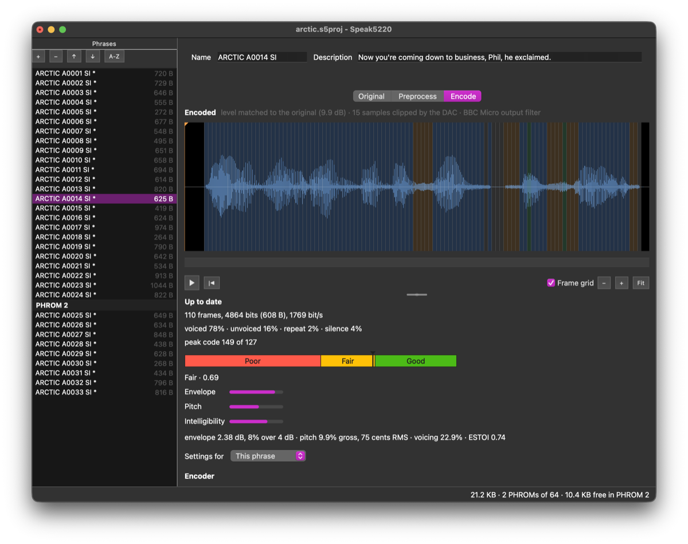

# speak5220

Speak5220 makes speech for the Texas Instruments TMS5220 voice synthesis processor. Its emulator and speech encoder are written from a reference datasheet of the chip, measured on real hardware.

- **Documentation:** <https://simoninns.github.io/speak5220/> (source in [`docs/`](docs/index.md))
- **Building:** [`BUILD.md`](BUILD.md): cloning, the Nix development shell, the application and the documentation site

## The Speak5220 application

Speak5220 is a cross-platform Qt/C++ application for creating and editing TMS5220 LPC speech data and building new PHROMs. It:

- imports WAV speech and encodes it, with an optimiser that tunes the encoder for the best quality, rated from Poor to Good by objective measures of the spectral envelope, pitch and intelligibility;
- shows and plays the original, preprocessed and encoded speech, the last through a built-in emulator;
- imports the words of existing Acorn PHROM images;
- exports Acorn PHROM images, C headers, WAV, and BBC Micro disc images that speak through Speak External.

It has a GUI, `speak5220`, and a command-line tool, `speak5220-cli`. Each release has installers for Linux (Flatpak), Windows (MSI) and macOS (DMG) on the [Releases](https://github.com/simoninns/speak5220/releases) page; the [user documentation](https://simoninns.github.io/speak5220/application/) says how to install and use it.

## Repository layout

| Path | Contents |
|---|---|
| [`app/`](app/CMakeLists.txt) | The Speak5220 application: its CMake build, sources (`src/`), tests (`tests/`), fixture projects for the tests (`projects/`), reference data from the retired encoder, emulator and quality tools, and the recorded hashes of the fixtures' exports (`golden/`), style configuration, the vcpkg manifest for Windows and macOS (`vcpkg.json`, with overlay ports in `vcpkg-ports/`), the installers' build files (`packaging/`: the Flatpak manifest and the macOS vcpkg triplet), the icon set, About-box logo, Linux `.desktop` file and AppStream metainfo (`resources/`), and check, corpus, benchmark, export, BBC Micro emulator golden-data, icon and encoder-quality diagnostic scripts (`scripts/`, with the diagnostics' option sets in `scripts/sweeps/`) |
| [`docs/`](docs/index.md) | The published documentation site: the application's user documentation, the reference datasheet, and how the emulator and encoder work |
| [`assets/`](assets/README.md) | Artwork: the logo, the application icon and a screenshot of the application |
| `flake.nix` | The Nix development shells, the application's package and its pre-commit hooks |
| [`BUILD.md`](BUILD.md) | Development environment and build instructions |
| [`TESTING.md`](TESTING.md) | Testing vision, strategy and rules for the application |
| [`AGENTS.md`](AGENTS.md) | Contribution and coding standards. `CLAUDE.md`, `.github/copilot-instructions.md`, `.cody/` and `.vibe/` point AI coding assistants to it |
| `.github/` | Issue and pull request templates, the application's CI workflows, the release workflow that builds the installers, and the workflow that publishes the documentation site |

## The research

The research that produced the reference datasheet (the capture board and its firmware, the capture and analysis tools, the captures, the speech PROM inventory and the die analysis, with the pages documenting them) was removed from the repository after commit [`c537c1d`](https://github.com/simoninns/speak5220/tree/c537c1d), the last commit that contains it. It can be read there.

## Contributing

Read [`AGENTS.md`](AGENTS.md) for the coding standards and [`TESTING.md`](TESTING.md) for the testing rules. Issues and pull requests use the templates in `.github/`. Report security vulnerabilities privately, through GitHub's security advisories for this repository.

## Licence

GNU General Public License v3.0 or later. See [`LICENSE`](LICENSE).
