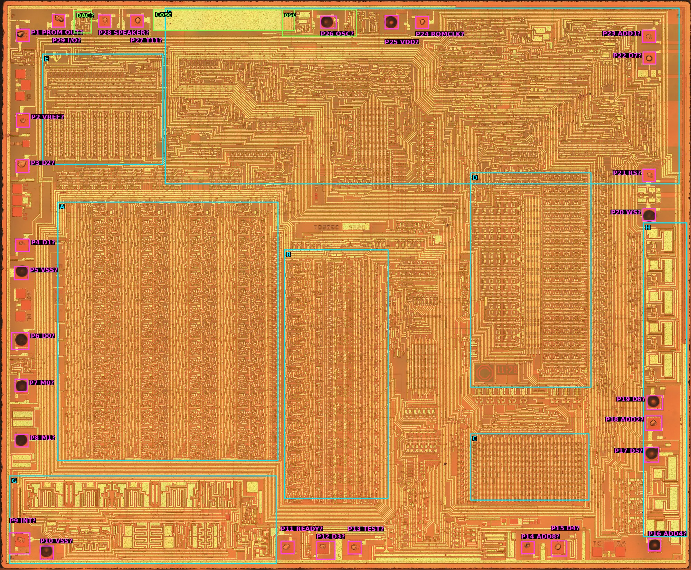

# TMS5220NL die analysis plan

**Status: Phase 0 done; Phase 1 done except the DAC; Phase 2 done as far as this image allows; Phase 3 done, to its second exit; Phase 4 done as far as this image allows, with no change to the model (`phase0.md` to `phase4.md`), 2026-10-09.** The pin map has been re-derived from the pads' drivers. A and B are 14 bits wide, with row 14 the LSB, and the delay stack has 18 clocked inverters per bit. The reference multiplier cell is consistent with the patent's at the level of its links. Both ROMs have been read: the parameter ROM equals `PROM OUT`, and the chirp ROM confirms Table 8-7 (T5 done). The image shows every gate but little of the diffusion, so random logic cannot be traced blind. Averaging the copies of a repeated cell shows much more of it (`phase2.md` §4.2). Phases 2 (step 3), 3 and 4 therefore check the patent's cells against the die and compare cells with each other, giving provisional results that the regression must confirm (§5). A delayered image is wanted, but not required. The block identifications in §2 are still hypotheses unless `phase1.md` §2 says otherwise.

The capture work has taken the reference datasheet as far as measurement can take it. Most of what is still unknown sits in the arithmetic, and the vectors constrain it without naming it. The lowest-order arithmetic in particular (datasheet §8.8, `lowest_order_arithmetic_ideas.md`) has survived every model built from the data and from the patents. A die image shows the circuit itself. This plan sets out how to read the image in phases, ordered so that each one either answers one of the important unknowns or makes the next phase reliable.

## 1. The image

| | |
|---|---|
| File | `local/die_image/ti_tms5220nl_mcmaster_mz_mit20x.jpg` (git-ignored, not committed) |
| Source | John McMaster (siliconpr0n, `mcmaster:ti:tms5220nl`), decapped April 2013, Mitutoyo 20× objective, stitched. **CC BY 4.0**: figures must credit him (`phase0.md` §1) |
| SHA-256 | `42e5707a0a24d8fa62444abe8efa11e8e1834070b08e822359dd9a3e665d6858` |
| Size | 18,074 × 14,916 px, RGB JPEG, 85 MB. Scale 0.341 µm/px, so the die is 6.16 × 5.09 mm (`phase0.md` §3) |
| Layer | Top metal intact (not delayered). This is a metal-gate process, so every gate is metal and can be seen. Diffusion shows only faintly, and not at all under metal |
| Second image | TMS5200NL, the same T0285E layout, also top metal: `local/die_image/tms5200nl/tms5200nl_mcmaster_mz_mit20x.jpg` (18,250 × 15,000 px, from the siliconprawn.org map tiles; `phase2.md` §4). A second copy of every cell, where this image is damaged or dirty |
| Markings | `TO285E` and `5220` in the centre (TMC0285, TI's internal number for the 5220); `© 11-78` beside block D; mask-level marks `1A 3A 4A 6A 7A` (left edge), `1-1`, `2-1`, `D.30`, `DL`, `TK`, `A.4` near the pads |

At full resolution the metal lines, the gates (thin-oxide windows in the metal) and the contacts can be read (`phase0.md`, `phase2.md` §1). The image has four limits:
- **The diffusion is barely visible** in one copy (`phase2.md` §4). Averaging many copies of a cell shows it between the metal lines, but not under them. A transistor's gate shows, but often not which diffusion regions lie on either side of it, so not what it connects. Regular structures (ROMs, PLAs, repeated cells) can be read, because their diffusion follows a pattern that needs finding only once. Random logic cannot be traced blind: it can only be checked against a known circuit, or compared with another copy of itself.
- **Metal hides what is beneath it.** This is a P-channel MOS die (the datasheet's supplies: `VSS` = +5 V substrate, `VDD` = −5 V). In a process of this age there is one metal layer, used mostly for power, clocks and long buses. There is no delayered image of this die. The TMS5200NL image (the same T0285E design) is also top metal (`phase0.md` §1).
- **JPEG compression** blurs the edges of thin features. A contact, or a buried contact under poly, needs care, and a transistor's W/L can only be measured to about ±1 px.
- **One part.** The imaged part is DEP 8319; chips 1 and 4 are DEP 8423. The die carries a 1978 copyright, and the mask set probably did not change across NL production, but Phase 6 should keep this in mind.

## 2. First look: floorplan

*Full-resolution pixel = figure pixel × 9.04. Pads P1–P29 are numbered counterclockwise from the top-left corner (`phase0.md` §4). Pin names are the working map of `phase1.md` §1 ("?" = not yet confirmed). Die image: John McMaster, siliconpr0n, CC BY 4.0.*

| Block | What is seen | Working hypothesis |
|---|---|---|
| **A** | The largest regular array. A header row, then **14 bit rows of 452 px**, and **five column groups of 1,260 px**: three identical between two specialised end groups (`phase1.md` §3) | The **array multiplier**: five Booth stages (stage 0 to stage 4) of 14 bit slices. US 4,335,277 FIG. 10 describes five stages of 14 cells. **Row 14 is the LSB, and group 1 is stage 0 (inferred).** The middle cell is consistent with the patent's (`phase2.md` §4) |
| **B** | Narrow columns of small, repeated cells at the **same 452 px vertical pitch**, bit-aligned with A | The **summer and its multiplexer, the delay stack, the Y latch and the multiplier multiplexer** (patent 402, 403, 404, 406, 415). **The delay stack is found** (x 8,450–9,300): 18 clocked inverters per bit (`phase1.md` §4) |
| **C** | A dense, uniform grid of bit cells with decoders on two sides | **The parameter ROM, read** (`phase2.md` §2): 2,720 bits, every readable one equal to `PROM OUT` |
| **D** | Two regular arrays with about 16 rows, column decoders below | The **FIFO** (16 × 8), and/or the parameter registers and interpolation (K-stack 302) |
| **E** | Five groups of comb-like columns under a row of drivers | **The K-stack (patent 302), inferred:** 10 identical columns, whose outputs drop into the recoding logic above A (`phase1.md` §2). Not a ROM, not the chirp ROM, not the DAC |
| **I** | A small ROM between B and C (x 10,700–11,480, y 8,980–10,220) | **The chirp ROM, read** (`phase2.md` §3): 52 words of 8 bits, equal to Table 8-7 |
| **F** | Random logic and routing across the top | **Control**: the PC and timing PLA, the frame parser, VSM and host interface state machines |
| **G** | Very wide, interdigitated transistors along the bottom-left, next to pads | Probably the **clock drivers**: four wide lines run from under G round A and on to B (`phase1.md` §5). Which driver feeds which line is not traced |
| **H** | Nine identical large drivers in the right-hand column, between P20 and P16 | Its upper five cells (y 5,950–9,950) are four identical and one larger. P2 (`VREF`) reaches cell 2, so H is the lead for the DAC or the output stage (`phase1.md` §2). Not obviously bus drivers |

Two features make A and B a strong lead. They share the 452 px bit pitch, so they are one bit-sliced datapath. A's five column groups match the multiplier's five stages. If this holds, the cells that matter most (bit slices 0–2 of stages 0 and 1, and the adder's bit 0) are at one end of the A/B rows and can be found in an evening.

## 3. Targets, in order of value

Each target is an unknown named in the reference datasheet. The order is by the value of the answer to the datasheet's acceptance tests, discounted by how hard the target is to read from a metal-layer image.

| # | Unknown | Datasheet | What to read on the die | Difficulty |
|---|---|---|---|---|
| T1 | **The lowest-order arithmetic** (the voiced one-code error, the period doubling, the *d*₁ < 0 sensitivity) | §8.8 "Not known yet"; ideas §1, §2.1 | Multiplier bit slices 0–2 in stages 0 and 1: the forced 1, what drives a partial-product line when no digit is selected, where the completing carry of a negative digit enters. Patent cells A-1, A-2, B-1…B-C (FIG. 10c) | Medium. Regular, and the patent is a map |
| T2 | **The adder's low end and the summer multiplexer** | §8.8 | Adder bit 0 and 1, the carry-in, the precharged-zero input (patent gate 420), the truncation logic (425), the Y latch's width | Medium |
| T3 | **Word lengths** | §8.8 "Word length and overflow" | Bit rows in A and B; the delay stack's depth and width. Confirms the 14-bit wrap and shows whether any register is wider or narrower | Easy |
| T4 | **The chip-specific departures and upsets** | §8.8 "A second error"; §7 upsets | The dynamic and precharged nodes on the T1/T2 paths, and any ratioed gate there: transistor W/L, node size, which clock phase precharges it | Hard. Needs sizes, not just connections |
| T5 | **The chirp table** | §8.1 Table 8-7, §8.6 | The chirp ROM (patent ROM 409): all 52 words, their bit weights and sign, and the address decoding, including the clamp that makes any count above 51 read location 51. Found as block I. The parameter ROM in C is read first, as a check of the method (Phase 2) | **Done** (`phase2.md` §3): all 52 words equal Table 8-7. The clamp above 51 is not read |
| T6 | **The DAC** | §8.2: the 26 µA step between codes −1 and 0, the 7 % scale step after a power cycle | Whether the DAC is sign-magnitude, offset binary or two's complement, its weighting, and its bias source | Medium |
| T7 | **`PROM OUT` and `TEST`** | §11.2 | The nets behind pins 10 and 20 | Easy to find; meaning depends on F |
| T8 | **The Speak External two-sample offset** | §8.5 "Speak External" | Where the Speak External path enters the frame timing in F | Hard. Control logic |
| T9 | **Host interface timing details** | §3 "Not measured yet" | The READY, INT and FIFO-full logic in F and D | Hard, and also measurable on the bench, which is easier |

T1 and T2 are the reason for doing this. T3 is cheap, and it checks the method. T5 is the one table the chip cannot report itself:

- **The chirp is not on `PROM OUT`.** The energy, pitch and K tables have all been read from the chip through `PROM OUT` (datasheet §8.10). The chirp ROM is a separate ROM, so it does not appear there.
- **Half of it is unconfirmed.** The vector fit confirms only 26 of the chirp's 52 entries (datasheet §8.1). At the other 26, marked † in Table 8-7, a neighbouring value fits as well or better. That happens because the model is not yet exact for voiced frames.
- **The listed values are MAME's.** MAME says they match a decapped TMS5220, but it does not publish the bits.

So reading the chirp from the die settles Table 8-7 independently of both MAME and the model. It also helps T1: once the chirp is fixed, the voiced error can no longer be absorbed by refitting it (datasheet §8.8 tried that). T4 and T6 explain effects that the model has to tolerate rather than reproduce. T7 to T9 can wait.

## 4. Phases

### Phase 0: preparation

1. **Viewer.** Cut the image into a tiled pyramid (Deep Zoom or plain 1024 px tiles), so that any region can be opened without decoding the 85 MB file. Pillow and numpy in the dev shell are enough. A `libvips` entry in `flake.nix` would make it faster. Write the tool as `tools/die.py`, with subcommands for `tiles`, `crop X Y W H` and `annotate`.
2. **Coordinates.** All positions are in full-resolution pixels of this image, origin top left. Every traced cell gets a record in `docs-tech/die_analysis/cells.json` (name, block, bounding box, notes), and crops are regenerated from it.
3. **Scale.** Find µm per pixel from a known feature: the pad pitch, or the design-rule width of a minimum poly line (about 5–6 µm for a TI process of 1978). Needed for T4 and T6.
4. **Pads to pins.** Map the 28 bond pads to package pins: `SPEAKER`, `OSC`, `VDD`, `VSS`, D0–D7, `PROM OUT` and `TEST`. Wide power buses mark VDD and VSS, and the bus drivers (H) mark D0–D7. This anchors every later trace.
5. **Other images.** Look for a delayered image, or another layer, of a TMS5220NL or TMS5220C on siliconpr0n (directly, or through the Wayback Machine). Look for a TMS5100 or TMC0280 die too. Its multiplier is the patent's, so a cell that differs between the two dies is the first suspect for T1.

**Exit:** a tiled viewer, a scale, and a labelled pad ring.

**Result (`phase0.md`):** the viewer, coordinates and scale (0.341 µm/px) are done, and the source and licence are confirmed. 29 bonded pads are numbered P1–P29, so one pin is double-bonded. Two pin orders fit the pads, and the choice moves to Phase 1 step 0.

### Phase 1: floorplan and bit slices

**Status: done except the DAC (`phase1.md`), with open items in its §6.**
- **Step 0:** the pin map was re-derived from the pads' drivers. The eight identical output drivers fall exactly on D0–D7 with P6 = pin 1. That gives `VDD` = P9, `VSS` = P10, `OSC` = P11, `SPEAKER` = P13, `VREF` = P16 (the drivers' return) and `TEST` = P25.
- **Step 1:** the coefficients come from E (the K-stack) through recoding logic above A. MR0–MR13 enter A at group 1, so group 1 is stage 0 (inferred). G is the clock drivers, and H the D0–D7 drivers. The `SPEAKER` output is a single large P-channel transistor beside P13, with P13 on its drain. **The DAC's weighting, which must drive its gate, has not been found.**
- **Step 2:** 14 bit rows, with row 14 the LSB, which `phase2.md` §4.3 confirms.
- **Step 3:** 18 clocked inverters per bit, as in the patent's nine stages.
- **Step 4:** each of G's four drivers is matched to one wide clock line. 1196 = φ3 (good: it gates three devices in every multiplier cell); 1153 = φ4 and 1068/1110 = φ1/φ2 are inferred, and the φ1/φ2 order is unknown.

0. **The pin map** (`phase0.md` §4.3). Trace the datapath's two widest rails to their pads (`VDD`, `VSS`), trace block G's output to its pad, and find the doubled pin. Then fill in `pin` in `cells.json`.
1. Confirm or replace each hypothesis in §2. Follow the A/B datapath's bus into C (the coefficient path) and from B to G (the output path, `YL13`–`YL4` per §8.4).
2. Count the bit rows in A and B exactly (T3). Identify the LSB end: the multiplier's partial sums shift right by two per stage (patent FIG. 10), so the stage boundary cells at the LSB end look different from the rest.
3. Count the delay stack's cells per bit (T3). The patent implies 9 or 10 stages plus the Y latch.
4. Find the two-phase clock lines and the precharge phase that reach A and B.

**Exit:** an annotated floorplan that replaces `fig_floorplan.jpg`, with the bit order of A and B and the datapath's word lengths. If the rows are not 14, update datasheet §8.8 straight away.

### Phase 2: calibration and the chirp (T5)

Before trusting a reading of the unknown cells, read some known ones.

MAME has already checked the 5220's LPC and chirp tables against this decap. The parameter tables have since been read from the chip itself through `PROM OUT` (datasheet §8.10), so reading C tests our method rather than the tables. The chirp is different: nothing but the die can confirm it (T5).

1. **The parameter ROM (C).** Decode its bits and compare them with the tables of datasheet §8.1, which are the values *as the chip uses them*, from the sweeps. Each bit cell is a transistor that is present or absent, which shows as a contact or a gate over diffusion. Work out the row and column decoding from the address lines in F.
2. **The chirp ROM (T5).** This step is a result, not just a check.
   - **Find the ROM.** E is the candidate. Confirm it by following the pitch counter's address lines into it.
   - **Read all 52 words,** including the 31 that should be zero, together with the bit weights and the sign bit.
   - **Read the address decoder.** Check that any count above 51 reads location 51, and that locations 21–51 are really zero. If those locations are not stored at all, write down how the decoder produces the zero instead.
   - **Compare with Table 8-7.** If every entry agrees, the 26 † entries become confirmed. If an entry differs, try the die's value in `tools/regress.py` before changing the datasheet or the model.
3. **One complete multiplier cell** in the middle of the array (bit 7 of stage 2, say), **checked against the patent rather than traced blind.**
   - Map every gate and contact of the cell.
   - Place the transistors of the patent's cell (FIG. 10c) on them, using the diffusion only where it can be seen.
   - Check that every visible gate and contact is used, that every patent transistor has a gate, and that nothing visible contradicts the patent's connections.
   - Do this on several copies in this image and in the TMS5200NL image, so that a smudge on one copy is not read as a feature.
   - Check the resulting logic against the multiplier form in §8.8, which is right for ordinary operands (ideas §1, constraint 1).

   The result is "consistent with the patent", and the cell becomes the **reference cell** for Phase 3. If the patent's cell does not fit, the misfit is a finding and has to be explained before Phase 3.

**Result (`phase2.md`):**
- **Step 1 is done.** Every readable bit of C equals `PROM OUT`: 2,470 automatically and 5 by eye, with 0 differences. 5 sites are damaged.
- **Step 2 is done.** The chirp ROM is block I, not E. All 52 words equal Table 8-7, so its † marks have been removed from the datasheet. The decoder, and with it the clamp above 51, is not read.
- **Step 3 is done at the level of the cell's links** (`phase2.md` §4). The cell is identical in groups 3–4 of every row, in both chips. Averaging 22 copies reveals the diffusion that one copy hides (`die.py copies`). The cell's one two-row link is the patent's Σ(x−2), and it confirms row 14 as the LSB. The result is the **reference cell**, labelled *consistent with the die*.
- **Finding for Phase 3:** the LSB row (14) uses the same logic as the middle cell, with its channel inputs tied off below it; row 1 does not differ at all. The patent's separate B-1 and B-3 cells are not used in this array (`phase2.md` §4.4).
- **Transistors placed:** 24 gates and 34 contacts, told apart by shape on the TMS5200NL average, which fits the patent's precharged cell. **The connections through diffusion under metal cannot be read**, so the cell is consistent with the patent, not proven gate for gate. A delayered image would settle it (`phase2.md` §4.5).

**Exit:** the parameter ROM agrees bit for bit with the tables read through `PROM OUT`, and the middle cell is consistent with the patent's cell. The chirp has been read in full, and Table 8-7 is either confirmed or corrected. A disagreement is a finding in itself, but until it is explained, the method is not trusted for T1.

### Phase 3: the multiplier's low end (T1)

This is the main phase. It works by **difference from the reference cell** of Phase 2 step 3. The low-end cells are where T1 lives. Anything they do differently from the middle cell must show as an added, missing or moved gate, contact or metal line, which this image can show even where the diffusion cannot be seen.

1. For each of the five stages, compare bit slices 0, 1 and 2 with the reference cell, gate by gate and contact by contact, in both images. Do the same for the stage's Booth recoder inputs (+1, −1, +2, −2 from recoding logic 301/313). Stage 0 gets the most care: the patent says it receives only −2, −1 and +1 and sees only MR2–MR13.
2. For each difference, work out what it does to the reference cell's logic. Where the image allows more than one reading, write each one down as a hypothesis. For each cell, write down:
   - what drives each partial-product line when no digit is selected (a precharge, a pull-down, or a floating node);
   - how a negative digit is formed: inversion, and where the +1 completion enters (a carry-in at the cell, at the next stage, at the adder, or never);
   - where the "forced 1" of datasheet §8.8 comes from. The model says the product's lowest bit is 1, and the Mega99 reading of the patent says 0. The die will show which, and why;
   - any input that is tied off, gated by a clock phase, or comes from outside the slice.
3. Turn each hypothesis into a bit-level model of the multiplier. Run it in place of the current multiplier in `model.py`, scored with `tools/regress.py` over the ring, pitch, energy, K and unvoiced K sets. Constraints 1–8 of ideas §1 are the test: the first pitch period stays exact, the *d*₁ < 0 coefficients depart, and *d*₀ < 0 energies show more differences. The regression chooses between hypotheses that the die leaves open.

**Exit:** either the voiced first departures in the pitch set disappear (the answer, provisional until a delayered image confirms it), or no difference in the low-end cells changes the model, which moves the search to Phase 4.

**Result (`phase3.md`): the second exit.**
- **Bits 1 and 2 are the middle cell in every stage.** Bit 0 differs only in that its inputs from below are tied off, to a diffusion band and contact plate. What they are tied to turns on one ambiguous rim.
- **No tie-off variant improves the model.** Each stage's ties were set to NEG, 0 or 1 in turn: 41 variants, scored on the unvoiced K sweeps and the ring and pitch sets.
- **Stage 0 has no adder** (group 1 lacks the reference cell's left logic block). So the +1 completing its negative digit has nowhere to enter. That is the form the model had already fitted (datasheet §8.8), which is now *consistent with the die*.
- **Stages 1–3 are the same cell with the same ties,** yet only *d*₁ < 0 goes wrong. That points at stage 1's input: stage 0's output, which comes from select logic rather than an adder. This is the first candidate for Phase 5's marginal node.

### Phase 4: the adder, the multiplexers and the delay stack (T2, T3)

The method is the same as in Phase 3: find the adder's repeated cell, check it against the patent, then compare bits 0 and 1 with it.

1. Trace adder bit 0 and bit 1 and their carry-in. Find what drives the carry-in at each slot of the sample period: patent FIG. 11 gives the summer's second input as the adder's own output (T10–T18), the delay stack (T20–T7, T9), the Y latch (T8), or a precharged zero (T19).
2. Trace the precharge gate 420 and check that "zero" is a clean zero at bit 0, not a weak node.
3. Trace the truncation logic 425 and the Y latch. The Phase 9 survey ruled out several low-bit truncations of *b*₁. The die shows which one, if any, exists.
4. Trace the overflow path. The model wraps at 14 bits and the vectors agree; confirm that nothing saturates.

**Exit:** a bit-level model of the whole lattice step from the die, scored as in Phase 3. If Phases 3 and 4 together reproduce the chip, datasheet §8.8 and §8.9 are rewritten from the circuit, the emulator follows, and acceptance test 1 can be judged (plan §1.5).

**Result (`phase4.md`): the die agrees with the present lattice and adds nothing to it.**
- **Block B is 14 copies of one bit cell.** The end rows differ only in routing, so the adder's bit 0, the summer multiplexer's zero, and the Y latch's low bits are the middle cell's. The Y latch is 14 bits wide. The MSB row has no saturation logic.
- **The MR lines were traced** from B's multiplier multiplexer, round under B and along the channel to stage 0. Each B row feeds the A row above its own, and a 14th line from an extra cell at B's bottom feeds stage 0's row 14. The array therefore sees 2*M* plus that line. This is the present multiplier exactly if the line carries 0, which the vectors require.
- **Every summer variant that the die leaves open** (the carry-in, a weak zero, truncation of *b*₁, saturation) was already ruled out by the vectors.
- **T1's candidates for Phase 5** are now the stage 0 → stage 1 link and the extra MR line.

### Phase 5: marginal nodes (T4)

Only if Phases 3 and 4 leave the *d*₁ < 0 sensitivity or the chip-specific departures unexplained.

1. List every dynamic node on the stage 0 and stage 1 negative-digit paths and in the adder's low bits. For each one, note the clock phase that precharges it, what can discharge it, and how far it runs (its capacitance).
2. Measure W/L for each ratioed pair on those paths. A pull-up/pull-down ratio near the switching threshold is a candidate for a chip-specific outcome.
3. Rank the candidates by how well each explains the data: departures that repeat on a chip, do not depend on the clock, and differ between chips (§8.8). Then design one bench test per candidate, such as a `VDD` or temperature change (ideas §4.5) that should move it.

**Exit:** a short list of physical mechanisms, each with a bench test. These belong in the datasheet's description of the tolerance, not in the model.

### Phase 6: the DAC and output (T6)

1. Trace G from `YL13`–`YL4` to the `SPEAKER` pad. Count the current-source transistors and measure their W/L.
2. Decide the coding: a separate sign branch would explain the 26 µA step between −1 and 0 (§8.2).
3. Find the bias network. It decides whether the 7 % scale step after a power cycle could be a bias state rather than the load.

**Exit:** a DAC transfer model to set beside the measured table of §8.2.

### Phase 7: control (T7, T8, T9)

This phase is open-ended, and much of it can also be measured on the bench, so it is done last and only as far as it is useful.

1. Trace pads 10 (`PROM OUT`) and 20 (`TEST`) to their sources (T7).
2. Find the PC and timing PLA in F, and read its terms. A PLA is a grid of gates like the ROMs, so it can be read with the method of `phase2.md`. With that, find where Speak External enters the frame timing (T8).
3. Trace the FIFO control and the READY/INT logic only where a bench test cannot answer an item on the §3 "Not measured yet" list (T9).

## 5. Ways of working

- **Record the trace, not only the conclusion.** Each traced cell goes into `cells.json` with its crop and a transistor-level drawing (KiCad schematic, or a netlist that a short script can simulate). A later reader should be able to check every claim against the pixels.
- **Label how each result was found.** A result read from a regular structure (a ROM, a PLA, a count of cells) is **read from the die**. A result for random logic is **consistent with the die**, because the diffusion is not fully visible. Such a result goes into the datasheet only once the regression supports it, and is marked provisional until a delayered image confirms it.
- **Wanted, not required: a delayered image.** With the metal removed, the diffusion and contacts would show, and Phases 2 (step 3), 3 and 4 would become direct readings. Two ways to get one:
  - ask John McMaster whether a delayered TMS5220 or TMS5200 exists, or whether he would make one;
  - decap and strip one of the dead chips (2 or 3).
- **Never trust the patent without the die.** The patent is the map for finding cells. Where the die and the patent differ, the die wins, and the difference is written down: it may be the answer to T1.
- **Score every model change with the regression.** No change goes into `model.py` because it looks right on the die. It goes in because `tools/regress.py` shows it fits the vectors better.
- **Write up each phase** in this directory as `phaseN.md`, as the capture phases are, and carry the results into the reference datasheet with citations to the cell records.

## 6. Effort and order

| Phase | Effort | Depends on |
|---|---|---|
| 0 Preparation | done (`phase0.md`); pin map moved to Phase 1 | — |
| 1 Floorplan | done except the DAC (`phase1.md`); open items in its §6 | 0 |
| 2 Calibration and chirp | done (`phase2.md`) | 1 |
| 3 Multiplier low end | done (`phase3.md`): no change to the model; the stage 0 → stage 1 link is the lead for Phase 5 | 2 (step 3) |
| 4 Adder and stack | done (`phase4.md`): no bit-specific logic in B; the MR wiring checked; no change to the model | 1; scored together with 3 |
| 5 Marginal nodes | 2–4 evenings, if needed | 3, 4 |
| 6 DAC | 2 evenings | 0 |
| 7 Control | open-ended | 1 |

**Order from here:** Phase 5, which needs levels rather than connections. Its candidates are the stage 0 → stage 1 link (`phase3.md` §5) and the extra MR line that must carry 0 (`phase4.md` §3). Both are under metal or in diffusion, so Phase 5 needs a delayered image (§5), or first the temperature and supply test (`lowest_order_arithmetic_ideas.md` §4.5), which says without the die whether the *d*₁ < 0 departures are a level effect at all. The Phase 1 open items (the DAC and naming the clock phases) can be done alongside; Phase 5 needs the clock phases on stage 1's input. Phase 6 and the PLA of Phase 7 can be read directly on this image, do not depend on the datapath, and can be done at any time.
