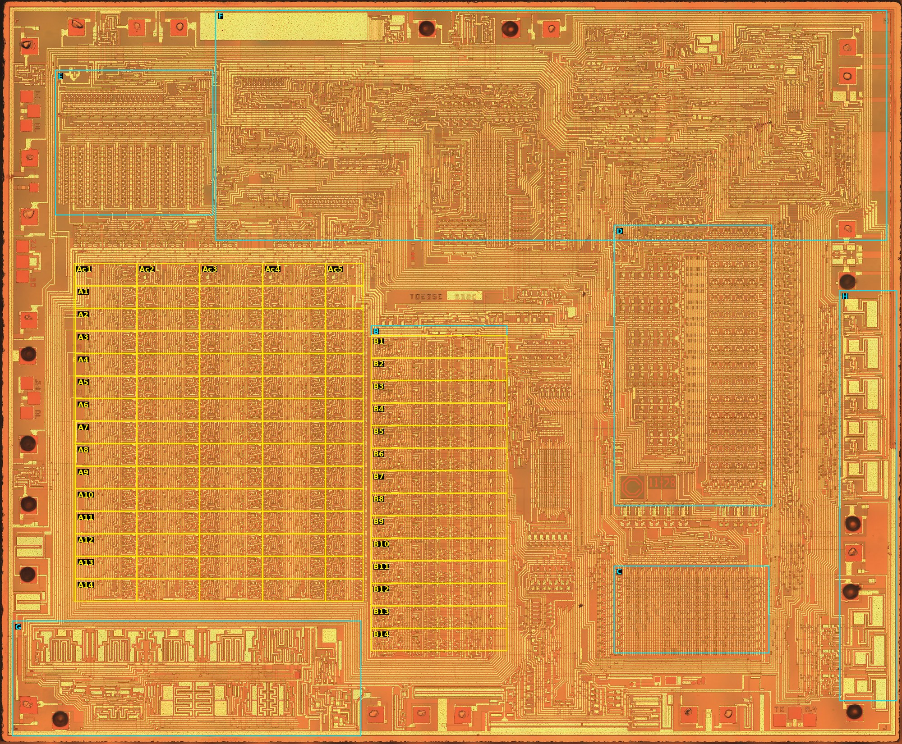

# Die analysis, Phase 1: floorplan and bit slices

**Status: in progress, 2026-10-09.**

| Step | State |
|---|---|
| 0 Pin map | A working map that fits most of the evidence (§1). Two pads conflict with it, and two tests are still to run |
| 1 Hypotheses | E, G and A have been revised. The DAC has not been found (§2) |
| 2 Bit rows | Done: A and B both have **14 bit rows**. The LSB end is tentative (§3) |
| 3 Delay stack | Not started |
| 4 Clock lines | Not started |

All positions are full-resolution pixels (`phase0.md` §2). Records are in `cells.json`: pads now carry `pin`, `pin_name` and `pin_status`, and there are new records for the rows (`A_row01`…, `B_row01`…), the column groups (`A_col1`…) and three features.

## 1. The pin map (step 0)

### 1.1 What was found

**P5 and P10 are tied to the substrate ring.** A wide metal ring runs inside the die edge. It is a C shape, open at the top right between x ≈ 11,920 on the top edge and y ≈ 8,990 on the right edge. Every pad's input-protection structure returns to this ring through a diffusion region (for example P2, P4 and P9). Its 26 µm metal shows thin dark lines, which at 4× zoom are oxide steps under continuous metal, not gaps.

Two pads, **P5 and P10**, join the ring through a full-width strap, with no device in between. Both still carry a gold ball. The ring touches the substrate diffusion, so it is `VSS` (+5 V).

**Neither ring pad has a supply beside it.** Pins 4 (`VDD`) and 5 (`VSS`) are adjacent on the package. So if P5 or P10 were bonded to pin 5, one of its neighbours would have to be `VDD`. All four neighbours (P4, P6, P9, P11) look like signal pads: each runs a narrow strap to a single contact a short way inside.

The two ring pads are also not next to each other, so they cannot be the one double-bonded pin of `phase0.md` §4. A pin's two wires to non-adjacent pads would cross the wires of the pins in between.

**Explanation: both are bonded down to the paddle.** The die is mounted on a paddle that is at the substrate potential. If the `VSS` lead is tied to the paddle and P5 and P10 are bonded down to it, `VSS` needs no pad in the ring of lead wires. The other 27 pins then have one pad each: 27 + 2 = 29, with no doubled pin. Under this model, `VDD` (pin 4) and `OSC` (pin 6) sit on adjacent pads.

**The oscillator is at P26.** The datasheet's RC option uses only an external resistor (Appendix A), so the capacitor is on the chip. The large metal plate at the top (`osc_cap`: x 4,012–7,704, y 248–808, about 1.26 × 0.19 mm) is not connected to any metal. Over field oxide it would be about 10 pF, which with 120–200 kΩ gives a period of the right order for 640 kHz.

At its right-hand end, a serpentine long-channel device and a small circuit (`osc_circuit`) lead to P26. This is a metal-gate process: the serpentine is a gate.

P27's strap goes down into the bus. It is not connected to the plate, which `phase0.md` §4.1 had suggested.

**P24 is driven from beside the oscillator.** P24's line runs along the inside of the top edge (y ≈ 250) and turns down into the circuit between P26 and P25. `ROMCLK` (pin 3) is `OSC` ÷ 4, so a divider and driver beside the oscillator fit.

### 1.2 The working assignment

Counting counterclockwise from P26 = pin 6, and skipping P5 and P10, gives:

| Pin | Pad | | Pin | Pad | | Pin | Pad |
|---|---|---|---|---|---|---|---|
| 1 D7 | P22 | | 11 `VREF` | P2 | | 21 ADD8 | P14 |
| 2 ADD1 | P23 | | 12 D2 | P3 | | 22 D4 | P15 |
| 3 ROMCLK | P24 | | 13 D1 | P4 | | 23 ADD4 | P16 |
| 4 `VDD` | P25 | | 14 D0 | P6 | | 24 D5 | P17 |
| 5 `VSS` | P5, P10 (down-bonds) | | 15 M0 | P7 | | 25 ADD2 | P18 |
| 6 `OSC` | P26 | | 16 M1 | P8 | | 26 D6 | P19 |
| 7 `T11` | P27 | | 17 `INT` | P9 | | 27 `WS` | P20 |
| 8 `SPEAKER` | P28 | | 18 `READY` | P11 | | 28 `RS` | P21 |
| 9 `I/O` | P29 | | 19 D3 | P12 | | | |
| 10 `PROM OUT` | P1 | | 20 `TEST` | P13 | | | |

**For it:**
- **Two anchors found independently give the same count.** One is `OSC` at P26. The other is the mirrored input pair at P20/P21 (`phase0.md` §4.1), which comes out as `WS`/`RS`, the only adjacent pair of pure inputs.
- **The pads with large drivers are outputs.** `ROMCLK` is P24. `M0` and `M1` are P7 and P8, each flanked by two large comb transistors.
- **The nine drivers in H match the outputs on the right-hand side.** Nine bus or VSM outputs fall on the right and bottom-right pads: P12, P14, P15, P16, P17, P18, P19, P22 and P23.
- **The 29 pads are explained** without a doubled pin.

**Against it:**
- **P25 (`VDD`) has no metal leaving it,** only a short tab. Its strap must continue in diffusion. In a metal-gate P-channel process, diffusion carries supplies under the metal, so this is possible, but `I_DD` is 10–35 mA (datasheet §6) and the path should be wide. It is the weakest point of the map.
- **P28 (`SPEAKER`) has no large output stage.** It joins a small circuit between P29 and P28 that has bars of several lengths (`dac_candidate`). The DAC's full scale is only about 1.2 mA (4.5 µA per code), so a compact DAC is possible, but it has not been read.

**Other orders checked and rejected:**
- `phase0.md` Order 1 puts D1 on P5.
- Order 2 puts `VDD` on P8.
- Any order with one ring pad bonded to pin 5 puts `VDD` on a signal pad.
- Clockwise counts put `WS`/`RS` on non-mirrored pads.

### 1.3 Tests that would settle it

1. **The `SPEAKER` and `VREF` paths.** Trace `dac_candidate` and see whether its inputs come from the Y latch (B) and its reference from P2. This is the cheapest test, and it needs only the image.
2. **The `VDD` path.** Find where P25's diffusion strap surfaces into metal, and whether that net reaches the load devices in A and B.
3. **An X-ray, or opening a dead chip** (chip 2 or 3), would show the paddle bonds directly. A bench test of the pins cannot: every pin shows a diode to `VSS` whichever pad it is bonded to.

`cells.json` carries the map with `"pin_status": "working"`. The figure marks each name with "?".

*Full-resolution pixel = figure pixel × 9.04. Die image: John McMaster, siliconpr0n, CC BY 4.0.*

## 2. The block hypotheses (step 1)

| Block | Phase 0 | Now |
|---|---|---|
| A | Multiplier, 5 groups × 14 rows | **Confirmed in shape:** 5 column groups × 14 bit rows, under a header row (§3). Stage order not yet known |
| B | Adder, delay stack, Y latch | 14 bit rows at the same pitch, **two rows lower than A** (§3) |
| E | Chirp ROM or PLA | A ROM or PLA array: regular cells with contacts under a decoder row. **Not the DAC** |
| G | DAC or clock drivers | Large symmetric drivers: four identical comb pairs on top and two mirrored pairs below. **Not a binary-weighted DAC.** Clock drivers are the likely reading |
| — | — | **New:** the oscillator capacitor and circuit at the top (`osc_cap`, `osc_circuit`), and the `dac_candidate` between P29 and P28 |

The DAC itself (target T6) has not been found. The candidates are `dac_candidate`, or something near the bottom of B, where the Y latch should be.

The paths from A/B into C (coefficients) and from B to the DAC (`YL13`–`YL4`) are not traced yet.

## 3. Bit rows and word length (step 2)

**Method.** Each row was matched against the next by normalised correlation of the green channel, allowing ±24 px of alignment. This was done with scratch scripts, not a `die.py` command; the method is simple enough to repeat from `die.py crop` output. The vertical autocorrelation of both blocks peaks at **452–453 px**, which is 154 µm. It is the same in A and B.

**Block A.** Matching a row with the row below it gives:

| Rows | Start y | Similarity to the row below |
|---|---|---|
| Header | 5,282 | 0.12–0.32 (different) |
| 1–13 | 5,734 + 452·*k* | 0.84–0.90 in every column group |
| 14 | 11,610 | 0.71–0.73 to row 13 |
| Below row 14 | 12,062 | 0.02–0.08: the bus channel, not a row |

So **A has 14 bit rows** below a header row. Row 14 differs in the same way in all four of the column groups tested. Each column group has a vertical channel of lines between its left and right logic, and these lines step sideways by one track from row to row. In row 14 several of them stop and end in contacts. In the header, new lines enter the channel from the drivers above.

**Columns.** One row was matched against a 1,260 px column group. The groups start at x = **1,480, 2,740, 4,000, 5,260 and 6,520**:
- the three middle groups are identical (0.77–0.87 at full width);
- group 1 matches only partly (0.42), and has a large rectangular structure at its left edge;
- group 5 is cut short at x 7,280, and only its left 700 px match the others (0.58).

That gives **five column groups: three identical stages between two specialised end stages**. This fits the five Booth stages of US 4,335,277. Its stage 0 has no incoming partial sum, and the last stage feeds the summer, so both would differ from the middle three. Which end is stage 0 is not known yet.

**Block B.** It has 14 bit rows from y = 6,724 (similarities 0.59, then 0.85–0.90, then 0.81 for the last pair). B's row *k* lies **96 px below A's row *k* + 2**: B is two rows lower than A, plus a fifth of a row. Whether that offset means anything (a two-bit alignment between the multiplier and the summer?) is for Phase 4.

**Word length.** The datapath is **14 bits wide**, as the 14-bit wrap of datasheet §8.8 and the patent's D0–D13 have it. No 15th row exists in A or B, so §8.8 does not change.

**The LSB end (tentative).** The channel lines carry signals down the rows, stepping sideways by one track per row. They end in row 14 and are fed from the header above row 1.

The patent's partial sums shift right (towards the LSB) by two bits per stage. On that reading, bits fall off the bottom, so **row 14 is the LSB and row 1 the MSB**. That puts the T1 cells (bit slices 0–2) in A's rows 12–14, at y ≈ 10,700–12,060.

This rests on one reading of what the channel carries. Confirm it in Phase 3 by tracing one channel line across two stages. If it moves down two rows per stage, the reading holds.

## 4. Not done yet

- **Step 3, the delay stack.** B's rows have an irregular left part (x ≈ 7,450–8,400), a middle section of small repeated cells (x ≈ 8,500–9,300) and buses on the right. The middle cells are stacked several to a row, with vertical metal gate lines, and are the likely delay-stack stages. They need counting at full resolution.
- **Step 4, the clock lines.** Start from G's large drivers and follow their outputs into the header of A and the gate lines of B.
- **Step 1 traces.** Trace A/B into C, and B to the DAC.

## 5. Changes elsewhere

- `cells.json`:
  - working pins on all 29 pads;
  - new boxes for A (from the header down) and B (to row 14);
  - new notes for E and G;
  - new records `osc_cap`, `osc_circuit`, `dac_candidate`, `A_header`, `A_row01`–`A_row14`, `B_row01`–`B_row14` and `A_col1`–`A_col5`.
- `fig_floorplan.jpg` has been redrawn with the working pin names. `fig_rows.jpg` is new.
- `tools/die.py annotate` adds a pad's `pin_name` to its label, with "?" while the pin is still working, and staggers the labels along the top and bottom edges.
- The plan has been updated: §2 (block table) and §4 (Phase 1 status).
