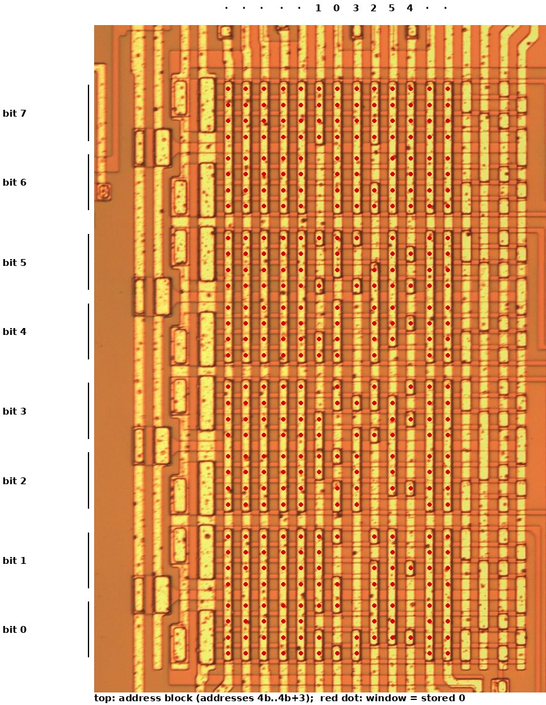
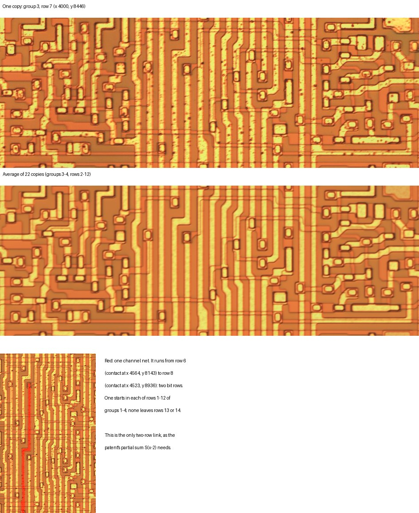
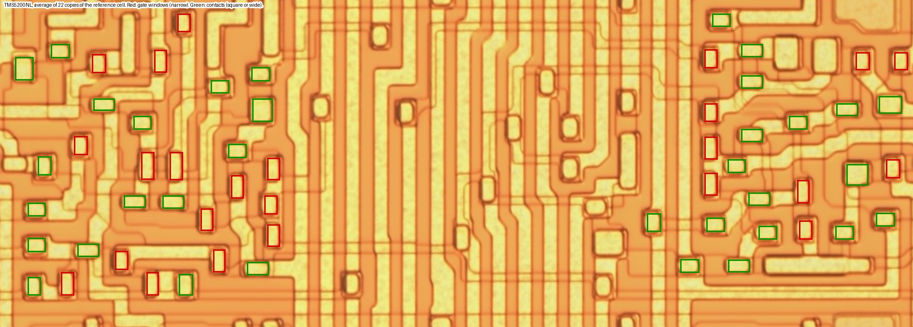

# Die analysis, Phase 2: calibration and the chirp

**Status: done, 2026-10-09.** Step 3 places and counts every gate and contact of the reference cell, and checks the cell against the patent's in links, count and style. The connections through diffusion under the metal cannot be read, so the cell is *consistent with* the patent, not proven gate for gate (§4.5).

| Step | State |
|---|---|
| 1 Parameter ROM | Done. Every readable bit of all 248 entries equals the tables read through `PROM OUT` (§2) |
| 2 Chirp ROM | Done. Found as a new block **I**. All 52 words equal Table 8-7, so its 26 † entries are confirmed (§3). The column decoder, and with it the clamp above address 51, is not read |
| 3 Multiplier cell | Done at the level of links (§4). The cell is identical in all regular copies in both chips, and averaging 22 copies reveals the diffusion. Its one two-row link is the patent's Σ(x−2), and it confirms row 14 as the LSB. The LSB row is the middle cell with its channel tied off, not a separate cell (§4.4). Gates and contacts are placed and counted: 24 gates and 34 contacts, which fits the patent's precharged cell. The diffusion connections cannot be read (§4.5) |

Positions are in full-resolution pixels (`phase0.md` §2). `python tools/die.py rom` repeats both readings from the image. It writes `rom_parameters.csv` and `rom_chirp.csv`, and compares them with the tables.

## 1. How a ROM bit looks

Both ROMs are built the same way:
- **Gate lines** are vertical metal lines at a pitch of 36.3 px (12.4 µm).
- **Diffusion strips** run horizontally under them at a pitch of 31.9 px (10.9 µm). They show faintly through the field oxide as pairs of edges 10 px apart.
- **A stored transistor** is a thin-oxide window where a gate line crosses the gap between two strips. The metal steps down into the window, and its outline shows as a dark rim inside the line. Windows over adjacent gaps on the same line merge into one long window.

**The reading.** For each gate line and each gap, the tool measures the fraction of dark pixels (red < 175) in a 33 px band centred on the line, between the two strips. It then splits each line's gaps into two classes by 2-means.

Two simpler measures were tried first and rejected, because the lower half of C is slightly out of focus and they misread it there:
- the darkness of the rim on the line's edges: 86 errors;
- a fixed threshold.

The dark-pixel measure can also be fooled by a dark particle sitting on a plain line. All such sites are listed in §2.

## 2. The parameter ROM (block C)

### 2.1 Organisation

**Rows.** 51 diffusion strips form 10 groups of five, separated by gaps that never hold a transistor. Each group is one **output bit**: group *g* is bit *g*, with group 0 (the top) as the LSB. A group's four gaps hold four words.

**Columns.** There are 73 gate lines from x = 12,494 to 15,122:
- **Column 0**, at the left edge, has a window in the first gap of every group. It is part of the periphery.
- **Columns 1–68** hold the data: 68 columns × 4 gaps = 272 words of 10 bits.
- **Columns 69–72** are the gap selectors. They hold the same pattern in every group:
  - column 70 has gaps 1 and 2, column 69 has gaps 3 and 4;
  - column 72 has gaps 1 and 3, column 71 has gaps 2 and 4.

  So two address bits pick one of the four gaps.
- Lines further right (x 15,167–15,318) carry large windows at a regular pitch. They are probably the output loads.

**Polarity and order.** A window stores a **1**. Within a column, table index 4*b* + *r* is in gap 4 − *r* of each group. So the lowest index is at the bottom of the group.

### 2.2 Which column holds what

Each column holds one table's block of four consecutive indices. The tables lie in the order of the frame, but within a table the decoder puts the blocks in an order of its own:

| Table | Columns, for blocks 0, 1, 2 … |
|---|---|
| Energy | 1, 2, 3, 4 |
| Pitch | 17, 18, 19, 20, 13, 14, 15, 16, 9, 10, 11, 12, 5, 6, 7, 8 |
| K1 | 26, 27, 28, 29, 22, 23, 24, 25 |
| K2 | 35, 36, 37, 38, 31, 32, 33, 34 |
| K3 | 41, 40, 42, 43 |
| K4, K5 | 45–48; 50–53 |
| K6, K7 | 55–58; 59–62 |
| K8, K9, K10 | 63–64; 65–66; 67–68 |

That accounts for 62 columns, or 248 words: exactly the 248 entries of Tables 8-4 to 8-6. The whole array, 68 columns × 4 words × 10 bits, is 2,720 bits: the size US 4,335,277 gives its parameter ROM (202, Fig. 8e). The other six columns (21, 30, 39, 44, 49 and 54) are **fillers**. Each sits where a table's columns end, and four of them hold the same four words (514, 522, 313 and 318). No index reaches them.

**The pitch table is stored unshifted.** Its words are the register values of Table 8-5 (0, 15, 16 … 159) in bits 0–7, with bits 8 and 9 clear. On `PROM OUT` the same entries appear as the value × 4, in bits 2–9 (datasheet §8.10). Energy and K appear in the same bits on both. So the pitch field is moved up by two bits, or two bit-times, between the ROM and the pin. Where that happens is not known yet. It does not change any table value.

### 2.3 Result

All 2,480 bits of the 248 entries were compared with the values read from chip 1 through `PROM OUT` (`captures/promout/chip1/rom.csv`).

| | Sites |
|---|---|
| Read automatically, equal to `PROM OUT` | 2,470 |
| Under a dark particle, which the reading takes for a window: read by eye at full resolution, no window, equal to `PROM OUT` | 5: (column 18, gap 6), (42, 26), (59, 36), (60, 26) and (61, 24) |
| **Unreadable**: the metal is damaged | 5: column 57, gaps 11–14 (under the scratch at x ≈ 14,560, y ≈ 11,800–11,950), and column 61, gap 26 |
| **Different from `PROM OUT`** | **0** |

The five unreadable sites hold bits of K6 indices 8–11 and of K7 index 11. `PROM OUT` gives all of them.

**The method is trusted.** Every bit that can be seen equals the chip's own output. The two manual corrections are recorded in `tools/die.py` (`PROM_BY_EYE`, `PROM_UNREADABLE`), so the reading can be repeated.

## 3. The chirp ROM (new block I)

### 3.1 Where it is

E is not the chirp ROM. It is an array of identical cells with no data pattern, so it is not a ROM at all.

The chirp ROM is a small array between B and C, at **x 10,700–11,480, y 8,980–10,220**. `cells.json` now records it as `block_I`. It is built like C and has the same pitches. A row of address lines sits above it and a decoder row below.

### 3.2 Organisation

**Rows.** 36 strips form four bands of nine, separated by empty gaps. Each band has a wide strip in its middle, with four gaps above it and four below. Each half-band is one **output bit**: 4 bands × 2 = **8 bits**.

**Columns.** There are 13 data columns. With four gaps each, that gives **13 × 4 = 52 words**, which is the patent's 52 locations. Every column of the array was read: there is no fourteenth data column, so locations 52–63 do not exist.
- **Selectors.** Four columns on the right select the gap. They are mirrored about each band's middle strip:
  - one pair selects gap *u* ∈ {0, 1} or {2, 3};
  - the other selects *u* ∈ {0, 2} or {1, 3}.

  Gap *u* above the middle strip is paired with gap 7 − *u* below it.
- **Periphery.** Two columns on the left carry large windows, as C's loads do.

**The reading separates cleanly.** On the 416 data sites, the highest score without a window is 0.101 and the lowest with one is 0.182, against a threshold of 0.144. There are no particles and no damage on the array. So no site needed a judgement by eye.

### 3.3 Decoding

**Polarity.** 32 of the 52 words have a window at every bit. Table 8-7 has exactly 32 zero words: address 0 and addresses 21–51. So **a window stores 0** here, the opposite of C.

**Bit order.** Of the 8! = 40,320 ways to assign the eight half-bands to bit weights, only one makes the 20 non-zero words equal the 20 non-zero entries of Table 8-7. That is the plain physical order: from the top, band 0's upper half is bit 7 (the sign) down to band 3's lower half, which is bit 0. Every non-zero word has bit 7 clear, so every chirp value is positive.

**Address order.** Within a column, address 4*b* + *u* is in gap *u* of the upper half (and gap 7 − *u* of the lower half). The six columns that hold anything other than zero carry blocks 0–5 in the physical order 1, 0, 3, 2, 5, 4: the pairs are swapped. The seven all-zero columns hold blocks 6–12, in an order the data cannot show.

### 3.4 Result

| Address | 0 | 1 | 2 | 3 | 4 | 5 | 6 | 7 | 8 | 9 | 10 |
|---|---|---|---|---|---|---|---|---|---|---|---|
| Die | 0 | 3 | 15 | 40 | 76 | 108 | 113 | 80 | 37 | 38 | 76 |
| **Address** | 11 | 12 | 13 | 14 | 15 | 16 | 17 | 18 | 19 | 20 | 21–51 |
| Die | 68 | 26 | 50 | 59 | 19 | 55 | 26 | 37 | 31 | 29 | 0 |

**All 52 words equal Table 8-7**, the 26 entries marked † included.

**Why this confirms the † entries, rather than only matching them.** Two steps above were fixed by matching against the table: the bit order and the column-to-block order. The confirmation does not depend on that matching:
- **The bit order** is the only assignment of 40,320 that works. It is also the plain physical order. A die that differed from the table would not have matched under any order.
- **The address order** follows from the anchors. The vector fit had already confirmed 26 entries at their own addresses (datasheet §8.1), with at least one in each non-zero column:
  - those anchors fix which block each column holds;
  - block 0, with confirmed entries at addresses 0, 1 and 3, fixes the order within every column. That order is one rule for the whole array, set by the selectors.

  Together they place every † entry: for example, 15 at address 2, and 108 before 113 at addresses 5 and 6.

So the die and the confirmed entries together determine all 52 values. They are MAME's values, read independently of MAME and of the model.

### 3.5 Not read: the decoder and the clamp

The plan asked whether a count above 51 reads location 51. The array has no locations 52–63, so a count of 52 or more selects no column. What then reaches the output depends on:
- the column decoder (the address lines above the array and the decoder row below);
- how the outputs are precharged.

The decoder's transistors sit over diffusion lines that the metal mostly hides. So the selected column could not be traced for each count.

Behaviour is not in question: the chip outputs zero for those counts (datasheet §8.6). Whether that zero comes from a clamp in the counter, from the decoder, or from the precharge stays open. It is a question about the circuit, not about any value.

## 4. The multiplier cell (step 3): the reference cell

### 4.1 Why a blind trace fails on one copy

The cell at stage 2 (column group 3, x 4,000–5,260) and bit row 7 (y 8,446–8,898) has a block of random logic on each side of a vertical routing channel. To reduce it to logic, every transistor's source and drain must be known. In a single copy:
- the diffusion shows only as a faint difference in the orange of the field oxide;
- near metal, that difference is lost in the metal's halo, in the speckle of the metal surface and in the JPEG blocks.

The ROMs could be read because their diffusion is a regular grid of strips. The random logic has no such grid, so a netlist drawn from one copy would be a guess.

### 4.2 The copies, and their average

`python tools/die.py copies` matches the cell (green channel, normalised correlation, ±40 px) against every group and row of A, in this image and in the TMS5200NL's:

| Column group | TMS5220NL, rows 1–13 | Row 14 | TMS5200NL, rows 1–13 | Row 14 |
|---|---|---|---|---|
| 1 | 0.52–0.61 | 0.41 | 0.46–0.51 | 0.33 |
| 2 | 0.76–0.80 | 0.64 | 0.66–0.69 | 0.53 |
| 3 | 0.87–0.90 | 0.71 | 0.70–0.73 | 0.59 |
| 4 | 0.85–0.88 | 0.69 | 0.70–0.72 | 0.60 |
| 5 | 0.30–0.37 | 0.33 | 0.25–0.29 | 0.29 |

The TMS5200NL's scores are lower because its photograph differs in colour and focus, but the pattern is the same in both chips:
- **Groups 3 and 4 are identical** in every row. These are the regular stages.
- **Group 2 is nearly identical.** Its differences are small and scattered over the left-hand logic: a few features, not a different circuit.
- **Groups 1 and 5 are different cells.** They are the two end stages, as `phase1.md` §3 found.
- **Row 14 differs in every group** (§4.4).

**Averaging reveals the diffusion.** The 22 regular copies (groups 3–4, rows 2–12) were aligned on their best match and averaged. The speckle and JPEG noise average out, and the field oxide and the diffusion become two distinct tones with sharp edges. The diffusion is the more saturated orange: on the parameter ROM, whose strips are known (§2.1), (R − G)/R is 0.50–0.51 on the strips and 0.44–0.46 between them. The command writes the average and a map of (R − G)/R to `local/die_image/` (`cell_average.png`, `cell_average_diffusion.png`).

*Top: one copy. Middle: the average of 22 copies, in which the diffusion shows as the lighter orange. Bottom: one net of the routing channel (red), which runs from row 6 to row 8.*

The average shows **107 dark-rimmed features** (gate windows and contacts). Their interiors do not split cleanly into the two kinds, and the diffusion still cannot be seen under metal, so the transistor-by-transistor fit is not complete (§4.5).

### 4.3 Checks against the patent's cell

The patent's middle cell is B-2 (FIG. 10c). It has:
- a Booth select (+1, −1, +2, −2 lines choosing MRx, its complement, 2MRx or its complement);
- an exclusive-OR with the incoming partial sum Σx;
- a precharged carry, C_IN from the bit below and C_OUT to the bit above;
- a second exclusive-OR, clocked on φ2 and φ3, giving the output Σ(x−2) to the next stage two bits lower;
- two clocked inverters (φ4, φ3) that pass MRx on to the next stage.

Its links therefore span a known number of bits:

| Link | Bits spanned | Found on the die |
|---|---|---|
| Σ(x−2), to the next stage | **2** | **One channel net per cell spans exactly two rows**: from a contact in row *r* to a contact in row *r* + 2, about 820 px long, stepping one track. It is identical in every row of groups 1–4 (12–13 per group), and **none starts in row 13 or 14**. Group 5 has none |
| C_IN, C_OUT, and the MR pair passed to the neighbour | 1 | 13–16 channel nets per group spanning one row (360 px, or 452 px) |
| +1, −1, +2, −2 and the clocks | the whole stage | 8 metal lines run straight through all 14 rows of each group |
| MRx to the next stage | 0 (same bit) | Horizontal lines leave each cell sideways. Not traced across the groups |

These were found with gap-bridging labels of the channel's metal (closing by 11 px vertically, so that diffusion edges under the metal do not cut the lines). The checks pass:

1. **The array is 5 stages × 14 bits** of one repeated cell, with two different end stages.
2. **The only link that spans two bits exists once per cell,** as Σ(x−2) needs. Two bits fall off per stage: no two-row link leaves rows 13 or 14.
3. **The links run downwards, so row 14 is the LSB.** This confirms the tentative reading of `phase1.md` §3 by an independent route: the bits that are dropped are at the bottom.
4. **Nothing in the cell contradicts the patent's cell** at this level.

**Result: the cell is consistent with the patent's B-2 cell at the level of its links.** It is the reference cell for Phase 3, labelled *consistent with the die* (plan §5).

### 4.4 A finding for Phase 3: the end rows

The patent uses different cells at the ends of each stage: B-1 at the multiplicand's LSB (MR0) and B-3 at its MSB (MR13). Differences between the average and the rows at the ends (24 px blocks, mean difference above 30 grey levels):
- **Row 1 does not differ** from the middle cell anywhere.
- **Row 14 differs only in the channel and below it.** Its logic on both sides is the same as the middle cell's. In the channel, the lines stop above y ≈ 11,950, several ending in contacts. A wide metal bar (x ≈ 4,520–4,950, y ≈ 12,000–12,040 in group 3) runs below them, and no other row has it.

So the chip does not use a separate LSB cell in this array. The reading that fits is that **the LSB cells are the middle cell with their inputs from the bit below (C_IN, and the neighbour's MR pair) tied off at the bottom of the channel**. The MSB handling is presumably in the header row above row 1, which `phase1.md` §3 found to differ. Both are hypotheses for Phase 3, which compares the low-end cells with this reference cell (T1). What the tie-offs are tied to (`VSS`, `VDD` or a clock) decides how the lowest bits are rounded, which is the question of T1.

### 4.5 The transistor-level fit: gates and contacts placed, connections not readable

**The TMS5200NL average is clearer.** The same 22 copies averaged in the TMS5200NL image show the diffusion edges as crisp dark-orange outlines, sharper than in this image (it aligns with the TMS5220NL average to within 2 px). Every feature below was classified on it.

**Gates and contacts can be told apart by shape.** The delay stack gives labelled examples, because each of its jumpers carries one contact (on a strip's output) and one gate (on the next strip). Averaged over its 14 bit rows:
- **contacts are square or wide:** inner opening 21 × 15 px;
- **gates are narrow windows lying across a strip:** 13–14 px across the channel, 27 px long.

Their colour and rim darkness are the same, so shape is the only test. In the reference cell, gates 50 and 51 show the pattern clearly: two narrow windows flank a strip of diffusion that runs between them, and their metal ends in square contacts (40, 78 and 79).

*Average of 22 copies in the TMS5200NL image. Red: gate windows. Green: contacts. Not marked: the routing channel's contacts (§4.3), and three large rimmed rectangles on the right (x ≈ 1,050–1,200), read by eye as probably wide contacts.*

| | Left logic (x 0–410) | Right logic (x 950–1,260) | Cell |
|---|---|---|---|
| Gates | 15 | 9 | **24** |
| Contacts | 17 | 17 + 3 large (probably) | **37** |

**Against the patent's cell.** B-2 has about 39 transistors if every gate has a static load. That falls to about 25 if its precharged nodes (φ3) have no static loads. The cell's 24 gates fit the second count. The three large windows were read by eye as probably wide contacts, not loads. Two further observations fit the patent's style of logic:
- **The stage-wide lines carry contacts, not gates.** The Booth selects and clocks reach their gates through short diffusion links to small metal pieces, such as the piece that joins contacts 40 and 78 to gate 50. This is the precharged, conditionally discharged logic the patent describes.
- **The gates come in mirrored pairs** (50/51 with contacts 78/79), as the patent's paired true and complement paths need.

**What is still not readable: the connections through diffusion.** Under metal, the diffusion shows only as outlines. Which outlined regions are diffusion, and so which gate's source and drain join which node, is a judgement at almost every site. A netlist drawn from it would be a guess, and the plan's rule is not to trust one for T1. So the fit stops at placing the transistors: the gates and contacts are placed and counted, and the cell is *consistent with the patent* in count, style and links (§4.3). It is not proven gate for gate. Only a delayered image can settle it:

- **A delayered TMS5220,** from a dead chip (chip 2 or 3), or from John McMaster if one exists.
- **A delayered sibling.** The TMS5100 (TMC0281) uses the same lattice-filter design (patent US 4,209,844). If siliconprawn has a delayered image of it, its multiplier cell could be compared with this one by shape.

**The TMS5200NL image is top metal too.** It was thought to be partly without metal (`phase0.md` §1), but the map is titled "TMS5200 top metal @ Mit20x", and its multiplier cells are fully metallised. Its layout matches this die's, at a ~45 px lower offset, so it is a second copy of every cell. It has been downloaded to `local/die_image/tms5200nl/`, from the siliconprawn.org map tiles (zoom 6, 73 × 60 tiles of 250 px, 18,250 × 15,000 px; the download needs a browser's Cloudflare cookie). `die.py` reads it from the tiles.

## 5. Changes elsewhere

- **Datasheet:**
  - Table 8-7 has its † marks removed;
  - §8.1 says the chirp has been read from the die;
  - §8.10 notes that the pitch field is stored unshifted;
  - a changelog row is added.
- **`cells.json`:**
  - block C's note now describes the parameter ROM;
  - block E's note now says it is not a ROM;
  - new record `block_I` for the chirp ROM.

  `fig_floorplan.jpg` and the viewer have been redrawn.
- **New files:** `fig_param_rom.jpg`, `fig_chirp_rom.jpg`, `rom_parameters.csv` and `rom_chirp.csv`.
- **`tools/die.py rom`** reads both ROMs. The geometry, layout and manual corrections are constants in the file.
- **`tools/die.py copies`** matches the multiplier cell against its copies in both images and writes their average. `fig_ref_cell.jpg` and `fig_ref_cell_features.jpg` are new.
- **The plan** has been updated: its block table, the Phase 2 status, and §6.
