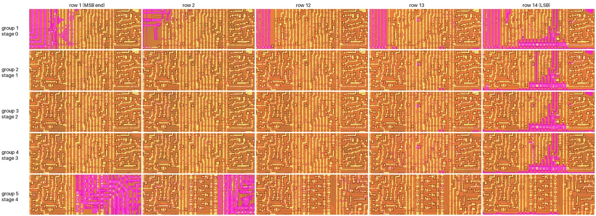
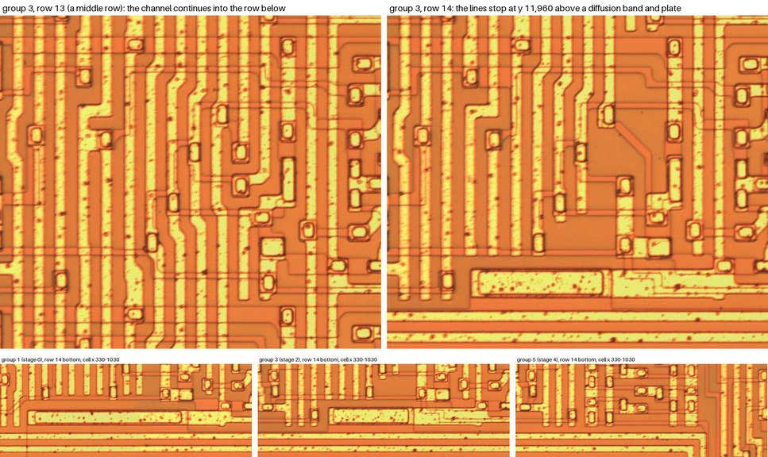
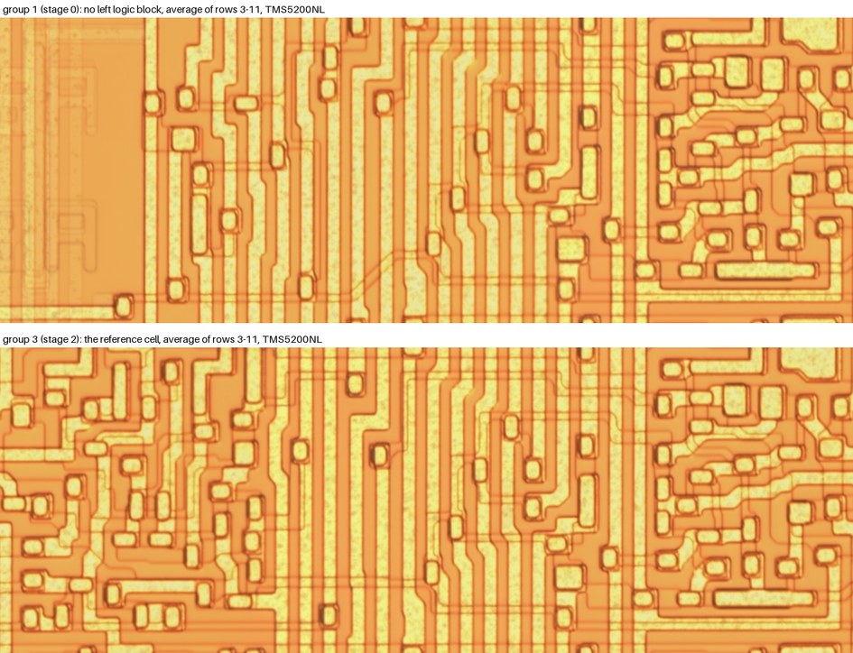

# Die analysis, Phase 3: the multiplier's low end (T1)

**Status: done to the plan's second exit, 2026-10-09.** The low-end cells were compared with the reference cell in all five stages, in both images. The only differences they show are tie-offs at bit 0. No assignment of those tie-offs improves the model, so the multiplier in datasheet §8.8 stands, and the search moves on (plan §4, Phase 3 exit). The comparison also gives two results:
- **The die explains the one irregular part of the model's multiplier.** Stage 0 has no adder, so the +1 that completes its negative digit has nowhere to enter (§3).
- **The fault is narrowed to one interface.** Stage 1 is built from the same cell as stages 2 and 3, yet only stage 1's negative digits go wrong. So the fault lies in what stage 1 receives from stage 0 (§5).

| Step | State |
|---|---|
| 1 Compare bits 0–2 of each stage with the reference cell | Done (§1, §2). Bits 1 and 2 match the middle cell in every stage. Bit 0 differs only in its inputs from below, which are tied off. Stage 0's cell differs from the reference as a whole (§3). The Booth recoders above the array were compared only as wholes (§4) |
| 2 Work out what each difference does | Done as far as the image allows (§2.3). The tie-offs have three possible readings each, but what they are tied to cannot be read: the decisive rim is ambiguous (§2.2) |
| 3 Score the hypotheses in the model | Done (§2.4, §3.2). The 41 tie-off variants and 4 stage 0/stage 1 interface variants are all worse than the present multiplier, or no better |

Positions are in full-resolution pixels of the TMS5220NL image (`phase0.md` §2). "Cell" coordinates are relative to a cell's top-left corner; group 3, row 7 is the reference cell (`phase2.md` §4). Groups 1–5 are stages 0–4 (`phase1.md` §5). Row 14 is the LSB (`phase2.md` §4.3). `python tools/die.py lowend` repeats the comparison in §1 and writes its averages and difference maps to `local/die_image/phase3/`.

## 1. Every stage's end rows against its own middle rows

For each column group, the tool aligns rows 3–11 on row 6 and averages them, in each image separately. It then compares rows 1, 2, 12, 13 and 14 with that average. Comparing each group with its own average keeps the method valid for groups 1 and 5, which are different cells from the reference (`phase2.md` §4.2). A difference counts only if it shows in both chips.

Normalised correlation of each row with its group's row 6, TMS5220NL (the TMS5200NL gives the same pattern, 0.03 lower):

| Group (stage) | Rows 1–2 | Rows 3–11 | Row 12 | Row 13 | Row 14 |
|---|---|---|---|---|---|
| 1 (stage 0) | 0.63, 0.82 | 0.79–0.88 | 0.78 | 0.75 | **0.58** |
| 2 (stage 1) | 0.90, 0.89 | 0.87–0.90 | 0.88 | 0.88 | **0.72** |
| 3 (stage 2) | 0.90, 0.89 | 0.88–0.90 | 0.88 | 0.88 | **0.72** |
| 4 (stage 3) | 0.89, 0.90 | 0.88–0.91 | 0.89 | 0.88 | **0.71** |
| 5 (stage 4) | **0.38, 0.61** | 0.73–0.90 | 0.88 | 0.89 | 0.85 |

*Magenta: where a row differs from its group's average of rows 3–11 in both chips. Rows 1 and 2 of group 1 differ only at the left edge, where the 14 MR lines rise one to each row (`phase1.md` §5). Die image: John McMaster, siliconpr0n, CC BY 4.0.*

What the comparison shows:
- **Bits 1 and 2 (rows 13 and 12) are the middle cell in every stage.** Row 12 has no difference at all in groups 2–5.
- **Row 13 differs in one place.** In groups 1–4 there is one small difference at cell (530–557, 138–177): a channel line that in other rows runs on down from a contact ends there instead. It is the start of the Σ(x−2) link that row 13 would send two rows down, to a row that does not exist. `phase2.md` §4.3 found that no two-row link leaves rows 13 or 14: these are the two bits that each stage drops. The other differences in row 13 are at its bottom edge, where it meets row 14's changed channel.
- **Row 14 (bit 0) differs in the channel and below it, in groups 1–4** (§2). Its logic blocks are the middle cell's.
- **Group 1 drifts from row to row** (0.88 down to 0.75). The difference is all at the left edge (cell x 0–200), where the 14 MR lines rise, a different one ending in each row. Group 1's cell is not the reference cell at all (§3).
- **Group 5's top rows differ** (rows 1–3). This is the MSB end of the last stage, which feeds the summer. It belongs to the word length and overflow (Phase 4), not to T1.

## 2. Bit 0: its inputs from below are tied off

### 2.1 What is seen

*Top: the channel of group 3 in a middle row (row 13) and in row 14, at the same place in the cell. Bottom: the bottom of row 14 in groups 1, 3 and 5. TMS5220NL. Die image: John McMaster, siliconpr0n, CC BY 4.0.*

In a middle row, the channel's lines run on into the row below. These are the one-row links: C_OUT to the bit above, and the MR pair that a ±2 digit needs from the bit below (`phase2.md` §4.3). In row 14:
- **The channel lines stop at y ≈ 11,960** (group 3; the same in groups 1, 2 and 4). Some end bluntly (x ≈ 4,510, 4,555 and 4,590). Others end on contacts (x ≈ 4,640 and 4,760); the one at 4,640 is also in the middle rows.
- **Below them is a band of diffusion** (y ≈ 11,965–11,990), seen in an average of row 14 over groups 2–4 in both images. It wraps round a **long rimmed plate** (x 4,515–4,745, y 12,000–12,040), a contact the length of the band. The plate's metal continues right as a bar along y ≈ 12,000–12,030, to x ≈ 5,240.
- **The stage-wide line at cell x ≈ 945 ends just above the bar** (§2.2).
- **The plate is identical in groups 2–4.** In group 1 it is longer (x ≈ 1,883–2,302): it runs further left, under the stage's left-hand lines. **Group 5 has no plate:** its row 14 is the same as its middle rows.
- The 14 horizontal lines below the array (y ≥ 12,060) are MR0–MR13 on their way to group 1 (`phase1.md` §5), not supply rails.

A line that ends bluntly carries a signal down to a bit that does not exist, so it is an output nobody reads. A line that carries a signal up from below must be driven by something in row 14, and the band and plate are the only candidates. So **bit 0's inputs from below (C_IN, and the MR(−1) pair) are tied to the plate's node.** This confirms `phase2.md` §4.4: there is no separate LSB cell.

### 2.2 What the tie node is: not readable

The plate's bar passes just under the end of a **stage-wide line at cell x ≈ 945**:
- **Its extent.** It is straight through all 14 rows of every group, from a contact at the top of row 1 (group 3: 4,952, 5,645) to a contact at the bottom of row 14 (4,948, 11,988).
- **It is not a supply or a G clock.** It starts on a contact below the bus over A, not on the bus, and none of the four G clock lines is at that position (φ3, line 1196, drops at about cell x 907; `phase1.md` §5).
- **It is most likely a per-stage signal from the recoder above,** such as a digit's sign. That is inferred from where it starts.

Whether the bar and this line are one piece of metal comes down to one dark rim at y ≈ 11,993. The rim is either the metal's edge or the step into the contact. It reads the same in both chips and in their averages, the ambiguity of `phase1.md` §6. Nor can the image show which of the stopped lines reach the band through diffusion.

### 2.3 The readings

Each input from below is tied to one of three things:
- **the stage's NEG** (the digit is negative). This is exact arithmetic: the +1 that completes a negative digit enters as C_IN at bit 0, and the bit-0 value a ±2 digit takes from below is right for both signs;
- **a constant 0;**
- **a constant 1.**

C_IN and the MR(−1) pair may be tied to the same node or to different ones. A tie to anything but NEG makes a fixed error at the stage's lowest bit on every product with the matching digit:

| Tie | Error at the stage's bit 0 |
|---|---|
| C_IN = 0 | −1 on every negative digit (the completion is lost) |
| C_IN = 1 | +1 on every non-negative digit, zero included |
| ±2's bit 0 = 0 | −1 on every −2 digit |
| ±2's bit 0 = 1 | +1 on every +2 digit |

If the line at x ≈ 945 is NEG and the bar joins it, stages 1–3 (groups 2–4, which are identical) compute exactly. That is what the present model does.

### 2.4 Scored in the model

Each stage's two ties were set in turn to each of the nine combinations (NEG, 0, 1 for each), with the other stages as in the present model: 41 variants. They were scored with `tools/model.py` against the chip on one take of each vector (`vsm01`):
- the unvoiced K sweeps `uk1`–`uk4` (96 takes), the fast filter for T1 (`lowest_order_arithmetic_ideas.md` §2.1);
- the voiced `ring` and `pitch` sets (111 takes).

| Variant | Unvoiced: samples differing | Exact | Voiced: samples differing |
|---|---|---|---|
| **Present model** (stage 0: C_IN = 0; stages 1–4: NEG) | **1,818** | **24** | **22,227** |
| Stage 0's ±2 bit 0 tied to 0 or 1 | 1,818 | 24 | 22,227 (no product changes) |
| Stage 0: C_IN = NEG (exact) | 2,361 | 24 | larger |
| Stage 1: ±2 bit 0 = 0 | 1,857 | 24 | 24,220 |
| Stage 3: both ties = 0 | 3,133 | 14 | 22,074 (the best voiced variant, −0.7 %) |
| Stage 1: C_IN = 0 | 2,018 | 23 | larger |
| Any change to stage 2 or stage 4 | 1,877 to 37,076 | 0–24 | larger, or −0.1 % |

*The voiced column gives the full voiced total only for variants in the voiced set's top 18; "larger" means outside it.*

**No tie-off variant improves on the present model.** The only voiced gain (stage 3 tied to 0, 0.7 %) costs 72 % on the unvoiced sweeps. This agrees with the die: groups 2–4 have identical ties, so stages 1–3 behave alike, and in the model the only choice that suits all of them is NEG. The choice for stage 0 is the subject of §3.

## 3. Stage 0 has no adder

### 3.1 What is seen

*Averages of rows 3–11 in the TMS5200NL image, which shows the edges more sharply. Top: group 1 (stage 0). Bottom: group 3 (stage 2), the reference cell. Die image: John McMaster, siliconpr0n, CC BY 4.0.*

Each group's average was compared with group 3's:

| Group | Against group 3 | What differs |
|---|---|---|
| 4 (stage 3) | 0.97 | Nothing |
| 2 (stage 1) | 0.88 | Line edges only. Fitting a 0.2–0.4 % scale difference leaves differences only in the channel's line widths. Every contact and every jog of the channel is in the same place (checked by eye). **Stage 1 is the reference cell** |
| 1 (stage 0) | 0.68 | **The whole left logic block is missing.** The right block is the reference cell's, and the channel is wired differently |
| 5 (stage 4) | 0.40 | A different cell. It has no two-row links (`phase2.md` §4.3) |

Single copies confirm stage 0's cell, in both chips (group 1, row 7, x 1,300–2,060). Where the reference cell has its left logic block (15 gates and 17 contacts, `phase2.md` §4.5), each row of group 1 has:
- an empty field box (x ≈ 1,530–1,660);
- one long, narrow rimmed window (x ≈ 1,505–1,520, about 370 px long), which is not explained;
- the L-shaped routing of the MR lines.

### 3.2 What it means

The patent's middle cell (B-2) has two halves:
- **the select and passing part:** the Booth select of MRx, its complement, 2MRx or its complement, and the clocked inverters that pass MRx on;
- **the adder:** the exclusive-OR with the incoming partial sum Σx, the precharged carry and the φ2/φ3 exclusive-OR that gives Σ(x−2).

Stage 0 has no incoming partial sum, so it needs only the first half. The patent builds stage 0 from different cells (A-1, A-2). The die fits this, if the missing left block is the adder and the right block, present in every stage, is the select and passing part. *Inferred:* the halves are named from the patent and from which one stage 0 lacks; the diffusion that would prove it cannot be read.

**An explanation of the model's stage 0.** The fitted multiplier (datasheet §8.8) negates stage 0's digit by inversion only (`NOT(|d0| × M)`, "without the +1"), and every other stage exactly. That form was chosen because it fits best. The die now gives a reason:
- the completing +1 must enter at an adder's carry-in, and stage 0 has no adder;
- stage 1's one carry-in at bit 0 is tied the same way as stages 2 and 3, so it completes stage 1's own digit.

Stage 0's +1 therefore has nowhere to go, and is lost. Two ways of passing it on to stage 1 instead were tried (rows 2–3 below). So were two readings of what an unselected stage 0 (d₀ = 0) puts out (rows 4–5).

| Variant | Unvoiced: samples differing | Exact | Voiced |
|---|---|---|---|
| **Present model** (stage 0's +1 lost; unselected = 0) | **1,818** | **24** | **22,227** |
| Stage 1's carry-in = NEG₀ OR NEG₁ | 3,195 | 18 | 39,358 |
| Stage 1's carry-in = NEG₀ XOR NEG₁ (with a −1 when both) | 2,956 | 18 | 38,985 |
| Unselected stage 0 puts out all ones (a precharged node left high) | 154,414 | 0 | 105,759 |
| Unselected stage 0 sets only the two bits it drops | 1,818 | 24 | 22,227 (no product changes) |

The present form wins. It is now **consistent with the die** as well as the best fit.

## 4. The Booth recoders

The header block above row 1 (y 5,250–5,730) holds each stage's recoder. Each group's header was matched against group 3's:

| Group | 1 | 2 | 3 | 4 | 5 |
|---|---|---|---|---|---|
| TMS5220NL | 0.45 | 0.76 | 1 | 0.82 | 0.28 |
| TMS5200NL | 0.50 | 0.73 | 1 | 0.80 | 0.27 |

- **Groups 2–4 are the same circuit,** wired to different bits of K.
- **Group 1's recoder is different,** as the patent says: stage 0 "receives only −2, −1 and +1". With k(−1) = 0, d₀ = −2·k1 + k0 can never be +2, so stage 0 needs no +2 select.
- **Group 5's is different again.** It also differs from the end of the array that feeds the summer.

These are random logic and have not been read gate by gate.

## 5. Where this leaves T1

**The exit.** None of the differences in the low-end cells changes the model: bits 1 and 2 are the middle cell, and every reading of the bit-0 ties scores worse. This is the plan's second exit for Phase 3, and the search moves to Phase 4.

**A lead for Phase 5.** The T1 signature, as the vectors give it (`lowest_order_arithmetic_ideas.md` §2.1–§2.3, §3.7):
- departures come on coefficients whose stage 1 digit is negative (*d*₁ < 0), not on *d*₂, *d*₃ or *d*₄ < 0;
- the outcome drifts between days on one chip, so the operation is marginal.

The die says stages 1, 2 and 3 are the same cell with the same bit-0 ties. So stage 1's negative path cannot be different logic from stage 2's or 3's. What stage 1 alone has is its input. Its Σx comes from stage 0, which has no adder, so that input is driven by stage 0's select logic. Stages 2 and 3 take theirs from the clocked exclusive-OR at the end of an adder. The stage 0 → stage 1 link (the two-row channel links of group 1) is therefore the first candidate for the marginal node of plan Phase 5:
- **how it is driven:** precharged and conditionally discharged by the Booth select, or statically;
- **the clock phase** on which stage 1 samples it;
- **its length:** each runs about 820 px of channel, two rows.

A negative stage 1 digit inverts MR, which changes which nodes switch at the same moment as the link is read. That is a plausible way for *d*₁ < 0 alone to matter, but it is a hypothesis, not a reading. Settling it needs:
- the diffusion of stage 0's cell and its link, which only a delayered image shows;
- or the temperature and supply test of `lowest_order_arithmetic_ideas.md` §4.5, which says whether the *d*₁ < 0 departures are a level effect at all.

**Not done here:**
- the stage 4 cell (group 5), which is a different cell and feeds the summer, so it is read in Phase 4;
- the MSB ends (group 1 rows 1–2, group 5 rows 1–3): Phase 4, overflow;
- the recoders gate by gate (§4).

## 6. Changes elsewhere

- **`tools/die.py lowend`** (new): compares every stage's rows with its own middle rows in both images, and each group with group 3. It writes the averages and the difference overview.
- **New figures:** `fig_lowend_diff.jpg`, `fig_lsb_ties.jpg` and `fig_stage0_cell.jpg`.
- **`cells.json`:**
  - new records `lsb_ties_g3`, `stage_line_945` and `stage0_cell`;
  - block A's note updated.
- **Datasheet §8.8:** a note that the die explains stage 0's missing +1 (provisional, plan §5), and a changelog row.
- **The plan:** Phase 3's status and result, and the order from here.
- **`tools/model.py` is unchanged.** No variant scored better. The scoring scripts subclass `Model` with a replacement `boothArray`; they were run from a scratch area, as in `lowest_order_arithmetic_ideas.md` §2.3.
