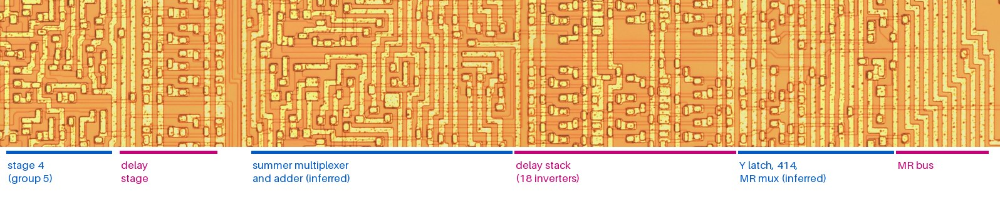
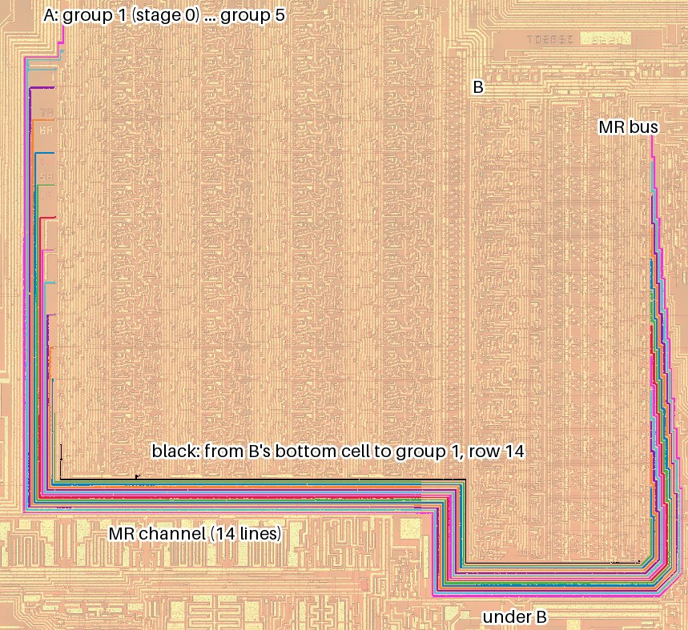

# Die analysis, Phase 4: the adder, the multiplexers and the delay stack (T2, T3)

**Status: done as far as this image allows, 2026-10-09. No change to the model.** Block B was compared row by row in both images, as block A was in Phase 3:
- **B is 14 copies of one bit cell.** Rows 2–12 are identical. The two end rows differ only at their edges, in routing, and B holds no logic that belongs to one bit (§1). So the adder's bit 0, the summer multiplexer's "zero" at bit 0, and the Y latch's low bits are built like every other bit's.
- **The multiplier's input was traced from B to stage 0** (§2). This checks the bit order of the whole datapath: each row of B drives one MR line, which enters A one row higher. A 14th line, from an extra cell at the bottom of B, enters stage 0's lowest row.
- **Scored in the model, the wiring forces one value** (§3). The array then sees the multiplicand as 2*M* plus that line's bit, with one more shift at the output. This is the present multiplier exactly when the line carries 0, and worse by 2–75 times when it carries 1 or *M*'s sign.

Nothing in B offers a new form for the summer. Every variant the die leaves open was already ruled out by the vectors (datasheet §8.8). So the plan's exit, a bit-level model of the whole lattice step taken from the die, is reached only in this sense: the die agrees with the present model and adds nothing to it. T1 stays where Phase 3 left it, at a marginal node (plan Phase 5).

| Step | State |
|---|---|
| 1 Adder bits 0 and 1, and the carry-in | Compared, not traced (§1, §4). Bits 0 and 1 are the middle cell. Bit 0's lines from below end on contacts and bends, as A's do, so they are tied off; to what cannot be read. The vectors already rule out a lost carry-in (subtraction by an inverted product without carry-in: datasheet §8.8, Phase 8) |
| 2 Precharge gate 420 at bit 0 | Bit 0's summer multiplexer is the middle cell's, so its "zero" is made the same way as at every bit (§4). Whether it is a clean zero is a question of levels, for Phase 5 |
| 3 Truncation logic 425 and the Y latch | The Y latch is the same cell in all 14 rows, so it is 14 bits wide and drops no low bits. This agrees with Phase 9: *b*₁ reaches the multiplier whole. The patent's 425 is the DAC's clip of YL13–YL4, not a truncation of *b*₁, so it belongs to Phase 6 (§4) |
| 4 Overflow | The MSB row of B is the cell with its upper half missing, and has no added logic: nothing saturates. This is consistent with the 14-bit wrap of datasheet §8.8 (§4) |
| Left over from Phase 3: stage 4 and the MSB ends | Compared as wholes only (§5). Stage 4 (group 5) is a different cell. Its right part is replaced by a column of small cells, probably the patent's delay stage |

Positions are in full-resolution pixels of the TMS5220NL image (`phase0.md` §2). B's rows are 452 px high from y 6,724, row 1 at the top. Groups and rows of A are as in `phase3.md`. `python tools/die.py summer` repeats §1 and §2, and writes its difference overview to `local/die_image/phase4/`.

## 1. Block B, row by row

*Bit row 7 of B, with stage 4 of A on the left (TMS5200NL image, sharper). The sections are named from the patent's order of parts (US 4,335,277 FIG. 4b, 11) and from where the delay stack (`phase1.md` §4) and the MR lines (§2) are. Only the delay stack and the MR lines are seen; the other names are inferred. Die image: John McMaster, siliconpr0n, CC BY 4.0.*

**Sections.** Each row of B, from left to right:

| x | Section | How it is known |
|---|---|---|
| 6,950–7,330 | A column of small repeated cells between stage 4 and B, at a finer vertical pitch than the bit rows | Seen. Probably the multiplier's "delay stage" (US 4,335,277: "five stages … and a delay stage"). The product crosses it to B in diffusion, which cannot be traced |
| 7,450–8,450 | Random logic, the largest section | *Inferred:* the summer multiplexer (402) and the adder (404). They are the parts between the product and the delay stack |
| 8,450–9,300 | The delay stack, 18 clocked inverters per bit | Seen (`phase1.md` §4) |
| 9,300–9,900 | Random logic | *Inferred:* the Y latch (403), the one-period delay gates (414) and the multiplier multiplexer (415). Its output is the MR line (§2) |
| 9,900–10,250 | The MR bus | Seen (§2) |

**The comparison.** Every row of B was aligned on row 7 and compared with the average of rows 4–10, in each image separately. A difference counts only if it shows in both chips.

| Row | Correlation with row 7 (TMS5220NL / TMS5200NL) | What differs from the middle rows |
|---|---|---|
| 1 (MSB end) | 0.63 / 0.63 | The upper half of the row (y 6,724–6,950) is the bus over B, not logic. The multiplexer's corner (x 9,632–9,980) differs. No line from it enters the MR bus (§2) |
| 2–12 | 0.84–0.90 | Nothing, apart from the MR bus's top two lines (rows 2–3, x 9,925) and one 300 px speck (row 11) |
| 13 | 0.84 / 0.84 | Only the left edge (x 7,280–7,380), where the channel beside A ends and the MR bus rises (§2) |
| 14 (LSB end) | 0.78 / 0.76 | The left edge, as row 13. The extra cell at the bottom (x 9,380–9,800, y 12,780–13,050) drives the 14th MR line (§2). The lines that run down from row 13 end in row 14 on contacts and bends |

So **B has no logic that belongs to one bit.** The patent's text expects some: its summer, Y latch and multiplexer cells differ by bit "only with respect to the interconnections" to the truncation logic and the excitation bus. Those are 8 or 10 extra connections, but none of them shows as a row difference. Both buses are routed with one line per row, in a step pattern that repeats from row to row (the MR bus of §2 is one), so a connection made through such a bus does not change the row's cell.

**Which end is the LSB.** Row 1 is the MSB end, as in A:
- its cell lacks the upper half, which in the other rows faces the bit above;
- the MR lines it drives would be the multiplicand's top bits (§2).

B lies two rows lower than A (`phase1.md` §3). Rows 13 and 14 of B face the MR channel, not the array, so the product enters B through the delay stage with a step of two rows. That step cannot be traced on this image: it runs in diffusion.

## 2. The MR lines: from B's multiplexer to stage 0

*The 14 MR lines, followed as metal by `die.py summer`, TMS5220NL. Each colour is one line. Black: the line from B's extra bottom cell. Die image: John McMaster, siliconpr0n, CC BY 4.0.*

Each of B's rows 2–14 sends one line from the same place in its cell (x ≈ 9,945, just below the row's top) into a bus on B's right edge. The bus runs down, under B (y 13,200–14,000), up B's left side (x 6,850–7,350) and left along the channel below A. These are the 14 lines that `phase1.md` §5 found rising one to each row of group 1. So the bus carries **the multiplier's input, MR**, and **the right-hand section of B is the multiplier multiplexer.**

| Source | Channel line (y at x 6,700) | Where it ends in group 1 |
|---|---|---|
| B row *r*, *r* = 2…14 | 12,100 + 35·(14 − *r*) | At the top of A row *r* − 1: a short stub to a contact at x ≈ 1,640–1,665, 15–55 px above the row's top (B row 14: 11,140, the top of A row 13) |
| B row 1 | none | Its multiplexer corner differs from the other rows' (§1). Its output was not traced |
| B's extra bottom cell (x 9,380–9,800) | 12,064 | **Group 1, row 14,** at a contact (1,735, 12,010) that sits where every row has one, at cell y ≈ 400 |

*The positions are from the TMS5220NL trace. In the TMS5200NL some lines break in the labelling; those that do not break give the same positions.*

**Reading.** Stage 0's rows 1–13 each take a line from the B row below their own. Row 14 takes the line from the extra cell, and the MSB row of B feeds nothing through this bus. If the bit order is the same in A and B (row 14 = bit 0 in both), the array sees the multiplicand **one place higher**: 2*M*, with its lowest bit supplied by the extra cell. That is consistent with the model's last shift being one place (`>> 1`), where every other stage shifts by two. The +1 shift is the doubling being undone. *Inferred:* the bit order of B is taken from A and from §1. The contacts at the row boundaries could be read as belonging to the row above instead, which would shift the whole mapping by one row. §3 shows that the arithmetic works only with the reading above, and only if the extra line carries 0.

## 3. Scored in the model

The model's multiplier (`Model.boothArray`, datasheet §8.8) was rewritten as an array over a multiplicand *m'* with one more output shift, and scored as in `phase3.md` §2.4, on one take of each vector (`vsm01`):

| Variant (array input *m'*, output) | Unvoiced K sweeps (96 takes): samples differing | Exact | Ring and pitch (111 takes) | Loud and random (84 takes) |
|---|---|---|---|---|
| **Present model** (*M*, `(acc >> 1) \| 1`) | **1,818** | **24** | **22,227** | **86,106** |
| *m'* = 2*M* (extra line = 0), `(acc >> 2) \| 1` | 1,818 | 24 | 22,227 | 86,106 (identical products) |
| *m'* = 2*M* + 1 (extra line = 1), `(acc >> 2) \| 1` | 16,931 | 6 | 44,941 | |
| *m'* = 2*M* + 1, `acc >> 2` (the forced 1 made by the extra line instead) | 137,409 | 0 | 129,046 | |
| *m'* = 2*M* + sign of *M* | 10,437 | 8 | 24,232 | |
| *m'* = 2*M* wrapped to 14 bits (B row 1's bit dropped) | | | | 132,732 |

- **With the extra line at 0, the doubled wiring is the present multiplier exactly.** The products are identical for every *K* and every third *M* (checked over 5.6 million operands), because each stage's `>> 2` of 2*x* drops the same bits as `>> 1` of *x* would.
- **The line carries 0.** A 1 there, with or without the forced 1 at the output, is 9–75 times worse on the unvoiced sweeps and 2–6 times worse on the voiced sets. Taking *M*'s sign instead is also worse.
- **The multiplicand's sign must reach the array.** Dropping B row 1's bit (2*M* wrapped at 14 bits) is 1.5 times worse on the vectors that reach large values. So B row 1's multiplexer output reaches A by a route not traced here, which fits its corner differing (§1).

A 0 supplied by a separate cell is the kind of node that `phase3.md` §5 says to look for in Phase 5. It is constant by design, and if it were weak, the error would show on every stage's lowest MR bit. It joins the stage 0 → stage 1 link as a candidate. Nothing in the data yet points to it rather than that link: the *d*₁ < 0 signature involves stage 1's negative digits only, and a weak bottom MR bit would act on positive digits too.

## 4. The adder's low end, the zero and the Y latch

What the plan asked for, against what the image shows:
- **The adder's carry-in at bit 0.**
  - *What the image shows:* row 14 of B is the middle cell, so the adder's bit 0 is built as every other bit. Its lines from below end in row 14 on contacts and bends, the same tie-off pattern as A's row 14 (`phase3.md` §2.1). What they are tied to is under metal.
  - *What the vectors say:* the u chain subtracts each product exactly, so a subtracting adder must get its +1 at bit 0. Subtraction by an inverted product without that carry-in is already ruled out (datasheet §8.8, Phase 8). The die gives no reason to reopen it.
- **The precharged zero (gate 420).** In the patent, the summer multiplexer gives the adder a zero at T19 (the energy product) by leaving a φ3-precharged input undischarged. Bit 0's multiplexer is the middle cell, so its zero is made the same way as at every bit. A zero that fails only at bit 0 would need a different cell there, and there is none. Whether the precharged node holds its level is a question of levels (Phase 5).
- **The Y latch and truncation.** The section that holds the Y latch is the same in all 14 rows, so the Y latch has 14 bits and the multiplier sees *b*₁ whole. This agrees with Phase 9, where every low-bit truncation of *b*₁ fitted 4–18 times worse (`lowest_order_arithmetic_ideas.md` §2.3). The patent's truncation logic 425 converts YL13–YL4 for the DAC and clips it; it is in the output path (Phase 6).
- **Overflow.** B's MSB row has less than the middle cell (the upper half, which faces the bit above, is missing), and nothing has been added. No saturation logic is present in B. This is consistent with the 14-bit wrap, which the loud and random vectors fit best (datasheet §8.8).

## 5. Stage 4 and the MSB ends (left over from Phase 3)

- **Stage 4 (group 5) is a different cell** (`phase3.md` §3.1: 0.40 against group 3). Its left 700 px resemble the other stages' (`phase1.md` §3). Its right part is replaced by the delay-stage column of §1. It has no two-row links, so its sum does not move down two rows within A. The two-row step into B (§1) is where the last shift is made. Its cells were not read gate by gate.
- **Group 5's rows 1–3 differ from its middle rows** (`phase3.md` §1). They lie beside the top of B, whose row 1 starts two rows lower than A's (`phase1.md` §3). So A's top two rows in stage 4 face B's row 1 and the bus above it. This is where the product's top bits would be dropped or folded in. Like the step into B, it runs through the delay stage and cannot be traced.
- **The MSB end of group 1** (rows 1–2) differs only where the MR lines rise (`phase3.md` §1). B row 1's bit, the sign, must reach stage 0 (§3), and how it does so has not been found.

## 6. Where this leaves T1 and T2

- **T2 has no open form on this image.** Every part of the summer side is the same cell at bit 0 as in the middle, and the variants that the die leaves open (the carry-in, a weak zero, truncation of *b*₁, saturation) were already scored and rejected. The datasheet's adder and summer stand. They are now *consistent with the die* as well as with the vectors.
- **T3 is confirmed.** The datapath is 14 bits in A, in B and in the MR lines (14 lines, one of them the extra 0). There is no wider register.
- **T1 moves to Phase 5.** Its candidates are now two:
  - the stage 0 → stage 1 link (`phase3.md` §5);
  - the extra MR line that should carry 0 (§3).

  Both need levels, not connections: the clock phase that precharges each node, what discharges it, and its size. That needs the diffusion, which only a delayered image shows, or the temperature and supply test (`lowest_order_arithmetic_ideas.md` §4.5), which says whether the *d*₁ < 0 departures are a level effect at all.

**Not done here:**
- the summer multiplexer's timing (which slot selects which input, patent FIG. 11), which is random logic driven from the PLA;
- B row 1's MR output;
- the step of the product from stage 4 into B through the delay stage;
- the delay stack's taps.

All four run in diffusion or under metal.

## 7. Changes elsewhere

- **`tools/die.py summer`** (new): compares B's rows with its middle rows in both images, and traces the MR lines from B to group 1. `metal_labels` is a new helper, shared by the trace.
- **New figures:** `fig_summer_row.jpg` and `fig_mr_loop.jpg`.
- **`cells.json`:**
  - new records `mr_bus`, `b_bottom_cell` and `delay_stage`;
  - block B's note updated.
- **Datasheet §8.8:** a note that the die finds no bit-specific logic on the summer side, and a changelog row.
- **The plan:** Phase 4's status and result, and the order from here.
- **`tools/model.py` is unchanged.** The scoring script rewrote the multiplier in a subclass, as in Phase 3, and was run from a scratch area.
