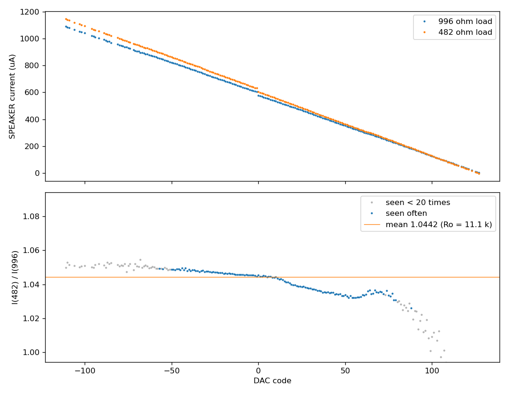

# TMS5220 Voice Synthesis Processor: Reference Datasheet

This datasheet describes the TMS5220 as measured on real hardware. It follows the section order of TI's *TMS 5220 Voice Synthesis Processor Data Manual* (transcribed in `../tms5220_datasheet/`, referred to below as "the original"), so that readers of the original can find things. The text is written fresh, and it cites the original rather than copying it.

The aim is that someone working from this document alone can author new phrases, author new speech PROMs, and emulate the chip exactly. `../speech_capture_plan.md` describes how the measurements are made.

**Status (2026-10-07):** These sections are drafted:
- the system clock (§2, Appendix A);
- the CPU interface, the FIFO and the commands (§3, §5, §6);
- the VSM interface (§4);
- the chip's state at power-up and between utterances (§7);
- speech synthesis: the frame format, the parameter tables, the excitation, interpolation and the lattice filter (§8.1, §8.5 to §8.9);
- the DAC and the audio output (§8.2, §8.3);
- the serial sample output (§8.4);
- the measured output characteristics (§9.5);
- the pin functions (§11.2).

What is not yet known is listed where it applies. The main gap is in §8.8: the filter's lowest-order arithmetic, which leaves the model of §8.9 one code off at a few samples per pitch period. Overflow is now modelled as a 14-bit wrap, following US 4,335,277.

**Phase 9 (2026-10-07).** A reference emulator written from this datasheet alone (`emulator/`) reproduces the model of §8.9 sample for sample on every standard take of the vector sets and the Acorn PHROM A (20,948 takes), and the VSM timing of every VSM take (§8.9). The host-interface tests of Phase 8 (p8-19 to p8-25) have not yet been replayed through it. The text is therefore complete for what the model knows. Where the chip still differs, so does the model, and the causes are those listed in §7 (upsets) and §8.8 (the lowest-order arithmetic).

## Conventions

- **Evidence.** Every measured statement cites one or more capture IDs in brackets, for example [p1-03]. `evidence/README.md` lists each capture with its settings and the SHA-256 hash of its raw data. A citation of the form [corpus `acorn_phrom_a`] refers to a PROM's whole reference set (plan §6). The set itself is kept outside the repository until it is published, but its index is committed in `captures/corpus/<prom>/`: `index.md`, `takes.csv` and `sweep.csv`. These give every take's checks and the SHA-256 hashes of its output and raw files.
- **Vector sets.** A citation of the form [vectors `energy`] refers to one of the Phase 8 synthetic vector sets (plan §9.1): its definition is in `captures/phase8/vectors/<set>.json` and `.csv`, its captures are kept local like the corpus, and its index (`captures/vectors/vectors_<set>/index.md`, `takes.csv`) is committed. `captures/phase8/analysis/` holds every take's comparison with the model of §8.9 (`vectors.csv`) and the table measurements (`tables.csv`, `pitch_periods.csv`).
- **Chips.** Four TMS5220NLs, all marked `DEP 8423`, are labelled 1–4 on the package. **Chip 1** made every measurement in this datasheet unless another chip is named. Chip 2 gave no `M0` pulses. Chip 3 loaded a wrong address and then stopped responding to writes, after the board's Pico restarted while the chip was fitted; that symptom matches the wedge in `firmware/PROTOCOL.md`, so chip 3 may work after a power cycle. **Chip 4** is the one compared with chip 1 in §8.8. `tools/bench.json` names the chip fitted; captures of chip 4 made before it was numbered record it as `replacement3`.
- **The model.** `tools/model.py` implements the behaviour this datasheet describes for the synthesis path (§8.9). Statements of the form "the model matches" mean its I/O codes equal the chip's, sample for sample.
- **New and corrected content.** Content the original does not have is marked **New**. Content that disagrees with the original is marked **Correction** and says what the original states.
- **Voltages** are measured at the probe tip, referred to board ground (`VREF`, 0 V), with `VSS` = +5 V and `VDD` = −5 V. Probes are 10 MΩ passive ×10 probes unless stated. Edge times are 10–90 % unless stated, and edge positions are taken at the midpoint between the low and high levels.
- **Slots.** A *slot* is one ROMCLK period, 6.25 µs at the nominal clock. Each 125 µs sample period has 20 slots, numbered 0–19. Slot 0 is the one in which `T11` is high (§8.4).
- **Codes.** A *code* is the signed 10-bit sample value the chip sends on `I/O` (§8.4).

## 1. Introduction

The original's introduction (scope, key features, device operation) still applies. This datasheet adds the measured behaviour that the original leaves out or gets wrong. The change log at the end lists every addition and correction.

## 2. System clock

**Status: drafted (Phase 1).**

The original says the internal RC oscillator runs at 640 kHz for an 8 kHz sample rate, and that the clock is divided by four into two major phases. The measurements confirm the division ratios:

| Quantity | Relationship | At 640 kHz | Measured |
|---|---|---|---|
| Oscillator (`OSC`) | `fosc` | 640 kHz | Driven by the test board at 640.000 kHz (crystal-derived) |
| ROMCLK (pin 3) | `fosc` ÷ 4 | 160 kHz | 160.0005 kHz, period 6249.98 ns [p1-03] |
| Slot (bit time) | 1 ROMCLK period | 6.25 µs | 6.25 µs |
| Sample period | 20 slots = `fosc` ÷ 80 | 125 µs (8 kHz) | 124.9996 µs [p1-01, p1-02, p1-03] |
| Interpolation interval | 25 samples | 3.125 ms | 25 samples (§8.7) [p8-04, vectors `interp`] |
| Frame | 8 interpolation intervals = 200 samples | 25 ms (40 Hz) | 200 samples: frames are read 25.000 ms apart (§4) |

The measured periods differ from nominal by about 3 ppm. That is within the combined tolerance of the test board's crystal and the scope's timebase.

**Correction.** The original's 8 kHz column in Table A-1 gives the interpolation interval as 3.125 ms, but its §2 text says 3.25 ms. 25 samples of 125 µs is 3.125 ms.

ROMCLK is high for 50.6 % of each period (3162.7 ns of 6250 ns) [p1-03]. The original's Figure A-2 calls it PHI-2.

**Every `T11` and `I/O` transition follows a ROMCLK rising edge** [p1-03]. No transition lines up with a ROMCLK falling edge. §8.4 gives the delays.

Driving `OSC` from an external clock is covered in Appendix A.

## 3. CPU interface

**Status: drafted (Phase 8).** Measured with the host interface tests of plan §9.3 (`tools/protocol.py`), from the Pico's trace of every host cycle, at 640 kHz. Trace times are late by up to about 1.5 µs (`firmware/PROTOCOL.md`).

**READY (New).** The original (§3.2) says READY goes inactive 100 ns after `RS` or `WS` goes active, and active again when the transfer can complete. These are the times from the strobe to READY active again [p8-19 to p8-25]:

*Table 3-1. Host cycle times, strobe to READY active, in µs. Medians, with the range seen.*

| Cycle | Median | Range | Cycles |
|---|---|---|---|
| Status read | 14.7 | 11.5–17.4 (95 %) | 12,106 |
| Command write (Load Address, Speak, Speak External, Reset, Read Byte, Read and Branch) | 22.7 | 18.4–23.9 | 129 |
| Data write to the FIFO during Speak External | 16.6 | 14.7–20.7 | 527 |
| Data read after Read Byte | 55–145 | up to 237 | 5 |
| A command written straight after Read and Branch | 386–486 | | 2 |

- **A status read or a write** completes in 12 to 24 µs, two to four slots.
- **After Read Byte**, the data read waits until the chip has read the eight bits from the VSM, and after a Load Address also the Dummy Read: up to 237 µs [p8-25]. READY goes active 4 slots (25 µs) after the eighth bit is read. When the bits are read is given in §4.
- **A Read Byte held during speech** (§6). Reads made while it is held do not wait: they return 0xFF at once, and do not use it up. After Talk Status clears, the chip reads the byte. The next read then waits for the eighth bit (237 µs after Talk Status cleared, in the one case measured) and returns the byte [p8-22].
- **After Read and Branch**, the next write waits 386 to 486 µs [p8-25]. The chip does not see the VSM finish a branch: US 4,335,277 times Read and Branch with a fixed timer (240 µs in its 10 kHz design, 48 bit times, which would be 300 µs at 640 kHz). A VSM must therefore finish the branch within that time. **When READY returns (New).** In both cases measured, READY for the next write went active at the start of **slot 15** of a sample period. It was the first slot 15 that came more than 59 slots after the Read and Branch function. The Branch fell in slot 16 in one case and slot 12 in the other, and READY came 79 and 63 slots after it. So the limit is between 60 and 63 slots, and the wait does not depend on when the next write is made [p8-25].
- **A second command while one is held.** A command that cannot run during speech is accepted at once (READY active after about 21 µs) and held until speech ends (§6). Another write while it is held keeps READY inactive. The test host gave up after 50 ms; the chip then did not drive READY active again until it had been reset [p8-23]. A host should not write a second command while one is held: it should poll Talk Status first.

**INT (Correction).** INT went active for Talk Status going clear and for Buffer Low going set, and a status read released it [p8-19, p8-20]. **It did not go active when Buffer Empty was set**, which the original's §3.3 lists as a cause: in eight Speak External streams that ran out of data, the status read 1 to 2 ms after Buffer Empty set found it set, with no INT between [p8-19, p8-20]. The INT at the end of those streams came when Talk Status cleared, a frame later (§5). The original's description matches the design in US 4,335,277, where any change of BE, BL or Talk Status raises INT, and BE resets the talk latch at once. This chip behaves differently on both counts.

**Status reads during speech.** During a VSM Speak, status reads return 0xFF or 0xDF: Buffer Low and Buffer Empty keep whatever the last Reset or Speak External left (§6) [p8-22].

**The latch (definition).** Throughout this datasheet a command is *latched* in the slot in which READY goes active for its write. The start of speech (§6, §7, §8.5) and the noise register's release (§7) are timed from it.

**Not measured yet (host interface).** These have not been measured, so an emulator has to choose. None of them changes the output of any capture in the data set:
- READY latencies as whole slots, and how they depend on the slot in which the strobe falls (Table 3-1 gives only the times);
- when Talk Status sets after Speak (later than 22 µs), and when the Speak's Dummy Read and each command's VSM functions occur, apart from Load Address (§4);
- what releases READY after a second command written while one is held (the chip may lock up, as p8-23 suggests), and what a held command does when a Reset arrives;
- which reads return Read Byte data when it is not held (the original's §5 and §6 differ): the tests made one data read per Read Byte. While a Read Byte is held, reads return 0xFF (above);
- whether INT goes active for the FIFO purges of Speak External and Reset, and whether Reset releases INT;
- a 17th byte written to a full FIFO, and when writes stop going to the FIFO after a Speak External ends;
- a Speak External written during a VSM Speak, or a Speak while another waits for its frame boundary;
- the exact length of the Read and Branch wait: more than 59 and at most 63 slots from the Branch function to the slot 15 that releases READY (two cases);
- what the power-up clear issues to the VSM, and its effect on INT.

## 4. Voice synthesis memory (VSM) interface

**Status: drafted (Phase 8).** From the Pico's trace of every VSM function. The VSM here is the Pico's emulation of a TMS6100 (`firmware/PROTOCOL.md`).

**The VSM holds the address, not the chip (New).** The TMS5220 has no address counter of its own. Each Load Address command is passed to the VSM at once as one Load Address function with the command's low nibble, about 35–45 µs after the write [p8-25]. The VSM shifts the nibble into its address register, least significant nibble first, as the original describes; five are needed for a full 20-bit address. With fewer, the VSM's register holds the earlier address shifted by the nibbles given, and a sixth nibble shifts the address on [p8-25]. Every read then advances the VSM's own register. So how an address carries from one bank to the next, or wraps, is the VSM's behaviour: with this emulation, reads run on from 0x3FFFF into 0x40000 (Phase 7).

**The Dummy Read (New).** The first VSM read after a Load Address is preceded by one Dummy Read, whether that read is for Speak or for Read Byte. Further Read Bytes do not repeat it [p8-25].

**When Read Byte reads (New).** The eight bits are read two slots apart, starting at **slot 13** of a sample period (slots 13, 15, 17, 19, 1, 3, 5 and 7). Without a Dummy Read, reading starts in the sample period after the one in which the command was latched. After a Load Address, the Dummy Read comes first, 2 slots after the latch. Reading then starts at the **first slot 13 that is at least 22 slots after the Dummy Read**. In seven cases, a slot 13 that was 22 to 33 slots after the Dummy Read was used. One 21 slots after and one 14 slots after were not, and the next slot 13 was used instead [p8-25]. Four Read Bytes on one trace started in the same slot of the sample period, 149 to 241 µs after their writes. A Read Byte held during speech read its byte from slot 13 of the sample period after Talk Status cleared [p8-22]. Read and Branch does not need one: a Read Byte straight after it read the branch target's first byte with no Dummy Read [p8-25].

**Read and Branch (New).** Command `0x30` makes the VSM replace its address with the two bytes at its current address. Loading the address of word 160's entry in the Acorn PHROM A's pointer table (0x3C140) and then Read and Branch left the VSM at 0x3CBB6, the word ACORN; a Speak then spoke it [p8-25]. The bytes there are 0xB6, 0x0B: the first byte read is the low byte, and the 14-bit value 0x0BB6 replaces the low 14 bits of the address, as the original's §4 says. This is how a BBC Micro speaks a word by number.

**Reset (New).** Each Reset command issues a Load Address function and a Dummy Read, as the original's §6.6 says (Phase 3). The nibble loaded was 8 (0b1000) for a Reset written during speech [p8-22].

**Observations from Phases 3 to 7:**

- **No read-ahead.** A Speak reads the VSM exactly up to the last bit of the stop code and no further. For ACORN that is 1152 bits, starting with a Dummy Read at the loaded address [p3-01, p3-03].
- **From any address (Phase 7).** The address sweep of the Acorn PHROM A spoke from 16,144 start addresses: every byte of the image that is not a word start, except the 75 whose data runs off the end of the image without a stop code. From every one, the chip read exactly the bits of the frames up to the end of the stop code, and nothing more. In all, that is 395,398 frames and 12.2 million bits [p7-07, p7-08, corpus `acorn_phrom_a`]. Most of these starts give data no encoder would write, so the frame lengths hold for any bits:
  - energy 0 (silence) and energy 15 (stop): 4 bits;
  - repeat: 11 bits;
  - unvoiced: 29 bits;
  - voiced: 50 bits.

  The frames were 204,144 voiced, 142,816 repeat, 22,841 silence and 9,453 unvoiced.
- **Reset uses the VSM.** Every Reset command issues a Load Address and then a Dummy Read to the VSM, as the original's §6.6 says. This includes each `0xFF` byte of the initialisation sequence, which decodes as Reset (`X111XXXX`) [p3-01].
- **One frame every 25 ms.** During a Speak, the chip reads each frame's bits in a burst, and the bursts start exactly 25.000 ms apart (within 0.12 µs, at the nominal clock) [p4-01, p4-02]. This held for all 15,575 sweep starts with more than one frame, silence frames included [corpus `acorn_phrom_a`].
- **When Talk Status clears (Phase 7).** It clears 0.13 ms before the end of the frame that follows the stop frame: 24.87 ms after the stop frame is read. Measured from the first frame read, that is *frames* × 25 ms − 0.13 ms, counting the stop frame. Across 15,575 sweep starts it was 0.133–0.136 ms short of *frames* × 25 ms, so ACORN's 674.87 ms is 27 × 25 ms − 0.13 ms [p7-08, corpus `acorn_phrom_a`]. **If the first frame read is a stop code**, Talk Status clears 0.09 ms after it is read, and the output never leaves its idle value. This held at all 569 such starts [p7-07, corpus `acorn_phrom_a`].
- **The start waits for the frame clock.** A Speak starts on the next boundary of a frame clock that runs all the time, so the first read comes 0.3–25.3 ms after the Speak (§7) [p5-09, p5-10]. The time from the first read to Talk Status clearing is the same for every Speak of a word: 674.87 ms, 27 frames, for ACORN [p3-01, p4-01, p4-02].
- **When a frame is read.** Each frame's first bit is read about 106 µs after `T11` rises, at the start of slot 17 of a sample period, in every frame [p5-01]. That sample period is the last of the frame's interpolation cycle (IP 7, PC 12; §8.7), and the frame starts to take effect 25 samples later.
- **The rest of the frame (Correction to this datasheet).** The bits are read two slots (12.5 µs) apart within each parameter, but each parameter is read in a later sample period, so a voiced frame takes 446 slots, about 22 sample periods. Times of each parameter's first bit, in slots from the frame's first bit, in every voiced frame of ACORN [p8-25]:

  | Parameter | Energy | Repeat and pitch | K1 | K2 | K3 | K4 | K5 | K6 | K7 | K8 | K9 | K10 |
  |---|---|---|---|---|---|---|---|---|---|---|---|---|
  | Bits | 4 | 1 + 6 | 5 | 5 | 4 | 4 | 4 | 4 | 4 | 3 | 3 | 3 |
  | First bit, slots | 0 | 34 | 78 | 118 | 160 | 200 | 240 | 280 | 320 | 362 | 402 | 442 |

  Counted from the energy's slot 17, each parameter starts about two sample periods after the one before. The parameters start in slots 17, 11, 15, 15, 17, 17, 17, 17, 17, 19, 19 and 19 of their sample periods, the last in the 23rd sample period of the frame. Shorter frames stop after the parameters they have. Earlier versions of this datasheet said all the bits follow one every 12.5 µs; that holds only within a parameter [p5-18, p8-25].
- **When the data must be valid.** The VSM emulation puts each data bit on `ADD8` after it sees `M0` rise. The chip still read every bit correctly with that delayed by up to 9.5 µs, but not by 10 µs [p5-18]. So the chip samples `ADD8` about 10 µs after `M0` rises, shortly before the next read. The emulation, which normally answers within about 1.5 µs, has a wide margin.

## 5. I/O structure

**Status: drafted (Phase 8).** The FIFO and the status register, measured with Speak External streams of 40 identical 50-bit voiced frames, written one byte at a time with a status read after each, or N bytes at once and then left to run dry [p8-19, p8-20].

**Status register.** Bit 7 (TI's D0) is Talk Status (TS), bit 6 Buffer Low (BL) and bit 5 Buffer Empty (BE). The low five bits read as 1. After a Reset the status reads 0x7F: TS clear, BL and BE set (the FIFO is empty).

**Filling the FIFO (confirms the original).**
- After a Speak External command and one data byte, the status is 0x5F: BE clears with the first byte.
- It stays 0x5F up to the 8th byte, and becomes 0x9F with the **9th**: BL clears and TS sets at once [p8-19].
- With 8 bytes or fewer, speech never starts: TS stays clear, and the output stays idle. A Speak External stream shorter than 9 bytes therefore does nothing until more bytes arrive [p8-11, p8-19].
- Speech then starts on a frame boundary, as for Speak (§7): the first frame was taken 2.6 to 24.2 ms after the 9th byte, in 60 writes at random times [p8-21].

**Emptying it.** Bits leave the FIFO as the chip reads each frame. A byte leaves when its last bit has been read. The VSM path reads a frame's parameters over 446 slots (§4), and the Speak External flags fit the same schedule better than reading all the bits at once. With all the bits taken at the frame's read time, the flags come up to 0.5 ms early or late (plan §12 Phase 9, `tools/replay.py`). The exact rule is not yet settled (below).
- **Buffer Low** sets, with INT, at the frame read that leaves **8 bytes or fewer** in the FIFO. From 14 bytes, the first frame (50 bits, 6 whole bytes) left 8 and set BL; from 15 it left 9 and did not [p8-20]. This confirms the original's half-full boundary.
- **Buffer Empty** sets when a frame read needs more bits than the FIFO holds. In every stream of 9, 10, 12, 13, 14, 15 and 16 bytes it set at the first frame that could not be read in full [p8-19, p8-20].

**Not yet settled: the times of BL, BE and TS within a frame.** Taking all of a frame's bits at its read time, and clearing TS a fixed time after the frame that runs out, puts BE and the final INT within one frame of the chip. It does not put them in the right slot. Against the chip, the final INT came 52 to 458 slots earlier than the start INT plus whole frames would give, depending on how many bytes were written [p8-19, p8-20, p8-24]. The examples below are exact to the status reads' 1 ms spacing.

**Running out (Correction).** The original says that Buffer Empty clears Talk Status, "causing speech to terminate immediately". On this chip TS stays set after BE, and clears 23–24.6 ms later, about one frame. That matches the end of a word, where TS clears 24.87 ms after the stop frame is read (§4). So a frame that runs out of data ends the speech as a stop frame does. INT goes active when TS clears, not when BE sets (§3). Examples [p8-20]:

| Bytes written | BL set (INT) | BE set (status read) | TS clear (INT) |
|---|---|---|---|
| 9 | 18.4 ms | 44.3 ms | 67.9 ms |
| 13 | 20.5 ms | 68.7 ms | 93.3 ms |
| 16 | 49.8 ms | 75.6 ms | 99.0 ms |

*Times from the Speak External command. BE is the first status read that showed it; reads were about 1 ms apart.*

**Writes during Speak External are data (confirms the original).** Every byte written while a Speak External is in progress goes into the FIFO, including bytes that decode as Reset (`0x70`, `0xFF`). Neither issued the Load Address and Dummy Read that a Reset does, and the speech carried on [p8-24].
- **The reset sequence cannot end a Speak External.** Nine `0xFF` bytes and a Reset (the original's §7 initialisation sequence) written to a chip with a Speak External pending become 10 bytes of FIFO data. If the FIFO then holds 9 bytes or more, speech starts and stops at the first frame of `0xFF`, which is a stop code. So the sequence brings the chip to idle within about two frames, but not at once, and the final Reset is never executed [p8-19].

## 6. Description of commands

**Status: drafted (Phase 8).** Commands written with Talk Status clear behave as the original describes. A command written while a VSM Speak is talking was tested with each command type, 200 ms into the word ACORN [p8-22, p8-23]:

| Command written during speech | What the chip did |
|---|---|
| Load Address (`0x4x`) | Accepted at once, but held. It reached the VSM when speech ended, at the moment Talk Status cleared [p8-23] |
| Read Byte (`0x1x`) | Held. When speech ended the chip read the byte from the VSM; a data read then returned it [p8-22] |
| Read and Branch (`0x3x`) | Held, and executed when speech ended [p8-22] |
| Speak (`0x5x`) | Ignored. The word finished normally and no second Speak followed [p8-22] |
| Reset (`0x7x`) | Executed at once. The VSM reads stopped mid-word, Talk Status was clear at the next status read, and the Reset's Load Address and Dummy Read followed [p8-22] |
| NOP (`0x0x`, `0x2x`) | No effect [p8-22] |

A second command written while one is held keeps READY inactive (§3).

**Read Byte (`X001XXXX`).** Returns the VSM byte bit-reversed: the chip reads it LSB first, and the first bit read appears on D0, TI's most significant bit [p3-04]. Four Read Bytes in a row returned the bit-reversed image bytes 0x23, 0x9B, 0x35, 0x85 as 0xC4, 0xD9, 0xAC, 0xA1 [p8-25]. The FIFO works the other way: Speak External shifts each written byte out LSB first (original §5). So a VSM byte read with Read Byte must be bit-reversed before it can be passed to Speak External.

**Speak (`X101XXXX`) and Speak External (`X110XXXX`).**
- Talk Status is not set at once: a status read 22 µs after Speak (preceded by Load Address) still shows it clear [p3-01].
- A Speak (or Speak External) starts on the first frame boundary at least about 320 µs after it is written (§7) [p5-09, p5-10, p5-12].
- Speak External starts when the 9th byte arrives (§5), on the next frame boundary [p8-21].
- Accepted at the same time before a frame boundary, Speak External's output starts 2 samples before Speak's [p5-01, p8-02].

**Buffer flags outside Speak External.** After a VSM Speak, BL and BE hold whatever the last Reset or Speak External left [p3-01, p3-02, p8-22]. A Speak External stream whose stop code ends exactly on a byte boundary finishes with BE set; its speech is nevertheless complete [p3-02].

**Reset (`X111XXXX`).** It halts speech at once and resets the noise generator's state (§7), but not the frame clock (§7) or the coded parameters (§7) [p5-09, p8-09]. During Speak External it is not a command (§5).

## 7. Power-up clear, and the state between utterances

**Status: drafted (Phases 5 and 8).** Measured on one chip at 640 kHz.

The original's §7 lists what the power-up clear does, and says that it resembles Reset. It does not say what the chip keeps from one utterance to the next. Three things are kept: the phase of a frame clock, the state of the noise generator, and the coded parameters of the last frames loaded (Phase 8). The first two explain why repeats of a word were not identical (plan §2); the third explains how the previous utterance changes the start of the next (Phase 7). A smaller effect is not explained yet ("Upsets", below).

**Power-up (New).** After a power cycle with `OSC` running, the chip spoke at once, without a Reset, so the power-up clear worked [p5-16].

**The frame clock (New).** The chip has a frame clock that runs whenever `OSC` runs, whether the chip is speaking or idle. Its boundaries are 16000 `OSC` cycles apart: 200 samples, 25 ms at 640 kHz.
- **It runs between words.** In 34 Speaks spread over 23 s, with idle gaps of 0.02–0.6 s, every first frame read fell on one 25 ms grid, to within ±0.08 µs [p5-09].
- **Neither Speak nor Reset moves it.** Half of those 34 Speaks came after the reset sequence (nine `0xFF`, then Reset) [p5-09].
- **Power-up starts it at an arbitrary phase.** After a power cycle the grid had moved by 262 µs [p5-16]. The original's power-up list says the "T State Counter" is reset. In US 4,335,277 that is the counter that generates the 20 bit times of a sample period (T1–T20); the parameter and interpolation counters that make up the frame clock are separate. So the power-up list does not say that the frame clock is reset.
- **When a Speak starts.** A Speak starts on the first frame boundary at least about 320 µs after it is written. Written 323 µs or more before a boundary, it started on that boundary; written 317 µs or less before, on the next one [p5-10]. So the first frame is read anywhere from about 0.3 ms to 25.3 ms after the Speak (measured: 2.1–24.7 ms [p5-09]). This is the start delay that varied in earlier captures (plan §2). From the first read onwards, a word's timing does not vary (§4).
- **When the output starts.** The first sample that differs from idle comes 207 samples (ACORN) or 206 samples (B) after the sample period of the first frame read [p5-01]. That agrees with the original's "audio output begins on the following frame boundary", with a few samples for the energy to rise from zero.
- **Stopping the clock freezes it.** With the chip idle, `OSC` was stopped for 1 ms to 1 s. Afterwards the frame grid had moved by the stopped time, to within 6 µs, and the chip spoke normally without a Reset. After 10 s stopped, the chip still spoke normally, but the grid had moved 4.3 ms further than the stopped time, so some internal state is lost over that time [p5-17]. That fits the patent's design, whose counters and registers are dynamic shift registers that hold their state only as charge. Stopping `OSC` is therefore not a reset. Stopping it during speech has left the chip unable to complete a write until it was power-cycled (`firmware/PROTOCOL.md`); that was not repeated.

**The noise generator (New).** The noise that excites unvoiced frames comes from a 13-bit shift register whose state carries over from one utterance to the next. §8.6 gives the register itself.
- **It runs freely, with a period of 8191 frames.** Takes of ACORN that started 8191 frames apart (204.8 s) differed by at most 3 codes. Takes at the other spacings, from 600 to 9391 frames, differed by 33–40 codes [p5-11]. The register steps once per slot, 4000 times a frame; 8191 is its period, and it is prime to 4000.
- **It affects voiced frames too.** Between takes whose noise differed, the output first differed in a voiced frame, 946 samples after speech started, by ±1–2 codes. The large differences start with the first unvoiced frame [p5-11]. The voiced difference is carried by the filter's state from the earlier unvoiced frames.
- **Reset holds it, and the next Speak restarts it.** After the reset sequence, takes of ACORN on frames 800 apart all matched (to 3 codes), although their frames differed. A take with another Speak between the Reset and the take differed by up to 32 codes [p5-12]. So after a Reset, the register stays in a fixed state until the next Speak, and runs freely from that Speak onwards.
- **It steps once per slot from the command (Phase 8).** Speaks accepted 1, 2 and 3 slots (6.25 µs) earlier or later than the standard time left the register exactly 1, 2 or 3 steps further on or back at the first sample of speech. Every take of the loud unvoiced vector matched the model bit for bit with that state, through both paths [p8-13 to p8-16].
- **Its state at the start of speech (Phase 8).** A command is *latched* in the slot in which READY goes active (§3). With the standard procedure the Speak is latched 12256.1 µs, 1961 slots, before the slot in which the first frame's first bit is read (slot 17 of sample 0, §8.5). Reset holds the register at 0x1FFF. A Speak releases it so that it makes its first step 6 slots after the latch, and one step per slot from then on; Speak External releases it 1 slot after the latch. The excitation of each sample period takes bit 0 of the register as it stands at slot 0 of that period (§8.6). So at slot 0 of sample 1, 1964 slots after the latch, the register has made 1958 steps from 0x1FFF (state 0x00EB) for Speak. Speak External runs its synthesis 2 samples earlier (§8.5): its sample 1 starts 1924 slots after the latch, when the register has made 1923 steps (state 0x00AF). These captures cannot tell this apart from another held state with another delay. With these states, the model matches every take of the unvoiced vectors of the energy set and of the noise set (two of 1.1 s and one of 4.1 s: 32,699 samples, 78 periods of the register), through both paths, bit for bit. The exceptions are a single sample, one code off, where the speech ends, in 4 of these 68 takes [p8-01 to p8-03, vectors `energy`, vectors `noise`].
- **The restart counts from the Speak, in slots.** After a Reset, Speaks at random times within a frame gave different noise [p5-13]. Speaks accepted in the same slot before the frame boundary gave the same noise, even in different clock sessions [p5-14].
- **The state after Reset is fixed.** After a power cycle, the same Reset-then-Speak timing gave the same output as before it [p5-16].
- **Confirmed across the Acorn PHROM A (Phase 7).** Ten word takes were accepted one slot (about 6 µs) away from the target. Each differed from its word's other takes by 12–63 codes [p7-09, p7-10, corpus `acorn_phrom_a`].

**Speak External (New).** Accepted at the same time before the frame boundary as a VSM Speak, Speak External starts its output 2 samples earlier, and its noise differs [p5-01, p5-05]. Its takes repeat among themselves as well as VSM takes do.

**The previous utterance (New, Phases 7 and 8).** What the chip spoke last changes the start of what it speaks next, even with the reset sequence in between. A sweep start whose data begins with a repeat frame, then loud voiced frames, was spoken repeatedly. Before some takes, a different address was spoken first [p7-01 to p7-06]:
- **Same predecessor, same start.** Takes spoken after the same thing matched from the start of speech. After the same loud address, the first difference was 258 samples in. After the word B, it was 6802 samples in. After a take of the same address, it was 4473 samples in.
- **Different predecessor, different start.** Takes spoken after different things differed from the first or third sample of speech. They then diverged to the full 10-bit range, because this data drives the filter far outside the range of speech.
- **The same in the sweep.** In the repeat sample (every 64th sweep start, 5 takes each), takes spoken after a different address differed from the others within 20 samples of the start in 46–51 % of cases. Takes spoken after the same address did so in 1–2 % [corpus `acorn_phrom_a`].
- **Not in words.** No such early difference appeared between the takes of any word, of 1660 takes.

**What is carried over (Phase 8): the coded parameters.** The chip holds each frame's coded indices (energy, pitch, K1–K10) in a parameter RAM, as US 4,335,277 describes, and the interpolator takes its targets from the tables at those indices (§8.7). A frame loads only the indices it carries (§8.1). Nothing clears this RAM: not a Speak, not the end of speech, not Reset. The interpolator's own registers, by contrast, are cleared at the start of every utterance: while a Speak's zeroing is in force, every target is 0 and the filter sees 0, and IP 0 (shift 0) takes every register to 0 before the first frame becomes the target (§8.9). So:
- **A first frame that is voiced or unvoiced** replaces every index the filter uses (energy, pitch, K1–K4, and K5–K10 or zero), and the previous utterance has no effect. This is why words, which start that way, did not show it. A loud vector that starts voiced gave the same output after four different predecessors [p8-17, p8-18].
- **A first frame that is a repeat frame** loads energy and pitch only. K1–K10 come from the indices of the last frame of the previous utterance that set them. The Phase 7 target above starts with a repeat frame. A vector that starts with three repeat frames matched the model to within one code when the model first spoke the vector's predecessor, and differed by up to 520 codes when it did not [p8-09].
- **A first frame that is silence** keeps the zeroing in force for that frame only (§8.5). From the second frame, the targets from the old indices reach the filter, with zero energy, until a frame with energy arrives. This rule is approximate: with it, the model still differs from that vector at 431 of 1899 samples, by up to 34 codes [p8-08].

The model with these rules reproduces the Phase 7 targets' first samples only when it is given their true predecessor: the first difference moved from 181–185 samples to 277–281 [p7-01, p7-03]. **For emulator writers:** keep the coded indices, the voicing and silence flags (§8.9) and the filter's state between utterances, and start from the state the previous utterance left.

**Upsets (New, not explained).** With the start delay and the noise fixed, repeats of a word match to within a few codes. They are often not identical:
- In a sequence of takes, some pairs are bit-identical. For example, three of six takes, and two others, matched exactly [p5-15]; two takes from different clock sessions matched exactly [p5-14]. In other runs, no two takes matched [p5-01 to p5-04].
- Where takes differ, the difference starts with a single ±1 at one sample. It then appears as scattered ±1 differences, now and then ±2 or ±3, for the rest of the word, as if a small difference had entered the filter's internal state.
- Each word has a few points where these departures start, and they recur from take to take. For ACORN they are about 2490, 2880 and 3280 samples after speech starts [p5-01 to p5-04, p5-12, p5-15].
- They are not caused by the start timing, which was the same in every take to within 1 µs.
- Each of these changes left them in place:
  - clocking the chip at 600 or 800 kHz;
  - stopping the host's status reads during speech;
  - delaying the VSM data by up to 8 µs;
  - speaking another word first;
  - a power cycle.

Phase 8 investigates them [p5-12 to p5-16].

**Upsets across a whole PROM (Phase 7).** Every word of the Acorn PHROM A was taken five times through each path, with the standard procedure: 1660 takes that passed every check [corpus `acorn_phrom_a`].
- **Exact matches are the exception.** Only 27 of the 330 groups (word and path) were bit-identical across all their takes. 420 takes (25 %) matched their group's per-sample majority exactly, and 93 % were within 2 codes of it. The largest departure was 7 codes (D, VSM). 141 groups have samples with no majority.
- **Recurring onsets.** Most departing takes have one upset onset (978 takes), some two to four. Onsets recur at the same sample from take to take. NEW's VSM takes, for example, depart at sample 717 in two takes.
- **Across days.** ACORN's majority output in Phase 7 differs from its Phase 5 majority by at most 3 codes, in about 900 of its samples, for each path.
- **Larger in garbage data.** In the sweep's repeat sample, the effect is much larger. Where a sweep start's data drives the filter far outside the range of speech, a one-code difference grows to the full 10-bit range. Only 8 of 251 such groups were identical across their takes.

**Upsets in the vectors (Phase 8).** Upsets also occur in the synthetic vectors, so they are not a property of PROM data. In 14 standard takes of one loud vector, spoken after four different predecessors, there were five distinct outputs. They first differed from each other at samples 678, 710, 810, 1009 and 1055 from the capture start, and which variant a take gave did not depend on its predecessor [p8-17, p8-18]. The vector sets' repeats were usually identical: in all 62 pairs of takes of the energy and noise vectors through the same path, the two takes matched bit for bit [vectors `energy`, vectors `noise`]. Their cause is still not known. The tests of plan §12 Phase 5 that need changes to the bench (temperature, supply, decoupling) have not been made. Chip 4 had more take-to-take upsets than chip 1. On chip 4 they became rare when `OSC` was raised to 720 kHz (2 of 94 pairs of takes differed, by one sample each), and they were as common at 480 and 560 kHz as at 640 kHz (§8.8). So upsets come from the chip, most likely charge leaking from dynamic nodes, not from the breadboard.

*Hypothesis (not tested).* US 4,335,277 builds the chip from precharged, conditional-discharge (dynamic) logic, clocked in four phases. A node that is marginal only for particular data would fit what is seen: departures that start at the same samples from take to take, but not in every take. If that is the cause, the upset rate should depend strongly on temperature and on `VDD`.

**For emulator writers.** To reproduce a capture, start from:
1. **The start time.** The Speak starts on the first frame boundary at least about 320 µs after it is written (§6). In the standard procedure it is latched 1961 slots before the first frame bit is read.
2. **The noise generator.** Held at 0x1FFF by Reset; released 6 slots (Speak) or 1 slot (Speak External) after the latch; one step per slot from then on, through speech and idle alike, until the next Reset (above).
3. **The coded parameters and flags.** Those the previous utterance left. They matter only when the first frames are silence or repeat frames. Each capture's predecessor is the take before it, in the order of the `captured` times in `takes.csv`.

`capture.json` records the first two for every capture taken with the standard procedure (plan §12, Phase 5): the frame, and the time the Speak was accepted before it.

## 8. Speech synthesis

### 8.1 Coded speech parameters

**Status: drafted (Phase 8).** Measured with the synthetic vector sets of plan §9.1 [vectors `energy`, vectors `pitch`, vectors `k`]:
- **energy:** every index, voiced and unvoiced, with the K parameters near zero;
- **pitch:** every non-zero index;
- **K:** every index of every K, with the other K near zero, voiced; K1–K4 also unvoiced.

Each setting was held for six frames, so the filter settles. Every vector was captured twice through each path with the standard procedure.

**How the values were measured.** The model of §8.9 was run on each vector with a table entry at its listed value, and at the values 1, 2 and 4 either side. An entry is **confirmed** when its listed value fits the captures strictly better than every other value tried (`captures/phase8/analysis/tables.csv`):
- **Energy:** 14 of 14 entries confirmed.
- **Pitch:** 63 of 63 confirmed. Each pitch period was also measured from the chip's output alone, and is the listed value plus one sample, for all 63 (§8.6).
- **K:** 142 of 168 confirmed.
- **Chirp:** 26 of 52 confirmed (§8.6).

An unconfirmed entry (†) is one where a neighbouring value fits as well or slightly better. That happens because the model is not yet exact for voiced frames (§8.9): a nearby value can offset its one-code slips at a few samples. No neighbouring value made any vector exact. So the listed values are kept, and none is contradicted.

**The values are MAME's.** All of them agree with the tables in MAME's `tms5110r.hxx` for the TMS5220 (`TI_028X_LATER_ENERGY`, `TI_5220_PITCH`, `TI_5110_5220_LPC`, `TI_LATER_CHIRP`; MAME states that its K and chirp tables match a decapped TMS5220), except that the pitch period is one sample longer than MAME's pitch value (§8.6). The original lists only coded index ranges, not values. The energy table is also the one in US 4,335,277 (its Table IV). That patent's pitch and K tables belong to an earlier chip and differ, though it stores them in the same form: 10-bit two's-complement values in a ROM addressed by the coded index.

*Table 8-4. Energy. The coefficient by which the excitation is multiplied (§8.8), as a 10-bit two's-complement value. Index 0 is silence and index 15 the stop code; both give the value 0. A value of 0 is multiplied like any other, so it gives u₁₁ = +1 (§8.8).*

| Index | 0 | 1 | 2 | 3 | 4 | 5 | 6 | 7 | 8 | 9 | 10 | 11 | 12 | 13 | 14 | 15 |
|---|---|---|---|---|---|---|---|---|---|---|---|---|---|---|---|---|
| Value | 0 (silence) | 1 | 2 | 3 | 4 | 6 | 8 | 11 | 16 | 23 | 33 | 47 | 63 | 85 | 114 | 0 (stop) |

*Table 8-5. Pitch. The value held in the pitch register (§8.6), and the pitch period it gives, which is the value plus one sample. Index 0 means unvoiced.*

| Index | Value | Period (samples) | Index | Value | Period (samples) | Index | Value | Period (samples) | Index | Value | Period (samples) |
|---|---|---|---|---|---|---|---|---|---|---|---|
| 0 | — (unvoiced) | — | 16 | 30 | 31 | 32 | 50 | 51 | 48 | 91 | 92 |
| 1 | 15 | 16 | 17 | 31 | 32 | 33 | 52 | 53 | 49 | 94 | 95 |
| 2 | 16 | 17 | 18 | 32 | 33 | 34 | 53 | 54 | 50 | 98 | 99 |
| 3 | 17 | 18 | 19 | 33 | 34 | 35 | 56 | 57 | 51 | 101 | 102 |
| 4 | 18 | 19 | 20 | 34 | 35 | 36 | 58 | 59 | 52 | 105 | 106 |
| 5 | 19 | 20 | 21 | 35 | 36 | 37 | 60 | 61 | 53 | 109 | 110 |
| 6 | 20 | 21 | 22 | 36 | 37 | 38 | 62 | 63 | 54 | 114 | 115 |
| 7 | 21 | 22 | 23 | 37 | 38 | 39 | 65 | 66 | 55 | 118 | 119 |
| 8 | 22 | 23 | 24 | 38 | 39 | 40 | 68 | 69 | 56 | 122 | 123 |
| 9 | 23 | 24 | 25 | 39 | 40 | 41 | 70 | 71 | 57 | 127 | 128 |
| 10 | 24 | 25 | 26 | 40 | 41 | 42 | 72 | 73 | 58 | 132 | 133 |
| 11 | 25 | 26 | 27 | 41 | 42 | 43 | 76 | 77 | 59 | 137 | 138 |
| 12 | 26 | 27 | 28 | 42 | 43 | 44 | 78 | 79 | 60 | 142 | 143 |
| 13 | 27 | 28 | 29 | 44 | 45 | 45 | 80 | 81 | 61 | 148 | 149 |
| 14 | 28 | 29 | 30 | 46 | 47 | 46 | 84 | 85 | 62 | 153 | 154 |
| 15 | 29 | 30 | 31 | 48 | 49 | 47 | 86 | 87 | 63 | 159 | 160 |

*Table 8-6. Reflection coefficients K1–K10. Each value is a 10-bit two's-complement number, the coefficient times 512 (§8.8).*

| Index | K1 | K2 | K3 | K4 | K5 | K6 | K7 | K8 | K9 | K10 |
|---|---|---|---|---|---|---|---|---|---|---|
| 0 | -501 | -328 | -441 | -328 | -328 | -256 † | -308 | -256 † | -256 | -205 |
| 1 | -498 | -303 | -387 | -273 | -282 | -212 | -260 | -161 | -176 | -132 |
| 2 | -497 | -274 | -333 | -217 | -235 † | -168 | -212 | -66 | -96 | -59 † |
| 3 | -495 | -244 | -279 | -161 | -189 † | -123 | -164 | 29 | -15 | 14 |
| 4 | -493 | -211 | -225 | -106 | -142 | -79 | -117 | 124 † | 65 † | 87 |
| 5 | -491 | -175 | -171 | -50 | -96 † | -35 | -69 | 219 † | 146 | 160 |
| 6 | -488 | -138 | -117 | 5 | -50 † | 10 | -21 | 314 † | 226 | 234 |
| 7 | -482 | -99 | -63 | 61 † | -3 | 54 | 27 | 409 | 307 † | 307 |
| 8 | -478 | -59 | -9 | 116 | 43 † | 98 | 75 |  |  |  |
| 9 | -474 | -18 | 45 | 172 | 90 † | 143 | 122 † |  |  |  |
| 10 | -469 | 24 † | 98 | 228 | 136 † | 187 † | 170 † |  |  |  |
| 11 | -464 | 64 | 152 | 283 | 182 † | 232 | 218 |  |  |  |
| 12 | -459 | 105 † | 206 | 339 | 229 | 276 | 266 † |  |  |  |
| 13 | -452 | 143 | 260 | 394 | 275 † | 320 | 314 |  |  |  |
| 14 | -445 | 180 † | 314 | 450 | 322 | 365 | 361 |  |  |  |
| 15 | -437 | 215 | 368 | 506 | 368 | 409 | 409 |  |  |  |
| 16 | -412 | 248 |  |  |  |  |  |  |  |  |
| 17 | -380 | 278 |  |  |  |  |  |  |  |  |
| 18 | -339 | 306 |  |  |  |  |  |  |  |  |
| 19 | -288 | 331 |  |  |  |  |  |  |  |  |
| 20 | -227 | 354 |  |  |  |  |  |  |  |  |
| 21 | -158 | 374 |  |  |  |  |  |  |  |  |
| 22 | -81 | 392 |  |  |  |  |  |  |  |  |
| 23 | -1 † | 408 |  |  |  |  |  |  |  |  |
| 24 | 80 | 422 |  |  |  |  |  |  |  |  |
| 25 | 157 | 435 |  |  |  |  |  |  |  |  |
| 26 | 226 | 445 |  |  |  |  |  |  |  |  |
| 27 | 287 | 455 |  |  |  |  |  |  |  |  |
| 28 | 337 | 463 |  |  |  |  |  |  |  |  |
| 29 | 379 | 470 |  |  |  |  |  |  |  |  |
| 30 | 411 | 476 |  |  |  |  |  |  |  |  |
| 31 | 436 | 506 |  |  |  |  |  |  |  |  |

*Table 8-7. Chirp. The voiced excitation at each value of the pitch counter (§8.6), as an 8-bit two's-complement value in units of 1/128. The ROM has 52 locations, 0–51; locations 21–51 hold 0, and a counter above 51 reads location 51.*

| Address | 0 | 1 | 2 | 3 | 4 | 5 | 6 | 7 | 8 | 9 | 10 |
|---|---|---|---|---|---|---|---|---|---|---|---|
| Value | 0 | 3 | 15 † | 40 | 76 | 108 † | 113 † | 80 | 37 † | 38 | 76 |
| **Address** | 11 | 12 | 13 | 14 | 15 | 16 | 17 | 18 | 19 | 20 | 21 |
| Value | 68 † | 26 † | 50 | 59 | 19 † | 55 | 26 † | 37 † | 31 † | 29 † | 0, to 51 |

† Not confirmed against its neighbours; see above.

**Frame format (confirms the original; New detail).** Each parameter is read **most significant bit first**, from a stream whose bytes are read least significant bit first (§6). Fields, in order:

| Field | Bits | Present when |
|---|---|---|
| Energy | 4 | always; 0 = silence, 15 = stop code, and the frame ends there |
| Repeat | 1 | energy 1–14 |
| Pitch | 6 | energy 1–14; 0 = unvoiced |
| K1, K2 | 5, 5 | not a repeat frame |
| K3, K4 | 4, 4 | not a repeat frame |
| K5–K7 | 4, 4, 4 | not a repeat frame, and voiced |
| K8–K10 | 3, 3, 3 | not a repeat frame, and voiced |

So frames are 4 (silence, stop), 11 (repeat), 29 (unvoiced) or 50 (voiced) bits. The lengths were confirmed from every byte of the Acorn PHROM A (§4). The bit order within fields is confirmed by the model reproducing the vectors, which were encoded most significant bit first: the unvoiced and noise vectors bit for bit (§7). Read least significant bit first, energy index 1 would be 8 and pitch 1 would be 32, which the output rules out [p8-01, vectors `pitch`].

**What a repeat frame changes.** It loads energy and pitch and keeps the previous K indices. A voiced repeat frame after an unvoiced frame keeps K5–K10 at zero, as the unvoiced frame left them; an unvoiced repeat frame zeroes them, as any unvoiced frame does [p8-10, vectors `special`]. A silence frame keeps the previous pitch and K indices: only the energy changes.

### 8.2 D/A conversion

**Status: drafted (Phases 1 and 2).** Measured on one chip into a resistive load to 0 V (996 Ω and 482 Ω), DC-coupled, with nothing else on the pin.

**DAC update timing (New).** The DAC changes to each new sample at the start of **slot 1**, one slot after `T11` rises. Measured from the ROMCLK rising edge that starts slot 1, into 996 Ω, the step reaches 10 % after 0.66 µs, 50 % after 0.85 µs and 90 % after 1.29 µs [p2-03]. This is the average of 180 steps of at least 20 codes. The same word measured with the test board's audio stage also loading the pin gave the same times to within 30 ns [p1-03], so they are set by the chip. Another word stepped about 0.3 µs earlier (10 % at 0.34 µs, 90 % at 1.16 µs) [p1-01]. Why is not yet known: the steps in that word are larger, and the timing may depend on the step size or direction. The output is within 3 % of its final value 2.3 µs after slot 1 starts [p2-01]. It then holds that value for the rest of the sample period, apart from coupling spikes of about 1 % at the `I/O` edges in slots 2–11 (Figure 8-1).

**The DAC and `I/O` show the same sample.** The value the DAC outputs from slot 1 of a sample period is the code sent on `I/O` in slots 2–11 of the **same** period [p1-01, p1-02].

**Input to the DAC.** The original's Table 4 describes the DAC input as bits YL13–YL4 of the lattice output: the sign and seven low-order bits drive the DAC, and the two remaining high bits clip it to full on or full off. The `I/O` code (§8.4) carries all ten bits *before* that clipping. Codes up to +134, outside the DAC's −128 to +127 range, have been observed on `I/O` [p1-01], and in louder speech the whole 10-bit range, −512 to +511 [p6-05 to p6-08].

**Clipping.** The DAC takes the code clipped to −128…+127. Codes +131 to +134 gave the same output as +127, to within 0.3 mV [p2-01, p2-02, p2-04, p2-05]. In TI-99 speech, which drives the DAC to both rails, codes from +128 to +511 gave the same output as +127 to within 0.5 mV, and codes from −129 to −512 the same as −128 to within 2 mV [p6-01 to p6-08].

**Direction and zero.** A more positive code gives less current, as in the original's Table 4. Code +127 gives no current: across either load the pin sits at 0 V, to within ±2 mV [p2-01 to p2-06].

**Transfer function (Correction).** This chip delivers about 20 % less current than the original's Table 4. Its step is not uniform, and it jumps by about six steps between codes −1 and 0. Table 8-1 gives the main figures. `captures/phase2/dac_transfer*/dac_table.csv` gives the mean current for each code seen, at each load.

*Table 8-1. DAC output current. Means of 83,190 sample periods per load. Each step is the median of single-code steps that do not cross a multiple of 16.*

| Quantity | Original (Table 4) | Measured, 996 Ω load | Measured, 482 Ω load |
|---|---|---|---|
| One step (1 LSB) | 5.86 µA | 4.49 µA | 4.80 µA |
| Code +127 | 0 µA | 0 ± 2 µA | 0 ± 3 µA |
| Code 0 | 744 µA | 578 µA | 604 µA |
| Code −1 (idle) | 750 µA | 604 µA | 631 µA |
| Code −128 (full scale) | 1500 µA | about 1160 µA (1.92 × idle, measured [p6-01 to p6-08]) | about 1230 µA (extrapolated) |

[p2-01, p2-02 at 996 Ω; p2-04, p2-05 at 482 Ω; scope zero from p2-06.] The currents are the TP2 voltage divided by the load resistance, measured with a meter. Their absolute accuracy depends on the scope's DC gain (a few per cent). The scope's own zero offset (−8.7 mV) was measured with the probe grounded [p2-06] and has been subtracted. The ratios between codes do not depend on any of this.

**Bit weights (New).** The DAC behaves as eight binary-weighted current sources, one per input bit, with input byte = code + 128 (code 0 = 0x80, code −1 = 0x7F). Fitting one weight per bit to every sample gives:

*Table 8-2. Bit weights, in LSB as defined in Table 8-1.*

| Input bit | 0 | 1 | 2 | 3 | 4 | 5 | 6 | 7 (sign) |
|---|---|---|---|---|---|---|---|---|
| Ideal | 1 | 2 | 4 | 8 | 16 | 32 | 64 | 128 |
| 996 Ω | 0.86 | 1.82 | 3.99 | 7.85 | 15.79 | 32.33 | 63.97 | 132.64 |
| 482 Ω | 0.87 | 1.82 | 3.94 | 7.78 | 15.74 | 32.09 | 62.89 | 130.96 |

The two loads agree to within 2 %, so the mismatch belongs to the DAC. It shows as steps of the wrong size wherever a carry crosses into a higher bit:

*Table 8-3. Measured step at the major carries, in LSB (ideal 1).*

| Codes | Input byte | 996 Ω | 482 Ω |
|---|---|---|---|
| −1 → 0 | 0x7F → 0x80 (bit 7) | **5.85** | **5.62** |
| −65 → −64, 63 → 64 | bit 6 | 0.03, 0.36 | 0.16, 0.32 |
| −33 → −32, 31 → 32 | bit 5 | 1.42, 1.35 | 1.38, 1.32 |
| −17 → −16, 15 → 16 | bit 4 | 0.91, 0.83 | 0.96, 0.86 |

The step between −1 and 0 is **about six times a normal step**: 26–27 µA, or 26 mV across 996 Ω [p2-01, p2-02, p2-04, p2-05]. The original's Table 4 implies a single 5.86 µA step. Its figures (5.86 µA a step, 744 µA at code 0, 750 µA at −1, 1500 µA full scale) are the design values in Table V of US 4,335,277, not measurements.

**How the DAC is built.** US 4,335,277 describes the DAC as eight binary-weighted MOS current sources. Each source's gate is switched between `VSS` (off) and a bias voltage that holds the transistor in saturation (on), and the input is the offset-binary byte used here. That design accounts for what is measured:
- each chip has its own mismatch between the bit weights;
- the output resistance is finite (§8.3);
- the shortfall at large currents grows with the pin voltage, as the sources leave saturation;
- the absolute scale depends on the on-chip bias, which may be why it moved by 7 % between sessions.

The patent also has the output current switched off whenever the chip is not talking. This chip does not do that: it idles at code −1 (§8.4), about 0.6 mA. Every zero crossing of the waveform passes through this step, so the analogue output has a small crossover distortion that a linear DAC model does not reproduce.

**Large currents.** For codes below about −55, the current falls progressively short of the bit-weight model fitted to codes −50 and above. The shortfall is 2.4 LSB at code −110 into 996 Ω (pin at 1.08 V), and 1.5 LSB into 482 Ω (pin at 0.55 V). Part of it is in the DAC, and part depends on the pin voltage (§8.3). At the rails the model fails outright: fitted to codes inside ±119 of TI-99 speech with a gain and an offset, it puts code −128 about 10 mV (2 LSB) too high and code +127 about 6 mV (1.3 LSB) too high, in every take [p6-01 to p6-08]. Phase 2 measured +127 1.6 LSB from the model too. Full scale is 1.92 times the idle current (code −1), against 1.94 in the model. In the loudest sweep data of Phase 7, the model also fails inside ±119. It sits 3–6 mV above the measurement for codes 64–119 in size, and the fit leaves more than 3 mV rms. That is just over the limit of the capture checks, in 10 of 16,144 sweep starts. Two of them failed again on every retake [p7-11, corpus `acorn_phrom_a`]. The codes recovered from the voltage were still within ±2 for 99.7 % of samples or more.

**No memory between samples (New).** Each sample's output depends only on its own code. Regressing the residual from the per-code table on the levels of the four previous samples gives coefficients of 0.2 % or less, and removes less than 0.02 mV of residual [p2-01, p2-02, p2-04, p2-05]. Within one capture, the noise on a sample's mean is 0.5–0.8 mV while the chip is idle. During speech, samples of the same code scatter more (1–2 mV). That extra scatter does not depend on the code or on earlier codes, so it is probably interference on the test board while the VSM is being read, not DAC behaviour. Between captures a few minutes apart, the whole table moved by up to 0.35 %. Some hours later, after the chip had been power-cycled, the whole scale was 7 % higher (code −1 at 0.635 V against 0.592 V), with the supplies within 6 mV of nominal [p4-01 to p4-04]. The shape of the table still fitted to 2.2–2.3 mV rms. The step then stayed put: over the next three hours, through another power cycle, the fitted scale was 1.068–1.079 times the table [p5-01 to p5-08]. A meter on TP2 read 0.642 V for the idle level, against the scope's 0.631 V, so the step is real, in the chip or the load, not in the scope. So the absolute current figures in this section can vary by at least 7 %; the cause is not known yet.

*Figure 8-2. DAC transfer into 996 Ω [p2-01, p2-02]. Top: mean TP2 voltage for each code, with the bit-weight model. Middle: deviation from a straight line through the model's end points, in LSB. The jump at code 0 is the bit-7 mismatch. The steps at ±32 and ±64 come from bits 5 and 6. Bottom: each sample's residual from the per-code table, plotted against the change from the previous sample, shows no dependence.*

**For emulator writers.** The `I/O` code (§8.4) is the exact output. To model the analogue output, take the code, clip it to −128…+127 and add 128, then sum the Table 8-2 weights for the bits that are **clear**. This is approximate: the fit also leaves a few µA of offset and the shortfall at large currents. More current means more bits clear: byte 0xFF gives no current and byte 0x00 gives full scale. Alternatively, use the per-code table. Expect another chip to have different bit weights.

### 8.3 Audio output

**Status: drafted (Phase 2).** Measured on one chip [p2-01 to p2-06].

**`SPEAKER` is a current output into a load returned to 0 V.** The pin pushes current into the load, so the load voltage is positive: 0 V at code +127 and about 0.6 V at idle (code −1) into 996 Ω. As the original says, the output must be AC-coupled to any amplifier, because the idle current puts a DC level on the load.

**The output is not an ideal current source (New).** Halving the load from 996 Ω to 482 Ω raises the current by 3–5 % (Figure 8-3). A current source with a finite output resistance would raise every code by the same fraction. The measured ratio is 1.049 at large currents and falls to 1.032 near code +60. Read as a Norton source, that is an output resistance of 10–16 kΩ in parallel with the pin, so the figure is approximate. Codes near zero current are not included: at those currents, the ±2 mV of offset left on the test board dominates the ratio.

*Figure 8-3. Current per code at two loads [p2-01, p2-02, p2-04, p2-05; zero from p2-06]. Top: current. Bottom: the ratio of the two currents. Codes seen fewer than 20 times are grey. The line is the mean over codes above a quarter of full scale.*

**Consequences.**
- **Quoting a current means quoting the load.** At 996 Ω, full scale extrapolates to about 1.17 mA. At 482 Ω it extrapolates to about 1.23 mA. A virtual-ground (transimpedance) measurement would give the current at 0 V, which has not been made yet.
- **A lower-value load gives a more linear voltage.** The extra shortfall at large currents (§8.2) grows with the pin voltage.
- **The original's 1.8 kΩ application.** The original says that 1.8 kΩ in series gives 2.7 V at 1.5 mA. That has not been tested here. Given the output resistance above, expect noticeably less current into that load.
- **AC coupling on the pin changes what the pin delivers.** The test board's own coupling network (C1 and 4.7 kΩ to ground, after a 1 kΩ load) made the voltage on the pin depend on earlier samples. That network was disconnected for these measurements (plan §5).

### 8.4 Serial sample output: `T11` and `I/O` (New)

**Status: drafted (Phase 1).**

The original lists pin 7 (`T11`) only as "Sync" and pin 9 (`I/O`) only as "Serial data out". Together they give the exact digital value of every output sample, with no analogue error. Both run continuously while the chip is clocked, whether it is speaking or idle [p1-02].

**Framing.** `T11` is high for one slot (slot 0) in every sample period and low for the other 19. Its rising edge marks the start of the sample period. Its high time is 6.23 µs, which is one ROMCLK period less the difference between its slow fall and fast rise [p1-01, p1-03].

**Sample format.** `I/O` carries one code per sample period:

| Slot | `I/O` |
|---|---|
| 0, 1 | Low |
| 2 … 11 | Bits 0 … 9 of the code: LSB first, high = 1 |
| 12 … 19 | Low |

The code is a 10-bit two's-complement number (−512 to +511), equal to YL13–YL4 of the original's Table 4. In 41,599 consecutive sample periods, `I/O` was never high outside slots 2–11 [p1-02].

**Idle value.** When the chip is not speaking, the code is −1. That is all ones in slots 2–11, which looks like a 50 % duty square wave at 8 kHz on a scope. A 1 s idle gap gave 8016 consecutive samples of −1 [p1-02]. At the end of a word, the output decays to 0 and keeps changing for about 15 samples after Talk Status clears, then returns to −1 [p5-01]. An earlier capture showed it resting at 0 for longer between back-to-back words [p1-02]; that was with the firmware's old demo loop, and no Phase 5 capture shows it.

**Timing.** Slot *k* starts at a ROMCLK rising edge. Each output changes a fixed delay after that edge [p1-03]:

| Edge | Delay after the ROMCLK rising edge that starts the slot | Spread (1σ) |
|---|---|---|
| `T11` rising (start of slot 0) | 490 ns | 8 ns |
| `T11` falling (start of slot 1), to mid-level | 465 ns | 2 ns |
| `I/O` rising (start of a 1 bit) | 215 ns | 0.8 ns |
| `I/O` falling (end of a 1 bit), to mid-level | 450 ns | 1.9 ns |
| DAC, 50 % of the step (start of slot 1), into 996 Ω | 0.85 µs (0.62 µs in one word, §8.2) | — |

These delays were measured with ×10 probes on all three pins. For decoding, sample `I/O` in the middle of each slot. Taking slot *k* as 6.25·*k* µs to 6.25·(*k*+1) µs after the `T11` rising edge puts each sampling point at least 2.6 µs from any `I/O` edge.

*Figure 8-1. One sample period [p1-03]. The code is −36 (1111011100 in binary), sent LSB first in slots 2–11: slots 2–3 low, 4–6 high, 7 low, 8–11 high. The DAC step at slot 1 is visible on SPEAKER. The small spikes on SPEAKER and the ripple on the low level of `T11` are coupling from the other signals.*

**Relation to TI's bit-time names (inference).** The original's Figure A-2 numbers the 20 bit times of a sample period T1–T20. The pin name suggests that `T11` is high during bit time T11. If so, slot *k* is bit time T((*k* + 10) mod 20 + 1): slot 0 is T11, slot 1 (DAC update) is T12, and the code is sent in T13–T20, then T1 and T2. This mapping comes from the pin name only. No measurement has confirmed it. TI's own numbering is not fixed: US 4,335,277 says its T17 is T9 in US 4,209,844. That patent starts each parameter count at T17, and this chip reads each frame from slot 17. That may tie slots to TI's bit times, but it is a hint, not a measurement.

**For emulator writers.** In each sample period:
1. Slot 0: `T11` goes high.
2. Slot 1: `T11` goes low, and the DAC changes to this period's sample.
3. Slots 2–11: the same sample goes out on `I/O`, LSB first.

The internal timing of the sample computation is not visible on these pins.

### 8.5 Timing of a frame (New)

**Status: drafted (Phase 8).** The chip runs its synthesis on fixed counters, whether it is speaking or not. Like the original's patents, this section names them the interpolation period (IP, 0–7) and the parameter count (PC, 0–12). Each sample period is one step:
- **An interpolation period is 25 samples.** PCs 0 to 11 last two samples each, A then B, and PC 12 lasts one sample.
- **A frame is 8 interpolation periods, 200 samples,** in the order IP 1, 2, …, 7, 0.

Sample numbers below count from the sample period in which a frame's first bit is read (§4), sample 0. That sample is PC 12 of IP 7. These timings are those that make the model match the captures (§8.9).

| Sample | What happens |
|---|---|
| 0 | The frame's bits are read, in slot 17 onwards. The voiced/unvoiced and silence flags of the frame read before it are latched for the excitation and for inhibiting interpolation (§8.7) |
| 1–25 | IP 0 of the previous frame: each parameter reaches the previous frame's value (§8.7) |
| 25 | PC 12 of IP 0: the frame read at sample 0 becomes the interpolation target |
| 26–200 | IP 1 to IP 7: the parameters move towards the new target |
| 200 | The next frame is read |

**When the filter sees a new value.** In each interpolation period, the parameter of PC *n* is computed in that PC's A sample, sample 2*n* of the period (0–24). The filter uses it from:
- **energy (PC 0):** sample 2;
- **pitch (PC 1):** sample 5;
- **K*j* (PC *j*+1):** sample 2*j*+3, so K1 at sample 5 and K10 at sample 23.

**When the excitation changes between voiced and unvoiced.** The flag latched at sample 0 changes the excitation from sample 2 on [vectors `interp`, corpus `acorn_phrom_a`].

**The start of speech.** A Speak latched at least 52 slots before the slot-17 read of a frame-read sample (§6, §7) has its first frame read in that sample, and the chip is *talking* from the end of that sample. The Speak also sets a zeroing state. While it is in force, every target is 0, and the filter sees 0 for every parameter, written in each parameter's PC. The interpolator's registers move towards those zero targets as usual, so IP 0 (shift 0) leaves every register at 0 before the first frame becomes the target (§7). The zeroing ends when the first frame becomes the target at sample 25. If the first frame is silence, it lasts until the second frame takes effect, approximately (§7) [p8-08]. So the output stays at its idle value, −1, until the first frame's energy arrives in IP 0 of the next frame. The first sample that differs from idle comes 206–207 samples after the first frame read (Speak), and 2 samples earlier for Speak External [p5-01].

**The end of speech.** A stop frame (or a frame that runs out of FIFO data, §5) sets the energy target to 0. Talk Status clears 24.87 ms after the stop frame's read, in slot 16 of its sample 199 (§4). The synthesis treats sample 200 as the last sample of talking: from the end of that sample the chip is no longer talking, and the frame counter no longer loads frames. In the following interpolation period the interpolator writes zero to the filter for each parameter in its PC, one sample earlier than a normal update. The filter keeps running meanwhile, so its output decays for a few samples to −1 [p8-01, vectors `energy`]. Interpolation of an unvoiced frame to a stop frame is inhibited (§8.7), so the energy stays at its last value up to the end, and then falls to 0 in one step.

**Speak External (New).** A Speak External latched at the same time before a frame boundary as a Speak gives exactly the output of the Speak, two sample periods earlier: voiced vectors through the two paths match sample for sample once shifted by 2 [p5-01, vectors `energy`, `pitch`, `k`]. So for a Speak External, every timing in this section and §8.9 applies with sample 0 two sample periods before the VSM read point: the frame is taken from the FIFO in sample 198 of the frame clock, and the interpolation counters run two samples ahead for that utterance. How the chip does this is not known; nothing in the VSM path shows it, because a Speak External reads no VSM, and the VSM reads of a later Speak are back on the 25 ms grid (§4).

### 8.6 Excitation (New)

**Status: drafted (Phase 8).**

**Voiced: the chirp.** A pitch counter counts samples from 0. When it is equal to or greater than the pitch value it returns to 0, so **the period is the pitch value plus one sample** (Table 8-5). That is one more than in MAME, whose counter returns to 0 at the pitch value: it was measured at every pitch index [vectors `pitch`] and in the PROM corpus (the Acorn tones, 25 and 35 samples for values 24 and 34). It agrees with US 4,335,277, where the counter is zeroed once its contents equal or exceed the pitch register. The patent's chirp ROM has 52 locations: addresses above 51 are held at 51, which stores zero, until the counter returns to 0. Each sample, the counter's value addresses the chirp (Table 8-7): values 0 to 20 give the chirp, and 21 or more give 0. The counter advances only while the chip is talking (§8.5). When the change to the current target is inhibited (§8.7), the counter is held at 0 from the end of the frame-read sample that precedes the jump (sample 200 of the target's frame, §8.5) to the end of the first two samples of IP 0 (PC 0, A and B): those two samples read chirp address 0, the next reads address 1. So each inhibited change restarts the chirp with the jump.

**Unvoiced: the noise register.** The excitation is +64 or −64, half of full scale, with the sign chosen by a 13-bit linear-feedback shift register:
- **Each step:** shift the register left by one, and bring in, as the new bit 0, the exclusive OR of bits 12, 3, 2 and 0.
- **The sign:** each sample, if bit 0 is 1 the excitation is −64, otherwise +64. The register then steps 20 times, once per slot.

This register has the maximal period, 8191 steps. Its state at the start of speech, and how it runs between utterances, are in §7. It matched the chip bit for bit over 32,699 samples [p8-03, vectors `noise`]. The patent (US 4,335,277) describes this excitation as a random sign on a steady 0.5. The excitation's top bit is the random sign and the next bit is forced to 1, so the value is ±64 in the units used here. The choice between chirp and noise follows the previous frame's voicing flag. That is why the excitation changes a frame after the flag (§8.5). The register and its taps are MAME's.

### 8.7 Interpolation (New)

**Status: drafted (Phase 8).** Each parameter (energy, pitch, K1–K10) has a register holding its current value, and a target from the frame (Tables 8-4 to 8-6). In each interpolation period, in its PC, the register moves towards the target:

    value = value + ((target − value) >> shift)

The shift is 3 in IP 1, 2 and 3, 2 in IP 4 and 5, 1 in IP 6 and 7, and 0 in IP 0, where the value reaches the target. `>>` is an arithmetic shift, rounding down. Rounding towards zero instead made the model's total difference from the PROM words 44 times larger [corpus `acorn_phrom_a`]. US 4,335,277 describes the same thing: the step is computed bit-serially, and the bits below the ten that are kept are zeroed, so no fraction carries over. The patent's Table I contradicts itself at IP 6: its divisor column gives 2 (shift 1), but its fraction column (0.717) needs 4. Shift 2 at IP 6 made the model worse on every vector set [vectors `pitch`, `k`, `interp`, `energy`].

**Inhibited interpolation.** The decision is made when a frame becomes the target (sample 25), from the flags latched at the frame read before it (§8.5) and the new frame's coded indices. Here *silence* means energy index 0 or 15 (a stop frame counts as silence in all three rules), and *unvoiced* means pitch index 0; a silence or stop frame carries no pitch, so it keeps the previous pitch index and with it the previous voicing. In these cases the registers do not change in IP 1 to 7, and jump to the target in IP 0:
- the new frame is unvoiced and the old one voiced, or the other way round;
- the old frame was silence (or the start of speech) and the new one is not;
- the old frame was unvoiced and the new one is silence or a stop frame.

In the last case the energy does not fade: an unvoiced sound followed by a stop code ends at full level [p8-01, vectors `interp`]. MAME's rule is the same, except that it does not count a stop frame as silence.

**K5–K10 of unvoiced frames.** An unvoiced frame (or an unvoiced repeat frame) sets K5–K10 to zero: in their PCs, their registers are set to 0 directly (not interpolated towards 0) and the filter sees 0. Every frame load ends the zeroing, and a voiced or unvoiced frame then sets it again according to its own voicing (§8.9). So a silence frame ends it: the targets of K5–K10 return to the table values at their stored indices, which an unvoiced frame never changes. A voiced repeat frame keeps the zeroing if the last non-repeat frame was unvoiced (§8.1). In US 4,335,277 this zeroing also acts on the value written back to the register. While interpolation is inhibited, this waits for IP 0 like any other change, so for the first frame after a voiced one the old K5–K10 stay in use [corpus `acorn_phrom_a`, vectors `interp`].

**Measured.** Jumps of each parameter, from one end of its table to the other and back, were captured for every parameter, along with each transition between voiced, unvoiced and silent frames [vectors `interp`]. The model with these rules matches 92 % of their samples; the rest are one-code differences except where noted in §8.9.

### 8.8 Lattice filter (New)

**Status: drafted (Phase 8), apart from the lowest-order arithmetic and overflow.** The filter is a ten-stage lattice computed once per sample, as in the original's patents. With *u*₁₁ the excitation times the energy, and *b*₁–*b*₁₀ the backward values from the previous sample:

    u11 = E × x                        (x: the excitation, in units of 1/128)
    for i = 10 down to 1:  u_i = u_(i+1) − K_i × b_i
    for i = 10 down to 2:  b_i = b_(i−1) + K_(i−1) × u_(i−1)     (b_(i−1) from the previous sample)
    b_1 = u_1;  the output is u_1

**Multiplier (New).** Every product, the energy's included, goes through one array multiplier, described in US 4,335,277. It multiplies a 14-bit two's-complement operand *M* (the excitation × 64, or a filter value) by a 10-bit coefficient *K* (or the energy), recoded into five radix-4 Booth digits *d*₀–*d*₄ in −2…+2:

    d_i = −2·k(2i+1) + k(2i) + k(2i−1)     for i = 0 … 4, with k(n) bit n of K and k(−1) = 0
    p_0 = d0 × M if d0 ≥ 0, else NOT(|d0| × M)    (bitwise inversion: −|d0|·M − 1, without the +1)
    p_i = d_i × M                                  for i = 1 … 4: exact, negative digits included
    acc = (p_0 >> 2) + p_1
    for i = 2, 3, 4:  acc = (acc >> 2) + p_i
    product = (acc >> 1) OR 1      (the patent: "P0 is always made a logical one")

*K* is taken as a 10-bit two's-complement number (the energy values, 0 to 114, are positive). `>>` is an arithmetic shift, rounding down. The partial sums are exact: nothing wraps inside the multiplier, only the sums of the lattice (below). Examples:

| *K* | *M* | Digits *d*₀…*d*₄ | Product |
|---|---|---|---|
| 0 | any | 0, 0, 0, 0, 0 | 1 |
| 33 | 192 | 1, 0, −2, 1, 0 | 13 |
| 114 | 4096 | −2, 1, −1, 2, 0 | 911 |
| −18 | 3 | −2, 0, −1, 0, 0 | −1 |
| −18 | −3 | −2, 0, −1, 0, 0 | 1 |
| 506 | 1000 | −2, −1, 0, 0, 2 | 989 |
| −501 | −777 | −1, −1, 1, 0, −2 | 761 |
| 409 | −8192 | 1, −2, 2, −2, 2 | −6543 |
| −256 | 8191 | 0, 0, 0, 0, −1 | −4095 |

This matched the chip better than every other form tried:
- the exact product, rounded down, towards zero or to nearest, with or without the forced 1;
- each partial product truncated;
- the +1 kept or dropped at each Booth stage;
- K negated before or after the product;
- (from the patent) stage 0 seeing only the twelve high bits of *M*, and the previous output fed back with its four or six low bits dropped, in the multiplier or in the adder. Each fitted the vectors as well as or worse than the form above, by up to 20 times [vectors `pitch`, `k`, `interp`, `energy`].

Using it for the energy product too, as the patent describes, cut the mismatch on the energy and pitch vectors by a factor of 4 to 5. The forced 1 also explains the idle output: with the energy and all coefficients zero, *u*₁₁ = +1 and each stage subtracts 1, so *u*₁ settles at −9 and the code is −1 [vectors `energy`, vectors `pitch`].

**Word length and overflow.** The filter's values are 14-bit two's complement, −8192 to +8191. Every sum (*u*₁₁, each *u*ᵢ and each *b*ᵢ) wraps at 14 bits; nothing saturates. US 4,335,277 gives the adder, the delay stack and the multiplier input as 14 bits (D0–D13). On data that stays in the speech range the wrap never acts. On the loud and random vectors, wrapping every sum cut the model's total difference from the chip to a third (loud) and a half (random), against unbounded sums. These did worse:
- wrapping at 15 bits, as MAME does;
- saturating at 14 bits;
- wrapping only the *u* chain, or only the *b* chain.

[vectors `loud`, vectors `random`.] Those vectors still differ from the chip in about 40 % of samples: their first one-code difference (below) grows without limit, as it does on the chip between takes (§7).

**Output.** The `I/O` code is *u*₁ shifted right by 4, with rounding down, as the top ten bits of the 14-bit value: YL13–YL4 (§8.4).

**Not known yet.**
- **The lowest-order arithmetic.** With this multiplier the model's voiced output is one code off at about one sample per pitch period, at a fixed point in the period, mostly where the waveform is near zero [p8-04, p8-05]. No change to the tables, the multiplier forms above, the chirp or the timing removed it. What is known about it:
  - **It is deterministic.** Voiced takes through the two paths, whose noise states differ, are identical. So the noise register plays no part [vectors `energy`, vectors `pitch`].
  - **It lives in the silent part of each pitch period.** After the chirp ends (counter 21 and above), the excitation is zero, and the filter rings within a few LSBs of zero. There the chip settles into a different low-order limit cycle from the model. For example, the chip holds code −1 where the model alternates between 0 and −1 [vectors `energy` v_e14]. Unvoiced frames, whose excitation is never zero, match almost exactly through the same lattice.
  - **It is period-doubled.** At pitch index 10 (a period of 25 samples, one interpolation period) the chip's output repeats only every 50 samples. The model's repeats every 25. At periods of 24 and 26, both repeat every period [vectors `pitch`].
  - **It is not a single event.** The first pitch period of a vector matches exactly. No single ±1 or ±2 change to any one operation in the samples before the first difference makes the rest match.
  - **It depends on the energy.** Energies whose lowest Booth digit is negative (u₁₁ = −1 at zero excitation) show 2–30 times more differences than the others. A fixed u₁₁ at zero excitation fits worse, whatever its value.
  - **It is not only in the tails (Phase 9).** With a strong resonance (K2 = 506), the first difference comes 6 samples into the very first chirp, while the coefficients are still arriving one per PC after the first jump [p9-01, vectors `ring`]. In steady state, with such a resonance, the chip's output is not periodic with the pitch period, while the model's is; the chip's is still deterministic (identical across takes and both paths) [vectors `k` k2_31].
  - **Large coefficients hide it.** In the K sweeps, almost every non-neutral K6, and large negative K7–K10, leave far fewer differences than the neutral vector; positive K8–K10 leave more [vectors `k`].
  - **Ruled out in Phase 9** (each fits as well or worse, on the ring, energy, pitch and K vectors):
    - a disturbance of each K once per interpolation period, at or around its PC (the K set to 0, halved, doubled, negated or with its low five bits cleared), seen by either chain or both;
    - a half-written K (some bits new, the rest old) in the first sample a new value is used;
    - *b*₁ taken from the Y latch with its 2, 4 or 6 low bits cleared, set or half-set, in the multiplier, the adder or both;
    - rounding towards zero, or sign-magnitude products, in one chain only;
    - every combination of stages negated by inversion without the +1, scored by how long each vector stays exact;
    - a free correction of ±2 or ±4 to the energy product at each chirp value: it could not make any energy vector exact, and the corrections it chose were inconsistent between energies;
    - the product's lowest bit forced to 0 instead of 1, in any combination of the energy, *u* and *b* products. This is how the Mega99 gate-level core (built from the schematics of US 4,335,277) reads the patent. It is 1.6 to 7 times worse, and its lattice otherwise has exactly the structure above;
    - a ±1 change to one product's lowest bit on alternate samples only, a state that would flip every sample;
    - the multiplier of US 4,700,323 (TI, 1984), which shifts each partial product before adding it, with exact or inverted negation and with or without the forced 1, for any one role or all of them.
  - **Outside sources (Phase 9).** No published source settles this:
    - no netlist or trace of the filter of any TI LPC chip is public. The 2013 decaps of the TMS5220NL were used only for its ROMs and some control logic;
    - MAME says in its source that its multiplier (`(a·b)>>9`) is not the chip's;
    - every accurate software decoder found, and the VHDL cores, are derived from MAME;
    - no bit-exact comparison of a real chip with an emulator has been published.

    The Mega99 core is the one independent reading of the patent, and it reproduces the model's lattice, not the chip. So what is missing is probably a detail of the TMS5220 that the TMC0280 and TMS5100 patents do not describe.
  - **A second chip (Phase 9).** The ring, pitch and energy vectors were captured on chip 4 and compared with chip 1, sample for sample and with the model. Each vector was scored by its first departure from the model:

    | Set | Pairs (vector × path) | Both chips depart at the same sample, same sign | Only chip 1 departs there | Only chip 4 departs there | Both exact |
    |---|---|---|---|---|---|
    | pitch | 126 | 121 | 3 | 2 | 0 |
    | ring | 96 | 62 | 24 | 9 | 1 |
    | energy | 56 | 15 | 10 | 5 | 26 |

    - **The voiced one-code error is in the design.** On the pitch vectors both chips leave the model at the same sample, by the same ±1, and stay almost identical after it. Over the pitch set chips 1 and 4 differ from the model on 6887 and 6360 samples, but from each other on only 2589, mostly after the first departure. So the error is a property of the TMS5220, not of one part, and a better model of the arithmetic can still remove it.
    - **A second error is specific to each chip.** In about a third of the ring vectors (strong resonance, noise or a large K₁ or K₂) and some energy vectors, one chip departs from the model by ±1 at a sample where the other matches it. Each chip's departures repeat from take to take, and chip 1's were unchanged a day later and after it was removed and refitted. Once one chip departs, the resonant filter carries the difference on, so the two chips' outputs then differ by one or a few codes for the rest of the vector. **They do not depend on the clock.** Chip 4 was captured again with `OSC` at 480, 560 and 720 kHz (ring vectors and ten pitch vectors). 13 or 14 of its 15 or 16 own departures recurred at the same sample with the same value at every clock, and its pitch outputs at 560 kHz were bit-for-bit those at 640 kHz. So they are not a timing margin. Chips 1 and 4 carry the same marking and date code (TMS5220NL, DEP 8423), so a die revision is unlikely to explain them either. One mechanism fits a departure that is chip-specific, data-dependent, repeatable and independent of the clock: a marginal level within a phase, such as charge sharing on a precharged node, or a ratioed NMOS gate near its threshold. Either depends on device parameters that vary from chip to chip, not on time. A single model can match only one chip on the vectors where this happens.
    - **Chip 4 is less stable, and its upsets depend on the clock.** At 640 kHz its two takes of a vector agreed in 65 of 95 ring pairs, against 95 of 100 for chip 1. They agreed in 67 of 96 at 480 kHz, 66 of 93 at 560 kHz and 92 of 94 at 720 kHz. At 720 kHz the two remaining upsets were one sample each. The takes that disagree latched their Speak in the same slot, and they part at varied points within the vector, so these are upsets, not a different noise start. That upsets become rarer as the clock gets faster fits charge leaking from dynamic nodes during the clock phases (§7). Its DAC also differs: the gain fitted to the Phase 2 table was about 1.24, against 1.16 for chip 1, with 3.5 mV rms residual.
    - Chips 2 and 3 were tried first and could not be used (see Conventions). Chip 1 worked normally in the same socket.
  - **Some of it is marginal (Phase 9).** In the unvoiced K sweeps, the coefficients that leave the model early are those whose second Booth digit *d*₁ is negative. Every K1 with *d*₁ ≥ 0 matches the model in all 4,784 of its products. Chip 1 was refitted and these 384 takes were captured again two days after the originals. 340 were bit-for-bit identical, 6 moved because their Speak latched in a different slot, and every other change was in a vector with *d*₁ < 0: from the same state, the chip took a different ±1 than before. Chips 1 and 4 leave the model at the same samples on such a coefficient (ring vector k1_00, K1 = −501), so the effect belongs to the design. But its outcome is not purely digital, which fits a level effect in the negative-digit path of the multiplier's stage 1. No rule in the product's own operands reproduces it: the array's internal bits, the adder's carries, and stale low bits of *b*₁ were all tried [vectors `k`, `loc`; `captures/vectors_chip1_repeat/`].
  - **Expected agreement (Phase 9).** Until the arithmetic is known, these are the measured distances between outputs of the same utterance, from `tools/variance.py` [`captures/phase9/variance/`]. Each is taken over the speech window and given as the median over pairs, and the model is the emulator (they agree on every take). The signal-to-difference ratio (SDR) is the chip's code power over the difference's power.

    | Pair | Set | Pairs | Exact | Samples equal | SDR (dB) | Largest difference (codes, 90th percentile) |
    |---|---|---|---|---|---|---|
    | Chip 1, two takes | pitch, ring, energy, K | 791 | 99 % | 100 % | identical | 0 |
    | Chip 1, two takes | Acorn words | 655 | 23 % | 93.4 % | 37.5 | 2 |
    | Chip 1, two days apart | unvoiced K sweeps | 380 | 90 % | 100 % | identical | 1 |
    | Chip 4 against chip 1 | pitch | 249 | 13 % | 98.8 % | 37.1 | 1 |
    | Chip 4 against chip 1 | ring | 189 | 3 % | 85.3 % | 22.1 | 6 |
    | Chip 4 against chip 1 | energy | 110 | 50 % | 99.9 % | 75.5 | 1 |
    | Model against chip 1 | pitch | 252 | 0 % | 95.7 % | 30.9 | 1 |
    | Model against chip 1 | ring | 192 | 2 % | 81.0 % | 21.9 | 24 |
    | Model against chip 1 | energy | 112 | 48 % | 99.8 % | 52.1 | 1 |
    | Model against chip 1 | K | 1,056 | 9 % | 98.6 % | 38.6 | 12 |
    | Model against chip 1 | Acorn words | 1,660 | 0 % | 78.6 % | 32.5 | 10 |
    | Model against chip 4 | pitch, ring, energy | 555 | 10 % | 95.6 % | 30.7 | 7 |

    - **The model is as close to chip 4 as to chip 1.** It is not fitted to one part.
    - **On strongly resonant data, the model is as close to either chip as the two chips are to each other** (ring: 81–84 % against 85 %, 22–23 dB against 22 dB).
    - **On ordinary voiced data, the model is further from the chips than they are from each other**, by about 6 dB (pitch: 31 dB against 37 dB). This is the design error that is still unknown. On real speech (the Acorn words) it is about 5 dB below the chip's agreement with itself: 32.5 dB against 37.5 dB.
    - **Every set has a typical difference of one code.** Larger ones come from a one-code difference growing in a resonant or overloaded filter, as they do between takes on the chip itself (§7). The loud, random and decay vectors, not in the table, are dominated by that growth: their median SDR is 18–28 dB, and chip 1's own takes of them agree at a median of 45–99 dB.
    - **The plan's acceptance tests (§1.5 of the capture plan) now use these figures as a tolerance.** The emulator's median SDR against chip 1 may be at most 7 dB below the agreement of a second chip, or of chip 1's own takes, counting agreement above 40 dB as 40 dB. **This tolerance is observed, not proven.** It comes from two chips of one date code, at one temperature and supply. Nothing yet shows that it bounds the chip on other data, other parts or other conditions.
  - **Ruled out** (Phase 8; each fits as well or worse, on voiced energy, pitch and K vectors):
    - every completion of the Booth array's inverted partial products (0, +1 or +2 at each stage), with each of four final roundings;
    - sign-magnitude rounding of products;
    - subtraction by an inverted product without carry-in, with and without the forced 1;
    - undriven low bits read as ones (the excitation's six low bits, the Y latch's four low bits);
    - truncating the multiplier's 14-bit input by 1–3 bits;
    - a one-sample gap while a parameter is interpolated;
    - shifting when either chain sees a new K;
    - ±1 or ±2 on any of the near-zero K entries;
    - the patent's 1/4 at IP 6;
    - a refitted chirp, which halved the error on its training vectors and doubled it on others.
- **Whether the wrap is the whole story.** Loud vectors, which reach the full output range, still match only about 60 % of their samples, because the one-code differences grow without limit there, as the chip's own upsets do (§7) [p8-12, vectors `loud`, vectors `random`]. Until those differences are found, the 14-bit wrap is the best fit, not a proof.

### 8.9 Reference algorithm and the model (New)

**Status: drafted (Phase 8); exact algorithm and emulator check (Phase 9).** `tools/model.py` implements §8.5–§8.8 and §7. Its defaults are the behaviour described here. Its options select the alternatives that were tested and rejected, so that each claim above can be checked against the captures:

    python tools/model.py captures/vectors/vectors_energy/*/vsm01   # compare takes with the model
    python tools/vecfit.py captures/vectors                          # table confirmation, every take

**How well it matches** (`captures/phase9/regress/`, `tools/regress.py`; standard takes that passed their checks, the DAC model's apart, each spoken after the takes captured before it back to the last with a voiced frame):

| Data | Takes | Takes bit-exact | Samples equal to the chip | Emulator = model |
|---|---|---|---|---|
| Unvoiced energy vectors and noise | 68 | 64 (the other 4: one sample each) | 99.998 % | all |
| Voiced energy vectors | 56 | 0 | 95.2 % | all |
| Pitch | 252 | 0 | 96.7 % | all |
| K sweeps | 1056 | 92 | 96.8 % | all |
| Interpolation | 100 | 4 | 94.0 % | all |
| Special frames | 44 | 3 | 86.0 % | all |
| Ring (Phase 9) | 192 | 4 | 76.2 % | all |
| Random and loud | 336 | 0 | 49–54 % | all |
| Acorn PHROM A words | 1660 | 0 | 79.6 % | all |
| Acorn PHROM A address sweep | 17,184 | 60 | 45.7 % | all |

Where the model differs from the chip in voiced speech-like data, it is by one code (two in the K sweeps). Larger differences come from data that drives the filter beyond the range of speech, where a one-code difference grows (§8.8), and from the chip's own upsets (§7). "Emulator = model" counts takes where the reference emulator (`emulator/`, written from this datasheet alone) gives the model's codes at every sample. The VSM path's timing matched in every VSM take: the bits read, the sample period of every frame read, and Talk Status clearing within 4.4 µs of the trace, whose times are late by up to about 1.5 µs and polled.

**Reference algorithm (exact).** This is the synthesis path, sample period by sample period, as the model runs it. Everything in it is integer arithmetic; `>>` is an arithmetic shift rounding down, and wrap14() takes a value to 14-bit two's complement.

*State.* It all persists from one utterance to the next; only the noise register is touched by Reset.

| Name | Meaning |
|---|---|
| IP, PC, A/B | The counters of §8.5. They run all the time |
| idx[0..11] | Coded indices of the current target frame: energy, pitch, K1–K10 (the parameter RAM, §7) |
| cur[0..11] | The interpolator's registers: energy, pitch and K1–K10 values |
| seen[0..11] | The values the filter (energy, K1–K10) and the pitch counter (pitch) use |
| queue | Pending writes to seen: (sample period due, parameter, value) |
| talking, requested | Whether the chip is speaking; whether it should go on (cleared by a stop frame) |
| Z, U | The start-of-speech zeroing (all parameters); the K5–K10 zeroing |
| loads, lastU | Frames loaded since the Speak; whether the last non-repeat frame was unvoiced |
| inhibit | Whether the change to the current target is inhibited |
| oldS, oldU | Silence and unvoiced flags, latched at each frame-read sample |
| hold, count | Pitch counter hold; pitch counter |
| noise | The 13-bit noise register (§8.6, §7) |
| u[1..11], b[1..10] | The lattice (§8.8) |

*Definitions.* silence(idx) is true when idx[0] is 0 or 15; unvoiced(idx) when idx[1] is 0. target(i) is 0 when Z is set (any i), or when U is set and i ≥ 6 (K5–K10); otherwise it is the table value at idx[i] (Tables 8-4 to 8-6). The filter delay d(i) is 2 for the energy, 3 for the pitch and 1 for each K. shift(IP) is 0, 3, 3, 3, 2, 2, 1, 1 for IP 0 to 7.

*A Speak* takes effect in the first frame-read sample (PC 12 of IP 7) whose slot 17 is at least 52 slots after the latch (§6, §8.5). At the start of that sample it sets Z and U, sets loads to 0 and sets requested. The first frame is read in that sample, and talking is set at its end (step 6). While talking and requested, a frame is read in every frame-read sample; once a stop frame has been loaded, none is.

*Loading a frame* (in PC 12 of IP 0, while talking; the frame read 25 samples earlier, or a stop code if a Speak External ran out of data):

    loads = loads + 1
    if not (energy index is 0 and loads is 1): clear Z and U
    idx[0] = energy index
    if energy index is 15: clear requested
    if the frame is not silence or stop:
        idx[1] = pitch index
        if repeat:  U = (pitch index is 0) or lastU
        else:       U = (pitch index is 0);  lastU = U
                    idx[2...] = the frame's K indices (K1–K4, or K1–K10 if voiced)
    inhibit = (oldU ≠ unvoiced(idx)) or (oldS and not silence(idx)) or (oldU and silence(idx))

*Each sample period n:*

1. Apply every queued write whose due period is n or earlier.
2. **If talking:**
   1. In PC 12 of IP 0, load a frame (above).
   2. In the A sample of PC *p* (0–11), update parameter *i* = *p*:

          now  = inhibit and IP ≠ 0
          step = 0 if now, else (target(i) − cur[i]) >> shift(IP)
          zero = Z if i ≤ 5, else U;   if i ≥ 6 and now: zero = false
          if zero and Z:  cur[i] = cur[i] + step;  value = 0      (start: the filter sees 0)
          else if zero:   cur[i] = 0;              value = 0      (K5–K10 zeroing)
          else:           cur[i] = cur[i] + step;  value = cur[i]
          queue (n + d(i), i, value)

   3. In the B sample of PC 0 of IP 0, clear hold.
   4. The excitation's voicing is oldU *as it was in sample n − 1*. Unvoiced: −64 if bit 0 of noise is 1, else +64. Voiced: the chirp at address min(count, 51) (Table 8-7).
3. **If not talking:** in the A sample of PC *p* (0–11), write 0 to seen[*p*] at n + d(*p*) − 1, that is in this sample for a K, one sample later for the energy and two for the pitch; cur and idx are kept. The excitation's voicing is oldU as it is now.
4. **Filter.** With E = seen[0], K*j* = seen[*j* + 1] and x the excitation:

       u11 = wrap14(booth(E, 64·x))
       for i = 10 down to 1:  u_i = wrap14(u_(i+1) − booth(K_i, b_i))
       for i = 10 down to 2:  b_i = wrap14(b_(i−1) + booth(K_(i−1), u_(i−1)))
       b_1 = u_1

   booth() is the multiplier of §8.8, with its first argument the coefficient.
5. **Output.** The `I/O` code of sample n is u_1 >> 4 (§8.4).
6. **End of the period.** If this is PC 12 of IP 7 (a frame-read sample):

       if inhibit and talking: set hold
       oldS = silence(idx);  oldU = unvoiced(idx)
       talking = requested;  a Speak latched in time starts here (above)

   Then, if talking: count = count + 1, and count = 0 if count ≥ seen[1] + 1 or hold is set.

The noise register is not part of this loop: it steps once per slot, 20 times per sample period, talking or not, from its release after the command until the next Reset (§7). Step 2.4 reads it at slot 0 of the sample period.

**Not known for this path.** The power-up state: an emulator can start with every index, register and flag at 0 and the filter at its idle state. What a Reset written during speech does to the output: the model treats it as the end of speech (step 3 from then on). Neither has been measured.

## 9. Electrical characteristics

The original's ratings and DC characteristics (§9.1–§9.4) are not repeated here.

### 9.5 Measured output signals (New)

**Status: drafted (Phase 1).** Measured on one chip, at room temperature, with `VSS` = +5 V and `VDD` = −5 V. Each output drives only a 10 MΩ ×10 probe, apart from ROMCLK, which also drives the VSM interface on the test board [p1-01, p1-03].

| Pin | Low level | High level | Rise (10–90 %) | Fall (90–10 %) |
|---|---|---|---|---|
| ROMCLK (3) | −2.7 V | +4.6 V | 36 ns | 173 ns |
| `T11` (7) | −3.0 V | +4.5 V | 73 ns | 480–510 ns |
| `I/O` (9) | −2.3 V | +4.5 V | 114 ns | 670–700 ns |

All three outputs swing from near `VSS` down to well below 0 V. Their falls are 5–7 times slower than their rises, which fits a strong pull-up to `VSS` and a weaker pull-down. Any circuit that takes `T11` or `I/O` into 0–3.3 V logic must clamp the negative swing.

## 11. Pin assignments and functions

### 11.2 Pin functions

**Status: drafted (Phases 1 and 8).**

| Pin | Name | Original | Measured function |
|---|---|---|---|
| 3 | ROMCLK | Clock to VSM | `OSC` ÷ 4, 50.6 % duty. Its rising edges start each slot, and all `T11` and `I/O` transitions follow them (§2, §8.4) |
| 6 | `OSC` | Oscillator input | The threshold node of the internal RC oscillator. An external clock must swing from `VDD` to `VSS`. A 0–5 V square wave does not clock the chip (Appendix A) |
| 7 | `T11` | Sync | High for slot 0 of each sample period. It frames the `I/O` data and runs continuously (§8.4) |
| 8 | `SPEAKER` | Audio output | DAC current output into a load to 0 V. About 4.5 µA per code, with a step of about 26 µA between codes −1 and 0. The current depends on the load. It changes at the start of slot 1 (§8.2, §8.3) |
| 9 | `I/O` | Serial data out | The 10-bit output sample before clipping, LSB first, in slots 2–11. It runs continuously, and sends −1 when idle (§8.4) |
| 10 | `PROM OUT` | Testing use only | An output that drives strongly. It was left unconnected for all measurements. Function unknown |
| 20 | `TEST` | Testing use only | Not explored (plan §11) |
| 1, 12–14, 19, 22, 24, 26 | D0–D7 | Data bus | TI numbers D0 as the most significant bit. Commands and FIFO data are written on it; status and Read Byte data are read from it. A byte from Read Byte arrives bit-reversed (§6) |
| 27, 28 | `WS`, `RS` | Write and read strobes | Active low. A write or status read completes 12–24 µs after the strobe, when READY goes active (§3) |
| 18 | `READY` | Transfer handshake | Active low. Inactive while a transfer is in progress; held inactive for a second command written while one is held during speech (§3) |
| 17 | `INT` | Interrupt | Active low. Set by Talk Status clearing and Buffer Low setting, not by Buffer Empty; released by a status read (§3) |
| 15, 16 | M0, M1 | VSM control | One Load Address, Read, Dummy Read or Read and Branch function per command or frame bit (§4) |
| 2, 21, 23, 25 | ADD1, ADD8, ADD4, ADD2 | VSM address and data | Carry Load Address nibbles out; ADD8 carries the data bits in, read about 10 µs after M0 rises (§4) |

## Appendix A: System clock

### A.1 Driving `OSC` from an external clock (New)

**Status: drafted (Phase 1).**

The original shows only the RC option (Figure A-1): a resistor and capacitor network on `OSC`, trimmed by measuring ROMCLK. It does not describe an external clock.

`OSC` is not an ordinary logic input. It is the threshold node of the internal RC oscillator, whose timing network returns to `VDD` (−5 V). On the test board:

- A 0 to +5 V square wave at 640 kHz did not clock the chip, so there was no ROMCLK.
- A 0 to +5 V square wave at 320 kHz with `PROM OUT` pulled towards −5 V also did not clock the chip. (A TI-99/4A note says this setup selects an external clock at half rate. That was not true for this chip.)
- **A square wave swinging from −5 V to +5 V at 640 kHz clocks the chip correctly.** ROMCLK is 160 kHz, and the chip speaks normally.

A working drive circuit is a single PNP stage:

- A 0/5 V logic signal goes through a 10 kΩ resistor to the base of a BC557 (or 2N3906).
- 3.3 kΩ from base to emitter.
- Emitter to +5 V.
- Collector to `OSC`, with 1 kΩ from the collector to −5 V.

This stage inverts the clock, which does not matter. It is the same arrangement used on the Atari Star Wars sound board, which clocks a TMS5220 at 672 kHz through a 2N3906 and CMOS inverters running from ±5 V.

The test board makes its 640 kHz from an RP2350 running at 144 MHz, with a PWM divider of 225. That gives exactly 8000 samples per second, with crystal accuracy, which makes captures repeatable and sample-aligned.

### A.2 Checking the clock

Measure ROMCLK (pin 3), as the original's trimming procedure does. It should be `fosc` ÷ 4 (160 kHz for 8 kHz sampling). `T11` gives the sample rate directly (`fosc` ÷ 80).

## Change log

Additions and corrections relative to the original, with their evidence.

| Date | Section | Change | Evidence |
|---|---|---|---|
| 2026-10-06 | §2 | Measured ROMCLK, slot and sample-period timing. ROMCLK rising edges start each slot | p1-01, p1-02, p1-03 |
| 2026-10-06 | §2 | Correction: the 8 kHz interpolation interval is 3.125 ms (§2 of the original says 3.25 ms) | Arithmetic, the original's Table A-1 |
| 2026-10-06 | §8.2 | DAC update timing (start of slot 1). `I/O` carries the code before clipping | p1-01, p1-03 |
| 2026-10-06 | §8.4 | New section: the `T11` and `I/O` serial sample format and its timing | p1-01, p1-02, p1-03 |
| 2026-10-06 | §9.5 | Measured output levels and edge times for ROMCLK, `T11` and `I/O` | p1-01, p1-03 |
| 2026-10-06 | §11.2 | Measured functions of pins 3, 6, 7, 8 and 9. Status of 10 and 20 | As above, plus the bench notes in plan §5 |
| 2026-10-06 | App. A | New: external clock drive requirements and circuit | Plan §5 bench tests |
| 2026-10-06 | §8.2 | DAC step timing into an unloaded 996 Ω. Clipping of codes above +127 confirmed | p2-03, p2-01, p2-02, p2-04, p2-05 |
| 2026-10-06 | §8.2 | Correction: the current is about 20 % below the original's Table 4, and the step from −1 to 0 is about 6 LSB, not 1. New: bit weights, carry errors, no memory between samples | p2-01, p2-02, p2-04, p2-05, p2-06 |
| 2026-10-06 | §8.3 | New: the `SPEAKER` current depends on the load (output resistance about 10–16 kΩ) | p2-01, p2-02, p2-04, p2-05, p2-06 |
| 2026-10-06 | §11.2 | Pin 8: measured current scale | As §8.2 |
| 2026-10-06 | §4 | New (early): no VSM read-ahead past the stop code; every Reset command issues a Load Address and a Dummy Read | p3-01, p3-03 |
| 2026-10-06 | §4 | New (early): frames are read exactly 25 ms apart; the delay from Speak to the first frame read varies by most of a frame | p3-01, p4-01, p4-02 |
| 2026-10-06 | §8.2 | The absolute DAC scale was 7 % higher on a later run; the table's shape was unchanged | p4-01 to p4-04 |
| 2026-10-06 | §6 | New (early): Read Byte returns the VSM byte bit-reversed. Talk Status is set some time after Speak. How BE behaves outside Speak External, and at the end of a stream | p3-01, p3-02, p3-04 |
| 2026-10-06 | §7 | New: the frame clock, which runs between words, and when a Speak starts on it; the noise generator, which runs freely with a period of 8191 frames, is held by Reset and restarts from the Speak; clock stops; upsets (not explained) | p5-01 to p5-17 |
| 2026-10-06 | §4, §6 | New (early): when each frame is read, and the `ADD8` data timing margin. Speak and Reset against the frame clock | p5-01, p5-09, p5-10, p5-12, p5-18 |
| 2026-10-06 | §8.2 | The DAC scale step confirmed with a meter (0.642 V idle); stable over three hours | p5-01 to p5-08 |
| 2026-10-06 | §8.4 | The output's return to idle at the end of a word | p5-01 |
| 2026-10-06 | §8.2 | Clipping at the negative end observed; full scale measured; the bit-weight model fails at the rails. The full 10-bit `I/O` range observed | p6-01 to p6-08 |
| 2026-10-07 | §4 | New: reads stop at the stop code from any of 16,144 start addresses, confirming the frame lengths. Frames 25 ms apart in all of them. When Talk Status clears, including at once for a stop code as the first frame | p7-07, p7-08, corpus `acorn_phrom_a` |
| 2026-10-07 | §7 | New: the previous utterance changes the start of the next, through the reset sequence. Upset statistics across the whole Acorn PHROM A. The start-slot sensitivity of the noise confirmed | p7-01 to p7-06, p7-09, p7-10, corpus `acorn_phrom_a` |
| 2026-10-07 | §8.2 | The bit-weight model is 3–6 mV high for codes 64–119 in size in very loud data | p7-11, corpus `acorn_phrom_a` |
| 2026-10-07 | §3 | New: host cycle timing. Correction: Buffer Empty does not raise INT. A second command written while one is held keeps READY inactive | p8-19 to p8-25 |
| 2026-10-07 | §4 | New: the VSM holds the address; when Dummy Reads occur; Read and Branch; the nibble of Reset's Load Address | p8-22, p8-25 |
| 2026-10-07 | §5 | New: Talk Status at the 9th byte, Buffer Low at 8 bytes or fewer, Buffer Empty when a frame cannot be read in full. Correction: Talk Status clears a frame after Buffer Empty, not at once. Streams under 9 bytes never start. The reset sequence cannot end a Speak External | p8-11, p8-19 to p8-21, p8-24 |
| 2026-10-07 | §6 | New: what each command does when written during speech | p8-22, p8-23 |
| 2026-10-07 | §7 | New: the noise register steps once per slot from the command, and its state at the start of speech. The previous utterance acts through the interpolator's registers, which nothing clears. Upsets also occur in synthetic data | p8-01 to p8-03, p8-08 to p8-10, p8-13 to p8-18, p7-01, p7-03 |
| 2026-10-07 | §8.1 | New: energy, pitch, K and chirp values, measured; field bit order; repeat and silence frames | vectors `energy`, `pitch`, `k`, `special`; p8-01, p8-10 |
| 2026-10-07 | §8.5–§8.9 | New: frame timing, the start and end of speech, the excitation and noise register, interpolation and its inhibit rules, the lattice filter and its Booth multiplier, and a reference algorithm. Correction to MAME: the pitch period is the pitch value plus one; interpolation from unvoiced to a stop frame is inhibited | vectors (all sets); p8-01 to p8-12; corpus `acorn_phrom_a` |
| 2026-10-07 | §2 | The interpolation interval (25 samples) and frame (200 samples) measured | p8-04, vectors `interp` |
| 2026-10-07 | §8.8 | New: the filter wraps at 14 bits (US 4,335,277), the best fit to the loud and random vectors. Patent-derived alternatives for the lowest-order arithmetic tested and rejected | vectors `loud`, `random`, `pitch`, `k`, `interp`, `energy` |
| 2026-10-07 | §8.8 | The voiced one-code error characterised: deterministic, in the zero-excitation part of each pitch period, a different low-order limit cycle (period-doubled at pitch index 10). A list of arithmetic and timing forms it rules out | vectors `energy`, `pitch`, `k` |
| 2026-10-07 | §3, §7, §8.1, §8.2, §8.4, §8.6, §8.7 | Cross-referenced with US 4,335,277: Read and Branch uses a fixed timer; the "T State Counter" is not the frame clock; the original's INT and Buffer Empty text and its DAC Table 4 come from the patent's design; how the DAC is built; the energy table; the pitch comparator and chirp ROM; interpolation truncation, and the patent's inconsistent Table I. Upsets: a hypothesis | US 4,335,277; vectors `pitch`, `k`, `interp`, `energy` |
| 2026-10-07 | §8.1 | Tables 8-4 to 8-7 (energy, pitch with periods, K1–K10, chirp) written into the text; they had been left out | `captures/phase8/analysis/tables.csv` |
| 2026-10-07 | §7, §6 | Correction (to this datasheet): what carries between utterances is the coded parameters (the parameter RAM), not the interpolator's registers, which the start of speech clears in IP 0 | vectors `special`, `interp`; p8-08, p8-09 |
| 2026-10-07 | §3, §7 | The latch defined (READY active). The noise register's start of speech stated in slots: held at 0x1FFF, first step 6 slots (Speak) or 1 slot (Speak External) after the latch, bit 0 read at slot 0 of each sample period. Host-interface details not yet measured listed | p8-01 to p8-03, p8-19 to p8-25 |
| 2026-10-07 | §4 | Read and Branch: low byte first, low 14 bits of the address replaced (checked against the Acorn PHROM A image) | p8-25 |
| 2026-10-07 | §8.5–§8.7 | Start and end of speech in slot terms; Speak External as Speak two samples earlier; the pitch counter's hold at an inhibited change; silence includes the stop frame in all inhibit rules; K5–K10 zeroing written directly, and ended by every frame load | vectors (all sets) |
| 2026-10-07 | §8.8 | The Booth multiplier fully specified, with worked examples. Correction (to this datasheet): energy 0 goes through the multiplier (u₁₁ = +1) and the idle u₁ is −9, not −10. Phase 9 findings on the lowest-order error and the forms it rules out | vectors `ring`, `k`, `energy`, `pitch`; p9-01, p9-02 |
| 2026-10-07 | §8.9 | An exact reference algorithm. A reference emulator written from the datasheet alone reproduces the model on every standard take of the vector sets and the Acorn PHROM A, and the VSM timing of every VSM take | `captures/phase9/regress/`; vectors (all sets); corpus `acorn_phrom_a` |
| 2026-10-07 | §8.8 | Outside sources surveyed (emulators, FPGA cores, encoders, TI patents and papers); none settles the lowest-order arithmetic. Ruled out: the product's lowest bit forced to 0 (Mega99), a per-sample lowest-bit toggle, the US 4,700,323 multiplier | vectors `pitch`, `energy`, `ring` |
| 2026-10-08 | §7, §8.8 | Chip 4 compared with chip 1: the voiced one-code error is shared by both chips (a property of the design); a further ±1 departure is specific to each chip, and chip 4 has more upsets | vectors `ring`, `pitch`, `energy` on chips 1 and 4 |
| 2026-10-08 | §7, §8.8 | Clock test on chip 4 (480–720 kHz, same marking and date code as chip 1): its own departures from the model do not depend on the clock, so they are not a timing margin; its upsets become rare at 720 kHz | chip 4, vectors `ring`, `pitch` at 480, 560, 720 kHz |
| 2026-10-08 | §8.8 | The unvoiced departures follow the coefficient's second Booth digit (*d*₁ < 0) and drift between days on one chip: part of the error is marginal. The expected agreement measured: chip against itself, chip against chip, model against each chip | vectors `k`, `loc`, chip 1 repeat; `captures/phase9/variance/` |
| 2026-10-08 | Conventions | The four TMS5220NLs numbered 1–4; chip 1 made every earlier measurement | — |
| 2026-10-08 | §3, §4, §5 | Phase 8 host tests replayed through the emulator (`tools/replay.py`). Correction: a frame's parameters are read over 446 slots, not all at once. New: Read Byte's bits start at slot 13 (at least 22 slots after a Dummy Read); a held Read Byte's reads return 0xFF; READY after Read and Branch returns at slot 15, 60–63 slots on. Speak External's BL, BE and TS timing within a frame not yet settled | p8-19 to p8-25 |
