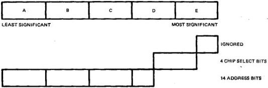
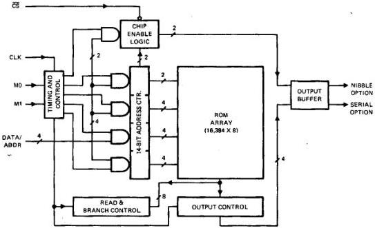
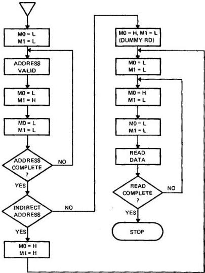
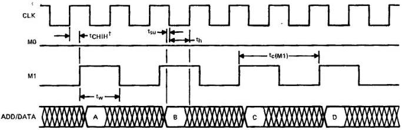
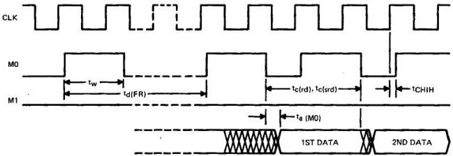
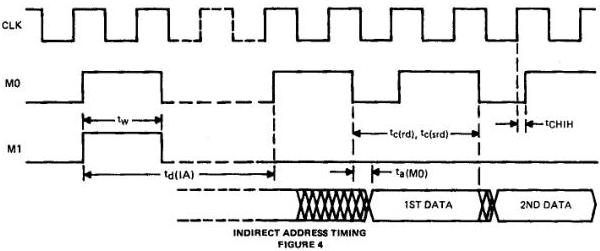
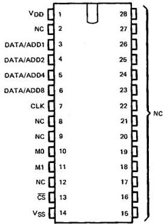
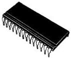
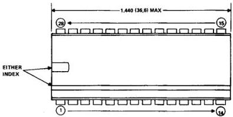
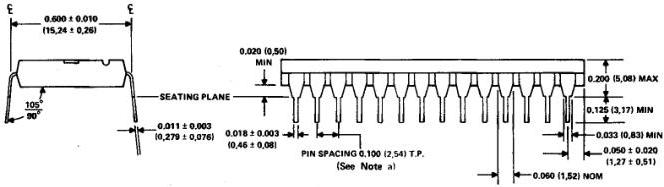

# TMS 6100 VOICE SYNTHESIS MEMORY DATA MANUAL

Used in TI speech synthesizer.

TENTATIVE DATA - JUNE 1980

## 1. INTRODUCTION

The TMS 6100 is a PMOS 128K ROM internally organized as 16K x 8. Externally it appears as either a one-bit (serial) or four-bit (parallel) output. Once the 14-bit address (of any eight-bit byte) is written into the device, data is read out one bit or one nibble (half byte) at a time by toggling a control pin. After eight bits or two nibbles have been read, the address is internally incremented. This allows quick download of the ROM starting at one address (at fclk = 200 kHz, the ROM can be read completely in 1.3 seconds). The output (one-bit or four-bit) is a mask programmable option as is an internal chip select allowing parallel connection of up to 16 ROMS (256K bytes).

## 2. THEORY OF OPERATION

Figure 1 shows the block diagram of the TMS 6100. M1 and M0 are control signals (formerly called I0 and I1) and determine the mode of operation of the device. The clock input to the device should be a maximum of 200 kHz.

For proper operation of the TMS 6100, it must be initialized after power is applied. This is accomplished by performing a dummy "load address" and then a dummy "data transfer". The dummy load address is done by pulsing M1 once in accordance with the device's timing constraints. The dummy data (read) transfer is done by pulsing M0 once and then waiting 80 microseconds.

In this state the device is ready to accept its first address. The address is loaded as shown in the timing diagram. Five nibbles (one nibble is four bits) must be loaded into the TMS 6100 constituting one address. Each nibble is first set up on the data pins and then clocked with one pulse of M1. This address can be broken down as follows.

*TMS 6100 20-bit address format, nibbles A (least significant) to E (most significant)*

The least significant nibble (LSN), A, is loaded into the ROM first and the most significant nibble (MSN), E, is loaded last. The nibbles A thru C and half of D as shown in the diagram make up fourteen bits of address used internally to address the memory array. These bits define one of 16,384 possible internal addresses. At each address there are eight bits of data. This data is read from the addressed location in either two or eight read cycles. If the one-bit output is selected, each M0 pulse puts a new bit on ADD8; eight pulses per byte. If the four-bit output is selected, each M0 pulse puts four new bits on ADD8 through ADD1, two pulses per byte. The data is read out from LSB to MSB or from LSN to MSN. After a byte has been read, the internal address counter is incremented. (Note that only the least significant bit or nibble can be directly addressed. The rest of the byte must be accessed through pulsing of the M0 pin; however, after one address is loaded data can be dumped sequentially by continued pulsing of M0.)

When the TMS 6100 is used singly, an indirect address technique is available. After a load address sequence is completed both M0 and M1 are pulsed simultaneously. This causes the contents of the addressed byte and the following byte to be loaded into the internal address counter and an access initiated. After a 320-ns wait, a "data transfer" pulse or series of pulses will cause the output of data stored in the indirectly addressed byte. No dummy data transfer is needed.

It should be noted that all wait times specified are proportional to ROM clock period, e.g., a 20 ns wait at 200 kHz is a 100 ns wait at 180 kHz.

The TMS 6100 has an internal chip select as well as an external select. The four address bits constituting the most significant half of D and the least significant half of E in the diagram make up the internal chip select. They can be thought of as an extension of the address resistor. When an address is loaded that is lower than the one that enables the device, the part does not respond to any request for data in the form of reading from the device, but if sufficient reads are performed to increment the address to that value enabling the device, it will respond. Similarly, if an address is loaded that enables the device and sufficient reads are performed incrementing the address beyond that which enables the device, the device will disable itself and not respond to any further reads. It is in this way that the internal chip select acts as a bank decoder, allowing 16 devices (one from each bank) to be bussed together.

The internal chip select can be programmed as one of 16 values. The value for this code appears in the gate placement deck as "BANK". The value specified here is a hexadecimal number between 0 and F. This corresponds to a decimal number between 0 and 15.

The external chip select is active low and may be bused to 16 devices (one from each bank). This is also programmable and can be programmed as a select or programmed open. In the open mode the device is always enabled if the internal chip select is valid regardless of the state of the external select.

An additional feature is the exclusive-OR option. When programmed in the gate placement deck (EXOR = 1), the MSB of the internal chip select is EXOR'ed with the CS pin. The result is AND'ed with the internal and external chip selects to select the chip. This allows connection of up to 16 devices without extra select circuitry.

EXCLUSIVE-OR OPTION TRUTH TABLE

|  CS | MSB OF INTERNAL SELECT | ACTUAL * CHIP SELECT  |
| --- | --- | --- |
|  L | 0 | 1  |
|  L | 1 | 0  |
|  H | 0 | 0  |
|  H | 1 | 1  |

Actual Chip Select = CS + Internal Chip Select

*Assuming correct lower 3 internal chip select bits.

*Figure 1 – TMS 6100 Block Diagram.*

*Figure 2 – Operation Flow. H = high, L = low.*

## 3. TMS 6100 ELECTRICAL SPECIFICATIONS

### 3.1 ABSOLUTE MAXIMUM RATINGS\* (OVER FREE-AIR TEMPERATURE RANGE)

|  Voltage applied to any device pin (see Note 1) | -15 V to +0.3 V  |
| --- | --- |
|  Supply voltage range, VDD | -15 V to +0.3 V  |
|  Continuous power dissipation | 300 mW  |
|  Operating free-air temperature range | 0°C to 70°C  |
|  Storage temperature range | -30°C to 125°C  |

* Stresses beyond those listed under "Absolute Maximum Ratings" may cause permanent damage to the device. This is a stress rating only and functional operation of the device at these or any other conditions beyond those listed under the "Recommended Operating Conditions" section of this specification is not implied. Exposure to absolute-maximum-rated conditions for extended periods may affect device reliability.

### 3.2 RECOMMENDED OPERATING CONDITIONS

|  PARAMETER |   | MIN | NOM | MAX | UNIT  |
| --- | --- | --- | --- | --- | --- |
|   |   | (See Note 2) |   |   |   |
|  VDD | Drain supply voltage | -8.3 | -9 | 9.7 | V  |
|  VSS | Substrate supply voltage | 0 |   |   | V  |
|  VIH | High-level input voltage | -1 |  | VSS | V  |
|  VIL | Low-level input voltage | VDD |  | -4 | V  |
|  TA | Operating free-air temperature | 0 |  | 70 | °C  |

NOTES: 1. Voltage values are with respect to VSS

2. The algebraic convention where the more negative (less positive) limit is designated as minimum is used in this data sheet for logic voltage levels only.

### 3.3 ELECTRICAL CHARACTERISTICS OVER RECOMMENDED OPERATING FREE-AIR TEMPERATURE RANGE AND AT -9 V VDD OPERATING VOLTAGE

|  PARAMETER |   | TEST CONDITIONS |   | MIN MAX (See Note 2) | UNIT  |
| --- | --- | --- | --- | --- | --- |
|  VOH | High-level output voltage | IOH = -100 μA | VDD = -9 V | -0.6 | V  |
|  VOL | Low-level output voltage | IOL = 100 μA |  | -4.2 | V  |
|  IIH | High-level input current | VIH = -0.6 V |  | 10 | μA  |
|  IIL | Low-level input current | VIL = -4.2 V |  | -10 | μA  |
|  IO | Output current | VI = VSS to VDD |  | ±10 | μA  |
|  IDD | Drain supply current |  |  | 10 | mA  |

### 3.4 TIMING REQUIREMENTS

|  PARAMETER |   | MIN | NOM | MAX | UNIT  |
| --- | --- | --- | --- | --- | --- |
|  fclk | Clock frequency | 100 | 160 | 200 | kHz  |
|  tCHIH | Delay time, clock high to control (I0 or I1) high | 0 |  | 1 | μs  |
|  tc(M1) | M1 cycle time | 10† |  |  | μs  |
|  tw | M0, M1 pulse width | 5† |  |  | μs  |
|  tsu | Address setup time | 2.5† |  |  | μs  |
|  th | Address hold time | 5 |  |  | μs  |
|  td(FR) | First read delay | 80† |  |  | μs  |
|  td(IA) | Indirect address delay | 320† |  |  | μs  |
|  tc(rd) | Parallel-data read cycle time | 40† |  |  | μs  |
|  tc(srd) | Serial-data read cycle time | 10† |  |  | μs  |

† These requirements are for fclk = 200 kHz. Times are inversely proportional to fclk.

*Figure 3 – Load Address Timing (top) and Read Data Timing (bottom). Five nibbles of data, A–E, are loaded comprising a 20-bit address. †M0 and M1 pulses should be synchronized with the rising edge of the clock.*

*Figure 4 – Indirect Address Timing.*

### 3.5 SWITCHING CHARACTERISTICS OVER RECOMMENDED OPERATING FREE-AIR TEMPERATURE RANGE, VDD = -9 V

|  PARAMETER |   | MIN | MAX | UNIT  |
| --- | --- | --- | --- | --- |
|  ta(M0) | Access time from control M0 |  | 2 | μs  |

## 4. TERMINAL ASSIGNMENTS

NC = no internal connection

## 5. MECHANICAL DATA

TMS 6100 - 28-PIN 600-MIL PLASTIC PACKAGE (100-MIL PIN SPACING)

NOTES: a. Each pin centerline is located within 0.010 inch (0.26 millimeter) of its true longitudinal position.

b. All linear dimensions are shown in inches (and parenthetically in millimeters). Inch dimensions govern.
