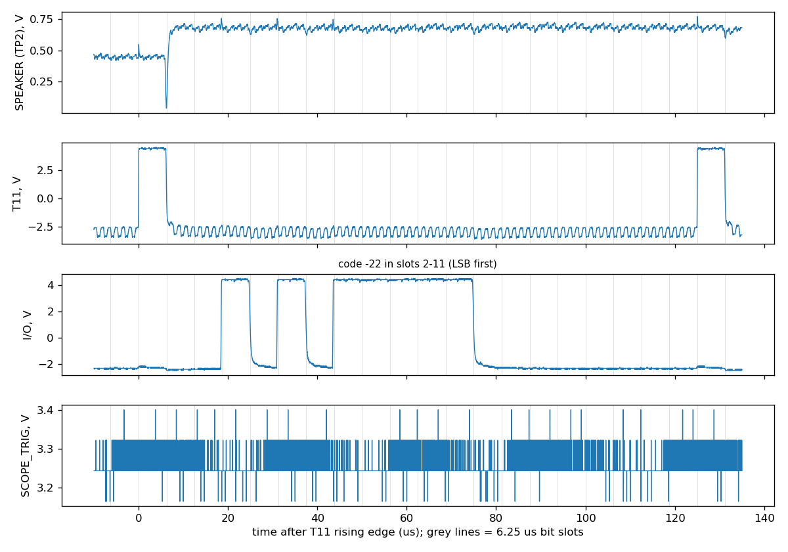
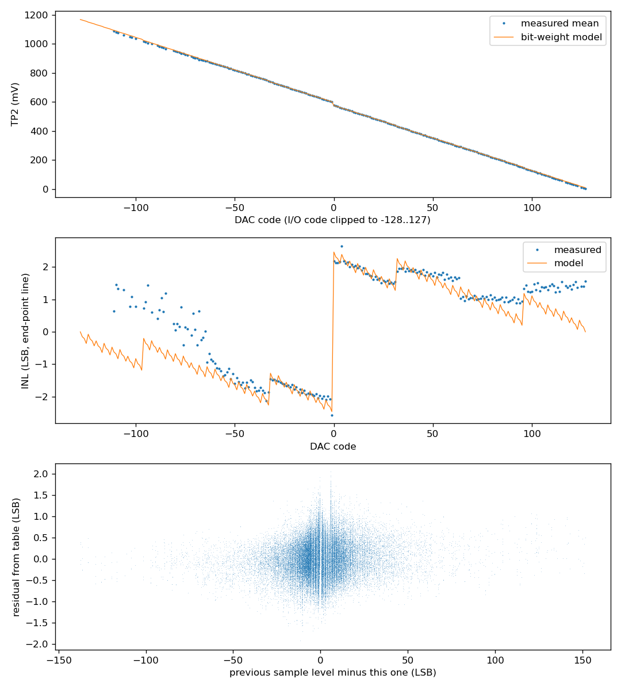

# DAC and audio output

## 8.2 D/A conversion

Measured on one chip into a resistive load to 0 V (996 Ω and 482 Ω), DC-coupled, with nothing else on the pin.

**DAC update timing (New).** The DAC changes to each new sample at the start of **slot 1**, one slot after `T11` rises. Measured from the ROMCLK rising edge that starts slot 1, into 996 Ω, the step reaches 10 % after 0.66 µs, 50 % after 0.85 µs and 90 % after 1.29 µs [p2-03]. This is the average of 180 steps of at least 20 codes, in both directions. The same word measured with the test board's audio stage also loading the pin gave the same times to within 30 ns [p1-03], so they are set by the chip.

**The two directions differ.** A step to more current (a lower code) is slow: it reaches 50 % after 0.90–1.04 µs and 90 % after 1.25–1.36 µs. A step to less current (a higher code) is fast: 50 % after 0.26–0.28 µs and 90 % after 0.31–0.32 µs. Its 10 % point is lost in the coupling spikes of the slot edge [p1-01, p1-03, p2-03]. So an average over a word depends on its mix of directions. Another word, in which 52 of 101 steps went to less current (against 81 of 180), averaged 10 % at 0.34 µs, 50 % at 0.62 µs and 90 % at 1.16 µs [p1-01]. Within each direction the words agree to within 0.14 µs.

The output is within 3 % of its final value 2.3 µs after slot 1 starts [p2-01]. It then holds that value for the rest of the sample period, apart from coupling spikes of about 1 % at the `I/O` edges in slots 2–11 ([Figure 8-1](serial-output.md#84-serial-sample-output-t11-and-io)).

*Figure: one sample period into 996 Ω with the audio stage disconnected [p2-03]. The code is −22. The DAC step on SPEAKER comes at the start of slot 1, as `T11` falls. Grey lines mark the slots.*

*Figure: one sample period of p1-01, the word whose averaged DAC step comes about 0.3 µs earlier, with the audio stage loading the pin. The code is 111.*

**The DAC and `I/O` show the same sample.** The value the DAC outputs from slot 1 of a sample period is the code sent on `I/O` in slots 2–11 of the **same** period [p1-01, p1-02].

**Input to the DAC.** The original's Table 4 describes the DAC input as bits YL13–YL4 of the lattice output: the sign and seven low-order bits drive the DAC, and the two remaining high bits clip it to full on or full off. The `I/O` code ([§8.4](serial-output.md#84-serial-sample-output-t11-and-io)) carries all ten bits *before* that clipping. Codes up to +134, outside the DAC's −128 to +127 range, have been observed on `I/O` [p1-01], and in louder speech the whole 10-bit range, −512 to +511 [p6-05 to p6-08].

**Clipping.** The DAC takes the code clipped to −128…+127. Codes +131 to +134 gave the same output as +127, to within 0.3 mV [p2-01, p2-02, p2-04, p2-05]. In TI-99 speech, which drives the DAC to both rails, codes from +128 to +511 gave the same output as +127 to within 0.5 mV, and codes from −129 to −512 the same as −128 to within 2 mV [p6-01 to p6-08].

**Direction and zero.** A more positive code gives less current, as in the original's Table 4. Code +127 gives no current: across either load the pin sits at 0 V, to within ±2 mV [p2-01 to p2-06].

**Transfer function (Correction).** This chip delivers about 20 % less current than the original's Table 4. Its step is not uniform, and it jumps by about six steps between codes −1 and 0. Table 8-1 gives the main figures. `investigation/captures/phase2/dac_transfer*/dac_table.csv` gave the mean current for each code seen, at each load.

*Table 8-1. DAC output current. Means of 83,190 sample periods per load. Each step is the median of single-code steps that do not cross a multiple of 16.*

| Quantity | Original (Table 4) | Measured, 996 Ω load | Measured, 482 Ω load |
|---|---|---|---|
| One step (1 LSB) | 5.86 µA | 4.49 µA | 4.80 µA |
| Code +127 | 0 µA | 0 ± 2 µA | 0 ± 3 µA |
| Code 0 | 744 µA | 578 µA | 604 µA |
| Code −1 (idle) | 750 µA | 604 µA | 631 µA |
| Code −128 (full scale) | 1500 µA | about 1160 µA (1.92 × idle, measured [p6-01 to p6-08]) | about 1230 µA (extrapolated) |

[p2-01, p2-02 at 996 Ω; p2-04, p2-05 at 482 Ω; scope zero from p2-06.] The currents are the TP2 voltage divided by the load resistance, measured with a meter. Their absolute accuracy depends on the scope's DC gain (a few per cent). The scope's own zero offset (−8.7 mV) was measured with the probe grounded [p2-06] and has been subtracted. The ratios between codes do not depend on any of this.

**Bit weights (New).** The DAC behaves as eight binary-weighted current sources, one per input bit, with input byte = code + 128 (code 0 = 0x80, code −1 = 0x7F). Fitting one weight per bit to every sample gives:

*Table 8-2. Bit weights, in LSB as defined in Table 8-1.*

| Input bit | 0 | 1 | 2 | 3 | 4 | 5 | 6 | 7 (sign) |
|---|---|---|---|---|---|---|---|---|
| Ideal | 1 | 2 | 4 | 8 | 16 | 32 | 64 | 128 |
| 996 Ω | 0.86 | 1.82 | 3.99 | 7.85 | 15.79 | 32.33 | 63.97 | 132.64 |
| 482 Ω | 0.87 | 1.82 | 3.94 | 7.78 | 15.74 | 32.09 | 62.89 | 130.96 |

The two loads agree to within 2 %, so the mismatch belongs to the DAC. It shows as steps of the wrong size wherever a carry crosses into a higher bit:

*Table 8-3. Measured step at the major carries, in LSB (ideal 1).*

| Codes | Input byte | 996 Ω | 482 Ω |
|---|---|---|---|
| −1 → 0 | 0x7F → 0x80 (bit 7) | **5.85** | **5.62** |
| −65 → −64, 63 → 64 | bit 6 | 0.03, 0.36 | 0.16, 0.32 |
| −33 → −32, 31 → 32 | bit 5 | 1.42, 1.35 | 1.38, 1.32 |
| −17 → −16, 15 → 16 | bit 4 | 0.91, 0.83 | 0.96, 0.86 |

The step between −1 and 0 is **about six times a normal step**: 26–27 µA, or 26 mV across 996 Ω [p2-01, p2-02, p2-04, p2-05]. The original's Table 4 implies a single 5.86 µA step. Its figures (5.86 µA a step, 744 µA at code 0, 750 µA at −1, 1500 µA full scale) are the design values in Table V of [US 4,335,277](../sources/patent-us4335277/index.md), not measurements.

**How the DAC is built.** US 4,335,277 describes the DAC as eight binary-weighted MOS current sources. Each source's gate is switched between `VSS` (off) and a bias voltage that holds the transistor in saturation (on), and the input is the offset-binary byte used here. That design accounts for what is measured:

- each chip has its own mismatch between the bit weights;
- the output resistance is finite ([§8.3](#83-audio-output));
- the shortfall at large currents grows with the pin voltage, as the sources leave saturation;
- the absolute scale depends on the on-chip bias, which may be why it moved by 7 % between sessions.

The patent also has the output current switched off whenever the chip is not talking. This chip does not do that: it idles at code −1 ([§8.4](serial-output.md#84-serial-sample-output-t11-and-io)), about 0.6 mA. Every zero crossing of the waveform passes through this step, so the analogue output has a small crossover distortion that a linear DAC model does not reproduce.

**Large currents.** For codes below about −55, the current falls progressively short of the bit-weight model fitted to codes −50 and above. The shortfall is 2.4 LSB at code −110 into 996 Ω (pin at 1.08 V), and 1.5 LSB into 482 Ω (pin at 0.55 V). Part of it is in the DAC, and part depends on the pin voltage ([§8.3](#83-audio-output)). At the rails the model fails outright: fitted to codes inside ±119 of TI-99 speech with a gain and an offset, it puts code −128 about 10 mV (2 LSB) too high and code +127 about 6 mV (1.3 LSB) too high, in every take [p6-01 to p6-08]. The 996 Ω transfer [p2-01, p2-02] also puts +127 1.6 LSB from the model. Full scale is 1.92 times the idle current (code −1), against 1.94 in the model. In the loudest data of the address sweep, the model also fails inside ±119. It sits 3–6 mV above the measurement for codes 64–119 in size, and the fit leaves more than 3 mV rms. That is just over the limit of the capture checks, in 10 of 16,144 sweep starts. Two of them failed again on every retake [p7-11, corpus `acorn_phrom_a`]. The codes recovered from the voltage were still within ±2 for 99.7 % of samples or more.

**No memory between samples (New).** Each sample's output depends only on its own code. Regressing the residual from the per-code table on the levels of the four previous samples gives coefficients of 0.2 % or less, and removes less than 0.02 mV of residual [p2-01, p2-02, p2-04, p2-05]. Within one capture, the noise on a sample's mean is 0.5–0.8 mV while the chip is idle. During speech, samples of the same code scatter more (1–2 mV). That extra scatter does not depend on the code or on earlier codes, so it is probably interference on the test board while the VSM is being read, not DAC behaviour ([Appendix B](gaps.md#noise-during-speech)). Between captures a few minutes apart, the whole table moved by up to 0.35 %. Some hours later, after the chip had been power-cycled, the whole scale was 7 % higher (code −1 at 0.635 V against 0.592 V), with the supplies within 6 mV of nominal [p4-01 to p4-04]. The shape of the table still fitted to 2.2–2.3 mV rms. The step then stayed put: over the next three hours, through another power cycle, the fitted scale was 1.068–1.079 times the table [p5-01 to p5-08]. A meter on TP2 read 0.642 V for the idle level, against the scope's 0.631 V, so the step is real, in the chip or the load, not in the scope. So the absolute current figures in this section can vary by at least 7 %; the cause is not known ([Appendix B](gaps.md#the-dacs-absolute-scale)).

*Figure 8-2. DAC transfer into 996 Ω [p2-01, p2-02]. Top: mean TP2 voltage for each code, with the bit-weight model. Middle: deviation from a straight line through the model's end points, in LSB. The jump at code 0 is the bit-7 mismatch. The steps at ±32 and ±64 come from bits 5 and 6. Bottom: each sample's residual from the per-code table, plotted against the change from the previous sample, shows no dependence.*

*Figure: the same analysis into 482 Ω [p2-04, p2-05]. The INL shows the same jump at code 0 and the same steps at ±32 and ±64.*

**For emulator writers.** The `I/O` code ([§8.4](serial-output.md#84-serial-sample-output-t11-and-io)) is the exact output. To model the analogue output, take the code, clip it to −128…+127 and add 128, then sum the Table 8-2 weights for the bits that are **clear**. This is approximate: the fit also leaves a few µA of offset and the shortfall at large currents. More current means more bits clear: byte 0xFF gives no current and byte 0x00 gives full scale. Alternatively, use the per-code table. Expect another chip to have different bit weights.

## 8.3 Audio output

Measured on one chip [p2-01 to p2-06].

**`SPEAKER` is a current output into a load returned to 0 V.** The pin pushes current into the load, so the load voltage is positive: 0 V at code +127 and about 0.6 V at idle (code −1) into 996 Ω. As the original says, the output must be AC-coupled to any amplifier, because the idle current puts a DC level on the load.

**The output is not an ideal current source (New).** Halving the load from 996 Ω to 482 Ω raises the current by 3–5 % (Figure 8-3). A current source with a finite output resistance would raise every code by the same fraction. The measured ratio is 1.049 at large currents and falls to 1.032 near code +60. Read as a Norton source, that is an output resistance of 10–16 kΩ in parallel with the pin, so the figure is approximate. Codes near zero current are not included: at those currents, the ±2 mV of offset left on the test board dominates the ratio.

*Figure 8-3. Current per code at two loads [p2-01, p2-02, p2-04, p2-05; zero from p2-06]. Top: current. Bottom: the ratio of the two currents. Codes seen fewer than 20 times are grey. The line is the mean over codes above a quarter of full scale.*

**Consequences.**

- **Quoting a current means quoting the load.** At 996 Ω, full scale extrapolates to about 1.17 mA. At 482 Ω it extrapolates to about 1.23 mA. A virtual-ground (transimpedance) measurement would give the current at 0 V, which has not been made ([Appendix B](gaps.md#the-dacs-absolute-scale)).
- **A lower-value load gives a more linear voltage.** The extra shortfall at large currents ([§8.2](#82-da-conversion)) grows with the pin voltage.
- **The original's 1.8 kΩ application.** The original says that 1.8 kΩ in series gives 2.7 V at 1.5 mA. That has not been tested here ([Appendix B](gaps.md#the-originals-18-k-application)). Given the output resistance above, expect noticeably less current into that load.
- **AC coupling on the pin changes what the pin delivers.** The test board's own coupling network (C1 and 4.7 kΩ to ground, after a 1 kΩ load) made the voltage on the pin depend on earlier samples. That network was disconnected for these measurements.
