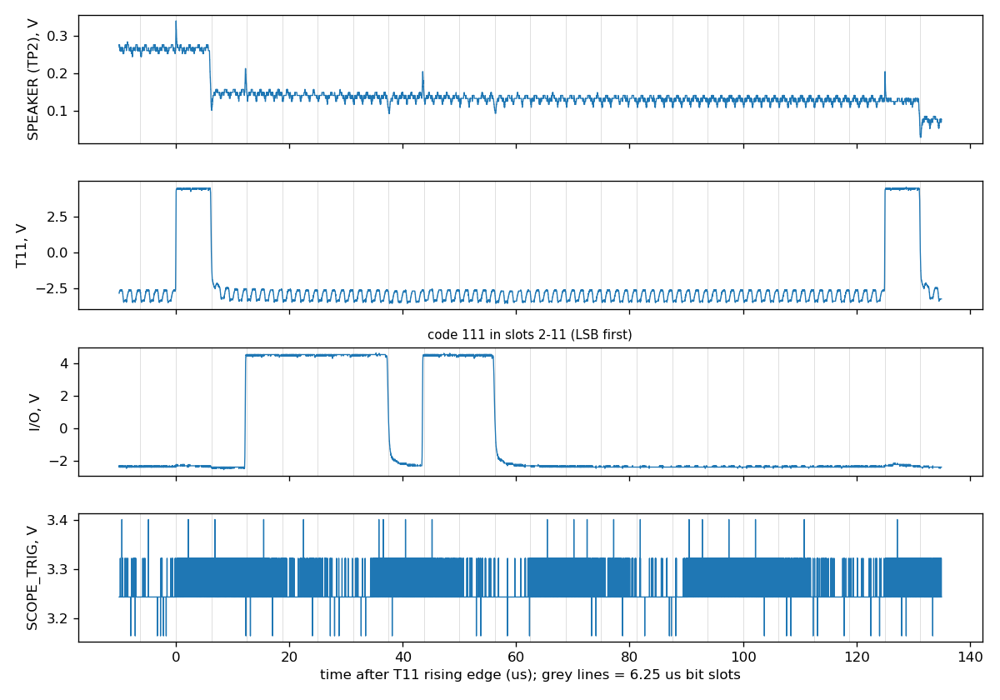
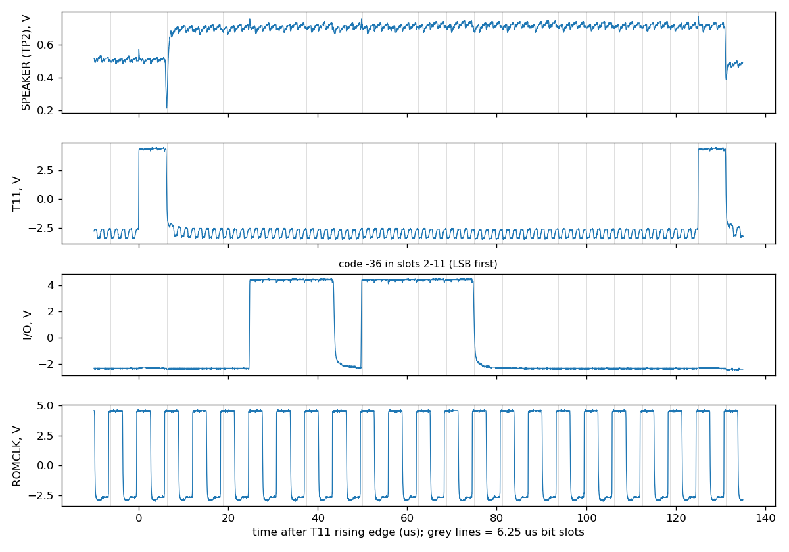

# Output signals and clock timing

Captures p1-01 to p1-03, made on 2026-10-06. They identify the `T11` and `I/O` serial output, time every edge against ROMCLK, and give the first DAC step timing. The datasheet uses them in [§2](../clock.md#2-system-clock), [§8.2](../dac-and-audio.md#82-da-conversion), [§8.4](../serial-output.md#84-serial-sample-output-t11-and-io) and [§9.5](../electrical.md#95-measured-output-signals).

## Set-up

Board: `investigation/kicad/tms5220_usb` with the Pico-driven 640 kHz `OSC` ([bench hardware](../../capture/bench-hardware.md)). C1 is fitted, so TP2 is loaded by the audio stage. Firmware: the demo loop at `6ffd2bc` (ACORN, B, B, C, COMPUTER from the Acorn PHROM, repeated). Probes: A ×1 on TP2, B ×10 on TP3 (`T11`), C ×10 on TP4 (`I/O`), D ×10 as listed.

## Captures

| ID | Probe D | Trigger | Interval | Length | What it shows | SHA-256 of `scope_raw.npz` |
|---|---|---|---|---|---|---|
| `p1-01_speech_8ns` | TP5 `SCOPE_TRIG` | `SCOPE_TRIG` rising | 8 ns | 122 ms | `I/O` and DAC edge timing relative to `T11`; codes up to +134 | `08cc906a6ab03cb639d2f3efec08c30390916c9e32f901d0911e040418a5828a` |
| `p1-02_phrase_496ns` | TP5 `SCOPE_TRIG` | `SCOPE_TRIG` rising | 496 ns | 5.2 s | Eight whole words and a 1 s idle gap (8016 samples of −1); no `I/O` activity outside slots 2–11 in 41,599 sample periods | `0ccbbc6ac06b6a9b625e00843de8ba6e0b3528bcedf2011b9fe5589c06514573` |
| `p1-03_romclk_8ns` | TP1 `ROMCLK` | `T11` rising | 8 ns | 100 ms | ROMCLK frequency and duty; every `T11` and `I/O` edge relative to ROMCLK | `bd57607ab93b45a17d8ffcb20e59099dba83a04f15c4d5b43eb7cc419db7cf5d` |



*Figure: one sample period of p1-01, from `investigation/tools/edge_timing.py`. The code is 111, sent LSB first in slots 2–11. Grey lines mark the 6.25 µs slots from the `T11` rising edge.*



*Figure: one sample period of p1-03, with probe D on ROMCLK. The code is −36. Every `T11` and `I/O` edge follows a ROMCLK rising edge. This is Figure 8-1 of the datasheet.*

## Derived files

In each capture directory:

- `edge_timing.json`, `edge_timing.png`: the output of `investigation/tools/edge_timing.py` (p1-01, p1-03).
- `word<N>_samples.wav`, `word<N>_samples.csv`: the output of `investigation/tools/decode.py` (p1-01, p1-02). p1-03 has no word files, because its probe D is on ROMCLK rather than `SCOPE_TRIG`.

To regenerate them:

```
python investigation/tools/decode.py investigation/captures/phase1/<ID>
python investigation/tools/edge_timing.py investigation/captures/phase1/<ID> --plot
```
