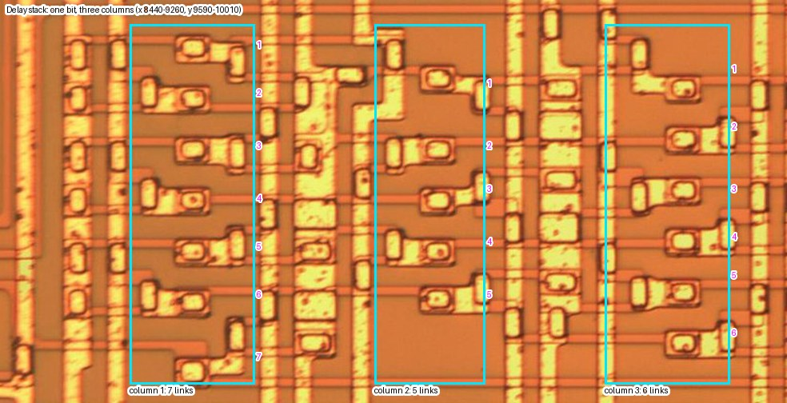
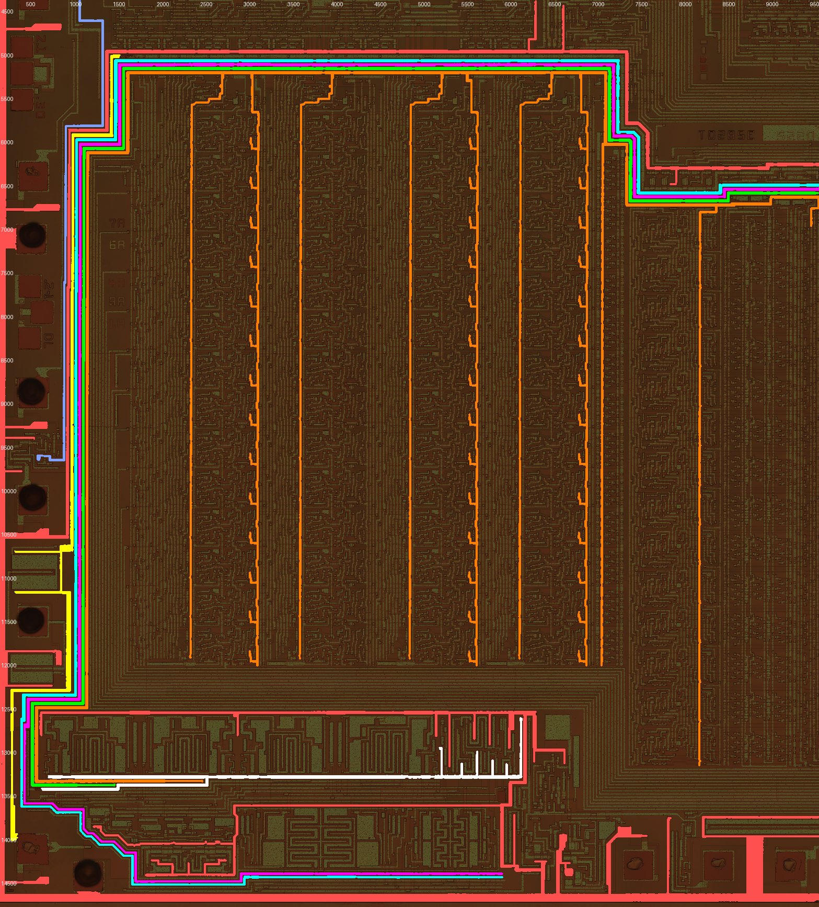

# Floorplan and bit slices

The pin map, the blocks, the bit rows of the datapath, the delay stack and the clock lines. In short:

- **Pin map:** derived from the pads' drivers. The eight identical output drivers fall exactly on D0–D7 with P6 = pin 1. `VDD` = P9, `VSS` = P10, `OSC` = P11, `SPEAKER` = P13, `VREF` = P16 (the bus drivers' return), `TEST` = P25. Only P26's capacitor plate is unexplained.
- **Blocks:** E is the K-stack, feeding A's coefficient inputs. MR0–MR13 enter A at group 1, so that group is stage 0. G is the clock drivers, and H the D0–D7 drivers. The `SPEAKER` output transistor is found (beside P13); **the DAC's weighting, which must drive its gate, is not found**.
- **Bit rows:** A and B both have **14 bit rows**, with **row 14 the LSB** (confirmed on the [reference cell](reference-cell.md#checks-against-the-patents-cell)).
- **Delay stack:** **18 clocked inverters per bit**, 9 two-inverter stages as in the patent, clocked by four buffers above B.
- **Clock lines:** four wide lines circle A, each driven by one of G's four drivers: copy 1 → 1153, copy 2 → 1196, copies 3 and 4 through a second stage → 1068 and 1110. 1196 reaches every cell of A. Phases inferred: 1196 = φ3 (good), 1153 = φ4, 1068/1110 = φ1/φ2 (order unknown). `VDD` is P9, feeding the drivers' common rail.

All positions are full-resolution pixels ([preparation](preparation.md#tools-and-coordinates)). Records are in [`cells.json`](data/cells.json): pads carry `pin`, `pin_name` and `pin_status`, and there are records for the rows (`A_row01`…, `B_row01`…), the header (`A_header`), the column groups (`A_col1`…), the delay stack (`delay_stack`, `ds_clock_buffers`), the `SPEAKER` transistor (`speaker_out`) and the features `osc_cap`, `osc_circuit` and `dac_candidate`.

## Pin map

### The substrate ring

**P5 and P10 are tied to the substrate ring.** A wide metal ring runs inside the die edge. It is a C shape, open at the top right between x ≈ 11,920 on the top edge and y ≈ 8,990 on the right edge. Every pad's input-protection structure returns to this ring through a diffusion region (for example P2, P4 and P9). Its 26 µm metal shows thin dark lines, which at 4× zoom are oxide steps under continuous metal, not gaps.

Two pads, **P5 and P10**, join the ring through a full-width strap, with no device in between. Both still carry a gold ball. The ring touches the substrate diffusion, so it is `VSS` (+5 V).

### The assignment from the pads' drivers

The pin map is derived from what each pad is connected to. The data bus decides it:

- **Eight identical output drivers sit on exactly eight pads.** Five are the large cells in H (x 16,880–17,710, y 5,950–9,950), and about three more sit beside P17–P19. Each is one large transistor, whose plate gate is driven by the cell's own small logic. Their frames run to pads P24, P27, P29, P2 and (probably) P6, and to P17, P18 and P19. Their shared rail (x 16,694–17,484, y 5,947–14,215) merges into P16's pad metal.
- **The datasheet's D0–D7 are pins 14, 13, 12, 19, 22, 24, 26 and 1.** Counting counterclockwise with P6 = pin 1, those pins fall on P19, P18, P17, P24, P27, P29, P2 and P6: **all eight driver pads, and no others.**

| Pin | Pad | | Pin | Pad | | Pin | Pad |
|---|---|---|---|---|---|---|---|
| 1 D7 | P6 | | 11 `VREF` | P16 | | 21 ADD8 | P26 |
| 2 ADD1 | P7 | | 12 D2 | P17 | | 22 D4 | P27 |
| 3 ROMCLK | P8 | | 13 D1 | P18 | | 23 ADD4 | P28 |
| 4 `VDD` | P9 | | 14 D0 | P19 | | 24 D5 | P29 |
| 5 `VSS` | P10 | | 15 M0 | P20 | | 25 ADD2 | P1 |
| 6 `OSC` | P11 | | 16 M1 | P21 | | 26 D6 | P2 |
| 7 `T11` | P12 | | 17 `INT` | P22 | | 27 `WS` | P3 |
| 8 `SPEAKER` | P13 | | 18 `READY` | P23 | | 28 `RS` | P4 |
| 9 `I/O` | P14 | | 19 D3 | P24 | | — | P5: ring pad, a second `VSS` bond |
| 10 `PROM OUT` | P15 | | 20 `TEST` | P25 | | | |

**For it, besides the data bus:**

- **`VREF` (pin 11, "ground reference, 0 V") is P16, the return rail of the eight bus drivers.** Outputs that swing between `VSS` (+5 V) and `VREF` (0 V) give TTL levels, which is what that pin is for.
- **`SPEAKER` (P13)** is the drain of the die's one large analogue transistor, a P-channel current source from `VSS` ([blocks](#blocks)).
- **`VDD` (P9).** A net that is neither the `VSS` ring nor driven by G runs round the die (net S, [clock lines](#clock-lines)): down the left edge, along the top of A, across the top, and along the bottom right. Its end at the left edge reaches P9's top-left corner, and the same net joins the common source rail of G's clock drivers. P9's own strap to the right is narrow.
- **`TEST` (P25)** connects only through a narrow diffusion strap, 15–20 px wide and about 1,900 px long: an input-protection resistor, as an input should have. It could not carry `I_DD` (10–35 mA), so P25 is not `VDD`. The bench confirms that pin 20 is an input with an on-chip load to `VDD` (it floats at −4.32 V); its function is in [datasheet §11.2](../datasheet/pins.md), and the trace beyond the strap is [below](#test-p25-beyond-the-strap).
- **`WS` and `RS` (P3, P4)** are plain straps with no driver, as pure inputs should be. **M0 and M1 (P20, P21)** share a mirrored circuit with four moderate transistors, as a pair of outputs should.
- **`OSC` (P11)** leads into a small logic block (x 6,200–6,900, y 13,800–14,400) beside G's lower-right clock generator.
- **`VSS` (P10)** is on the substrate ring. P5, the other ring pad, is a second `VSS` bond (for example a down-bond to the paddle).

Two anchors that look natural fail against the drivers: `OSC` at P26, beside the capacitor plate, and `WS`/`RS` on the mirrored pair P20/P21. Counting from them puts D0–D7 on pads without drivers, P25 at `VDD`, P28 at `SPEAKER` and P2 at `VREF`, none of which holds.

**Against it:**

- **The plate and serpentine at P26** (`osc_cap`, `osc_circuit`) are unexplained. P26 is ADD8/DATA, an I/O pin. The plate has no metal connection. It may be a power-on-reset or bias capacitor rather than the oscillator's.
- **No output drivers have been seen at P28 and P1** (ADD4, ADD2), which are outputs.

### Other traces at the pads

- **P2's line** runs, unbranched and about 13 px wide, from P2 to the second H cell (x 17,220–17,710, y 6,737–7,425). That cell is a bus driver, so P2 is D6, not `VREF`. The line goes along y ≈ 965–980, up at x 11,550, along the top at y ≈ 390–403 and down the right edge. It has a break at (11,545–11,558, 398–428) in this image, continuous in the TMS5200NL image, so a defect.
- **`dac_candidate`** (x 1,930–2,400, y 270–900) is a small circuit of about 10 devices on **P29's** line, not P2's. The two lines run 40 px apart; checked at full resolution, its contact at (1,905–1,930, 880–905) is on P29's line along y ≈ 920–935. It is not the DAC.
- **P28** has no output stage. Its left strap lands on a thin gate at x ≈ 2,290–2,315. Its right strap leads through a short diffusion link to a line that runs into a large diffusion block (x 2,850–3,240, y 850–1,100), which P27 joins in the same way.
- **P25's** tab lands on diffusion (x ≈ 10,350–10,640, y 255–390), and only narrow straps leave it: down x ≈ 10,470, across y ≈ 600, down x ≈ 10,600, back along y ≈ 850, down x ≈ 10,050, to a contact at (10,035, 1,680).
- **The die has no wide internal rail.** A scan for metal at least 36 px wide and over 1,500 px long finds only the edge ring, `osc_cap` and a few pad straps.

An X-ray, or an opened dead chip (chip 2 or 3), would confirm the bonds directly. `cells.json` carries the map above with `"pin_status": "working"`, and the [floorplan figure](index.md#floorplan) marks each name with "?".

### `TEST` (P25) beyond the strap

From P25 a diffusion strap (the input resistor) passes through a small metal piece with a long window beside the pad (x 10,568–10,723, y 462–797; probably the protection diode's contact), runs on to the contact at (10,035, 1,680), and joins a metal line along y 1,667–1,685 from x 10,055 to 10,637. That line has one stub down to a contact at (10,412, 1,709). Below it the signal continues in diffusion, through a small metal jumper (x 10,369–10,451, y 1,821–1,848), into the logic of F. Past that, the diffusion cannot be followed in either image, so the first gate was not found. No pull device was seen, though the patent and the bench show one.

The function of `TEST` comes from the patent's drawings (Fig. 8g: the pad, its load to `VDD`, and two NANDs with C4 and C5 making TEST1 and TEST2) and a bench trial ([datasheet §11.2](../datasheet/pins.md)). C4 and C5 have no source in the drawings: finding them is what is left for the die, and needs a delayered image.

## Blocks

| Block | From the pads alone | From the traces |
|---|---|---|
| A | Multiplier, 5 groups × 14 rows | **Confirmed in shape:** 5 column groups × 14 bit rows, under a header row ([bit rows](#bit-rows-and-word-length)). Stage 0 is group 1 (inferred, below) |
| B | Adder, delay stack, Y latch | 14 bit rows at the same pitch, **two rows lower than A** ([bit rows](#bit-rows-and-word-length)) |
| E | Chirp ROM or PLA | **The K-stack (patent 302), inferred.** Its lower array (x ≈ 1,300–4,000, y ≈ 2,850–4,150) is 10 identical columns of 17–18 rows of paired cells, one column per coefficient. Lines leave its bottom at contacts (y ≈ 4,272) and drop into the driver row above A. Not a ROM, not the chirp ROM (block I, [ROMs](roms.md#the-chirp-rom)), not the DAC |
| G | DAC or clock drivers | **The clock drivers** ([clock lines](#clock-lines)): four identical comb pairs on top, each driving one of the four wide clock lines, and two mirrored pairs below. Not a DAC |
| H | Bus or VSM drivers | **The D0–D7 output drivers**: eight identical large transistors on a shared return rail to P16 (`VREF`) |
| — | — | The `SPEAKER` output transistor beside P13; the capacitor plate and serpentine at P26 (`osc_cap`, `osc_circuit`, purpose unknown); `dac_candidate`, a small circuit on P29's line |

The DAC (target T6) has not been found (below).

**The coefficient path: E → recoding → A.** A's coefficients do not come from C or D directly:

- **Seen:** lines leave E's bottom at contacts (y ≈ 4,272; x 1,675, 1,963, 2,250, 2,538, 2,826, 3,241, 3,404, …) and drop into a driver row (y ≈ 4,400–4,960, x ≈ 1,400–6,400), where they end in contacts at y ≈ 4,400–4,475. Eight were traced. The driver row is short local wiring repeated per column group of A, which fits the patent's recoding logic 301 (one recoding stage per multiplier stage).
- **Seen, faintly:** A's header channel lines start at contacts at y ≈ 5,290 (group 2: x 3,355–3,600, 50 px apart) with no metal going up. Diffusion straps run up from them under the bus at y 4,990–5,240 to the driver row.
- **Inferred:** E (K-stack) → recoding logic → crossunders → A's header → the channel lines and through-lines of each group ([clock lines](#clock-lines)). The +1/−1/+2/−2 selects would be among the through-lines.
- **Not followed:** E's own inputs. Two sets of lines at E's top (y 2,130–2,370 and 2,430–2,860) leave right towards F, and the parameter ROM C would feed E through them.

**The multiplier's MR input: B → A.** The 14 lines between A and G come from under B and rise into A's left edge, one per bit row ([clock lines](#clock-lines)). This fits MR0–MR13 from the multiplier multiplexer, and makes column group 1 stage 0. They are traced back to B on the [adder and delay stack](adder-and-delay-stack.md#the-mr-lines) page.

**The output path: B → DAC, not found.** The bus of about 12 lines on B's top (y 6,470–6,870) is **clocks**: it is mostly the wide lines that circle A ([clock lines](#clock-lines)), and at x ≈ 11,600 it turns down, not up into F. The Y latch's outputs (`YL13`–`YL4`) have not been traced. They should be a feature present in B's rows 1–10 and absent in rows 11–14.

**Places ruled out as the DAC's weighted sources, by eye:** G, both rows (clock-type drivers); the bottom pads P11–P16; the top-right logic (x 11,000–17,900, y 100–4,500); D; the area right of B (x 9,800–12,300, y 9,800–13,800); `osc_circuit`; `dac_candidate`; the top-left corner and the left pad column. None has a set of binary-weighted devices.

**H is the data bus's output drivers, not the DAC.** Each of its five large cells (x 16,880–17,710, y 5,950–9,950, pitch about 824) is one large transistor. Its gate is a pair of joined plates, driven by the cell's own small logic. Diffusion fingers at a 39 px pitch lie under the plates. One terminal is a T-shaped finger on a shared rail; the other is the cell's outer frame, which runs to a pad. Cells 2–5 are identical (0.64–0.85 against cell 3), and cell 1 is larger. With about three similar cells beside P17–P19, they make the eight D0–D7 drivers ([pin map](#the-assignment-from-the-pads-drivers)).

**The `SPEAKER` output stage is a large P-channel transistor beside P13.** It is a nested structure at x 8,250–10,100, y 13,765–14,000. Read on a cross-section in both chips (x 9,000):

- **source:** the thin outer C (y 13,765–13,779 and 13,984–13,999, bar at x 8,255–8,290), a narrow contact strip tied to the `VSS` ring by a strap at x 8,775–8,955;
- **gate:** two wide plates (y 13,801–13,849 and 13,911–13,959, x 8,303–10,035), each about 17 µm long, one either side of the drain;
- **drain:** the thin inner line (y 13,874–13,889), a contact strip shared by both halves.

It is one device in two halves, W ≈ 2 × 1,730 px ≈ 1.2 mm and L ≈ 17 µm (W/L ≈ 70). **P13's strap joins the drain.** It runs along y ≈ 14,100–14,130, through a long window (x 9,803–9,967), up a staircase and a column of metal at x ≈ 10,040–10,075, and into the inner line. Two points were read by eye on side-by-side images of both chips: the strap continues through the window rather than ending at it, and the column joins the inner line rather than the lower plate. A large P-channel drain with its source on `VSS` pushes current into the pin, which is what the bench measures: 0.6–1.2 mA into a load to 0 V, with an output resistance of 10–16 kΩ ([datasheet §8.3](../datasheet/dac-and-audio.md)). This also confirms P13 = `SPEAKER`, independently of the pin count.

**The DAC's weighted sources were not found.** The patent's DAC switches eight weighted current sources onto the pin; here the pin has a single uniform output transistor, so the weighting must set its gate voltage instead. Graded widths, a unit array and a ladder were all searched for:

- by eye, in G, D, H, the corners, the pad rows, the logic beside P13 and P14 (x 9,900–13,800, y 13,300–14,700) and the area right of B;
- by a die-wide search for groups of 8 bars whose lengths double.

None was found. The P14 block has bars of about 260, 460, 480 and 590 px: a push-pull output driver, not a 1:2:4 series. **But the bench says the sources exist.** [Datasheet §8.2](../datasheet/dac-and-audio.md) fits the measured output with one weight per input bit: eight binary-weighted sources, each with its own mismatch (Table 8-2). Bit 7's source is about 4.6 LSB too large, which makes the step from code −1 to 0 six times a normal step. Mismatch per bit means separate devices. So the DAC is built as the patent draws it, and it has been missed on the die, not replaced. Locating it needs a delayered image, or a narrower search ([open questions](#open-questions)).

## Bit rows and word length

**Method.** Each row was matched against the next by normalised correlation of the green channel, allowing ±24 px of alignment. This was done with scratch scripts, not a `die.py` command; the method is simple enough to repeat from `die.py crop` output. The vertical autocorrelation of both blocks peaks at **452–453 px**, which is 154 µm. It is the same in A and B.

**Block A.** Matching a row with the row below it gives:

| Rows | Start y | Similarity to the row below |
|---|---|---|
| Header | 5,282 | 0.12–0.32 (different) |
| 1–13 | 5,734 + 452·*k* | 0.84–0.90 in every column group |
| 14 | 11,610 | 0.71–0.73 to row 13 |
| Below row 14 | 12,062 | 0.02–0.08: the bus channel, not a row |

So **A has 14 bit rows** below a header row. Row 14 differs in the same way in all four of the column groups tested. Each column group has a vertical channel of lines between its left and right logic, and these lines step sideways by one track from row to row. In row 14 several of them stop and end in contacts. In the header, new lines enter the channel from the drivers above.

**Columns.** One row was matched against a 1,260 px column group. The groups start at x = **1,480, 2,740, 4,000, 5,260 and 6,520**:

- the three middle groups are identical (0.77–0.87 at full width);
- group 1 matches only partly (0.42), and has a large rectangular structure at its left edge;
- group 5 is cut short at x 7,280, and only its left 700 px match the others (0.58).

That gives **five column groups: three identical stages between two specialised end stages**. This fits the five Booth stages of US 4,335,277. Its stage 0 has no incoming partial sum, and the last stage feeds the summer, so both would differ from the middle three. Which end is stage 0 is inferred under [blocks](#blocks): group 1, where MR0–MR13 enter.

**Block B.** It has 14 bit rows from y = 6,724 (similarities 0.59, then 0.85–0.90, then 0.81 for the last pair). B's row *k* lies **96 px below A's row *k* + 2**: B is two rows lower than A, plus a fifth of a row. How the product steps into B is discussed on the [adder and delay stack](adder-and-delay-stack.md#block-b-row-by-row) page.

*Figure: the bit rows of A (A1–A14) and B (B1–B14), A's column groups (Ac1–Ac5), the delay stack (DS) and the reference cell (ref). Die image: John McMaster, siliconpr0n, CC BY 4.0.*

**Word length.** The datapath is **14 bits wide**, as the 14-bit wrap of [datasheet §8.8](../datasheet/lattice-filter.md) and the patent's D0–D13 have it. No 15th row exists in A or B.

**The LSB end.** The channel lines carry signals down the rows, stepping sideways by one track per row. They end in row 14 and are fed from the header above row 1.

The patent's partial sums shift right (towards the LSB) by two bits per stage. On that reading, bits fall off the bottom, so **row 14 is the LSB and row 1 the MSB**. That puts the T1 cells (bit slices 0–2) in A's rows 12–14, at y ≈ 10,700–12,060.

**Confirmed** on the [reference cell](reference-cell.md#checks-against-the-patents-cell): each cell has one channel net that runs exactly two rows down, and none leaves rows 13 or 14. That is the partial sum moving two bits towards the LSB.

## The delay stack

**Where it is.** In every bit row of B, the middle section (x ≈ 8,450–9,300) holds three columns of the same small cell. Thin horizontal diffusion strips, about 50 px apart, cross vertical metal gate lines. Short metal jumpers zig-zag down each column: each jumper takes one strip's output node (a contact) to the gate of the next strip (a window), alternating left and right.

**The count.** One bit's chain (y ≈ 9,615–9,990, the chain of bit row 7) has:

| Column | x | Jumpers |
|---|---|---|
| 1 | 8,575–8,705 | 7 |
| 2 | 8,830–8,945 | 5 |
| 3 | 9,070–9,200 | 6 |
| **Total** | | **18** |

The same pattern repeats in every row from the top of B (y ≈ 6,900) to the bottom (y ≈ 13,150). Rows near both ends were checked by eye.

*Figure: one bit's chain of the delay stack (x 8,440–9,260, y 9,590–10,010), with the jumpers of its three columns numbered: 7, 5 and 6. Die image: John McMaster, siliconpr0n, CC BY 4.0.*

**Reading.** Each jumper is one inverter's output carried to the next inverter's gate, so a bit's chain has **18 clocked inverters**. The patent's delay stack is "14 nine bit long shift registers, each stage of which comprises inverters clocked on φ4 and φ3": 9 stages × 2 inverters = 18. The count matches. Which inverters are the Y latch's, and where the stack's taps (patent lines 440–453) leave it, have not been traced.

**Its clocks.** The gate lines of the three columns run up out of the stack and join, at the top of B (y ≈ 6,800–6,880), into nested L-shaped lines shared by all three columns. These lead left to **four identical buffer circuits above B** (x ≈ 7,600–8,400, y ≈ 6,350–6,560). The patent clocks the stack on its own phases, φ1B–φ4B, made from the PLA's T10–T18 by "clock buffers 417". Four buffers for four phases fit that. At the bottom of B the gate lines end at y ≈ 13,150–13,190 without leaving the block.

## Clock lines

The clock lines were traced with gap-bridging labels of the metal (closing by 15 px, vertically and horizontally only, so that diffusion edges under a line do not cut it), and the key points were checked by eye. A closing of 15 px can join parallel lines closer than that, so each long path below was also confirmed in crops.

*Figure: region x 200–9,600, y 4,400–14,800. Orange: the line at x 1,196, which drops into every group of A. Cyan, magenta and green: the lines at x 1,068, 1,110 and 1,153. Red: the `VSS` ring. Other colours mark nets not discussed here. Die image: John McMaster, siliconpr0n, CC BY 4.0.*

**A bus of four wide lines (19–32 px) runs round A.** From below G, the four lines run up A's left side (x 1,068, 1,110, 1,153 and 1,196 at y 9,000). They turn right into the bus above A (y ≈ 5,085–5,250), follow it to x ≈ 7,150, and turn down the right of A to y ≈ 6,300.

- **Three of them (1,068, 1,110 and 1,153) go on to B.** They run right at y ≈ 6,520–6,590 along the bottom of the delay stack's four clock buffers ([delay stack](#the-delay-stack)) and on past x 9,600. *Inferred:* they are main clock phases, and they feed those buffers.
- **The fourth (1,196) drops into every column group of A** in two places. One is about 400–410 px from the group's left edge, with a short branch into every bit row. The other is a straight line about 907 px from the left edge. It also goes down into B at x ≈ 8,240, to y 13,450. A line that reaches every multiplier cell is either a clock (the φ3 precharge, say) or a supply. The image does not show which.
- **At G.** 1,196 and 1,153 run under G's driver row (y ≈ 13,356 and 13,405). 1,068 and 1,110 go round G's left side and along its bottom (y ≈ 14,428 and 14,460), and end in contacts near the right of G's lower row, at (5,935, 14,425) and (5,710, 14,455).

**Which G driver feeds which line.** The four comb drivers of G's top row are copies, two of them mirrored. They were aligned by normalised cross-correlation, at copy 1 x 650–1,600, copy 2 mirrored about x 3,600 (0.89), copy 3 at copy 1 + 2,254 (0.90) and copy 4 mirrored about x 5,850 (0.62). Compared side by side, every copy has the same contacts:

- **a 140 px contact on rail R** (y ≈ 13,300), the common source of all four;
- **a 450 px contact on its output line**, which differs per copy (seen):
  - copy 1 → **1153** (y ≈ 13,405; the line ends under copy 1, at x 1,515);
  - copy 2 → **1196** (y ≈ 13,350; ends under copy 2, at x 2,520);
  - copies 3 and 4 → lines L3 and L4 (y ≈ 13,355 and 13,400). These cross under 1068/1110 through pairs of long contact bars at G's lower left, and run along G's bottom to a column of about 15 small gates at x 5,650–5,950, y 13,700–14,350. **1068 and 1110 start there**, on contacts at (5,700–5,745, 14,460) and (5,905–5,950, 14,420).

So copies 1 and 2 drive 1153 and 1196 directly. Copies 3 and 4 feed a second stage that drives the two longest lines, 1068 and 1110. Which of them drives which has not been decoded. **None of the four lines is a supply:** each comes from a driver output.

**The phases (inferred).**

| Line | Phase | Confidence | Reason |
|---|---|---|---|
| 1196 | φ3 | Good | The only clock that reaches every bit row of every column group of A in metal. In the reference cell it carries a strip of three gates (57, 80 and 92); that the strip is the same metal as the line was read by eye on the averaged cells of both chips. In the patent's cell, φ3 clocks all three parts: the carry precharge, the φ2/φ3 exclusive-OR and the φ4/φ3 inverters |
| 1153 | φ4 | Weak | Its driver (copy 1) is the mirror twin of 1196's, so these two are a pair |
| 1068, 1110 | φ1 and φ2 | Order unknown | The main phases, given the extra drive stage. They also pass the delay stack's buffers |

Naming them for certain needs the small gate column at x 5,650–5,950 decoded, or the clock gates in the multiplier cell, which is the same diffusion problem as on the [reference cell](reference-cell.md#gates-and-contacts).

**`VDD` is P9 (inferred, good confidence).** Rail R, the drivers' common source, ends at (510–530, 13,530). A die-wide net S, neither the `VSS` ring nor driven by G, ends beside it at (320–345, 13,530). S runs down the left edge outside the pads, along the top of A (y 5,027–5,059), across the top (y 1,444–1,515), down a corridor at x ≈ 11,500 and along the bottom right to x 15,434. A thin band of diffusion joins S and R at y ≈ 13,535–13,545, crossing under 1068 and 1110. A 40 px strip starts just below it and runs into **P9's own glass opening** (seen in the TMS5200NL image, where the opening covers the strip's end and the pad as one area). So P9 feeds S and R: P9 is `VDD`, as in the [pin map](#the-assignment-from-the-pads-drivers). The crossunder's contacts cannot be seen as separate rims. The link was read by eye as present on side-by-side images of both chips and the saturation map.

**Not clocks.** The 14 lines in the channel between A and G (y 12,065–12,524, 35 px pitch) come from under B, turn at x 6,870–7,360, and run left to A's left edge. Each then rises to **one bit row of A** and ends there. These look like the multiplier's input, MR0–MR13 from the multiplier multiplexer (patent FIG. 11), entering A at column group 1. *Inferred:* **column group 1 is stage 0**, so stages run left to right and the last stage sits next to B's summer. This also answers which end of A is stage 0 ([bit rows](#bit-rows-and-word-length)), but it rests on reading these lines as MR. The [MR trace](adder-and-delay-stack.md#the-mr-lines) follows them back to B.

**Supplies.**

- **`VSS` (+5 V):** seen. The substrate ring includes the wide line over A (y 4,977–5,005), a line above B (y 6,364–6,389) and G's top rail (y ≈ 12,570, x 653–3,933), which is probably the drivers' `VSS` rail.
- **The rail under G's top row** (rail R, y ≈ 13,300) is `VDD`, fed from P9 (above).
- **The line at x 6,932** between A and B has a branch into every row of A. It is a supply or a clock.

**Through-lines in each group.** Lines at offsets of about 450, 487 and 943 px from each group's left edge (x 4,449, 4,486 and 4,943 in group 3) run through all 14 rows. They start at contacts in A's header row and end near y 12,035. They are driven per group from the header: either the Booth select lines or clocks brought down by crossunders.

## Open questions

- **The DAC (T6).** The output transistor is found ([blocks](#blocks)), but not the eight separately mismatched weights the bench requires ([datasheet §8.2](../datasheet/dac-and-audio.md)). They must set its gate, and the gate's connection was not found. The two plates are joined at their left end, inside the source bar. Both right-hand ends were read by eye as closed, and no contact lies along their length. The only candidate left is a small rimmed piece at the left joint (x 8,300–8,320, y 13,855–13,905), but no crossunder comes out beyond the source bar. A gate cannot be unconnected, so at least one rim here has been misread. Every remaining call is a dark rim that could be a metal edge or an oxide step under continuous metal. A delayered image of x 8,200–10,400, y 13,600–14,500 would settle it. The bench has already answered the pin 8 question: it sources 0.6–1.2 mA with an output resistance of 10–16 kΩ ([datasheet §8.3](../datasheet/dac-and-audio.md)), so it is a current output, not a gate input. The Y latch's outputs were not seen leaving B: no feature is present in rows 1–10 and absent in rows 11–14. The rest of the DAC work is listed under [open work](index.md#the-dac-and-output-t6).
- **The clock phases.** Which of copies 3 and 4 drives 1068 and which 1110 could not be read, by agent or by eye. Decoding the gate column at x 5,650–5,950 would settle it.
- **The bonds.** An X-ray or an opened dead chip would confirm the driver-derived pin map directly ([other traces](#other-traces-at-the-pads)).
- **The delay stack's taps.** Where the Y latch and the taps to the summer multiplexer leave the stack. Not traced on the [adder and delay stack](adder-and-delay-stack.md#open-questions) page either: they run in diffusion or under metal.
- **The plate and serpentine at P26** (`osc_cap`, `osc_circuit`): purpose unknown.
