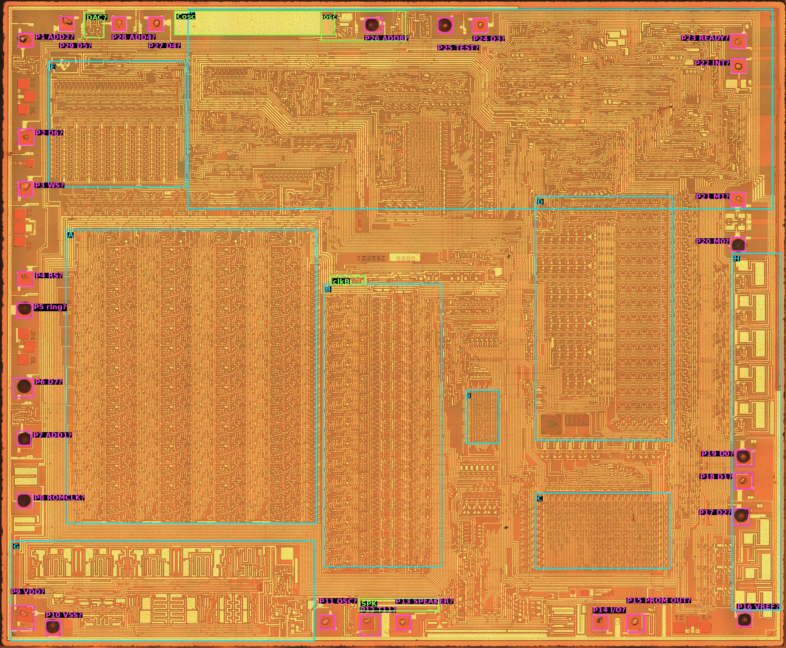

# Die analysis

The capture work has taken the [reference datasheet](../datasheet/index.md) as far as measurement can take it. Most of what is still unknown sits in the arithmetic, and the vectors constrain it without naming it. The lowest-order arithmetic in particular ([datasheet §8.8](../datasheet/lattice-filter.md), [lowest-order arithmetic](lowest-order-arithmetic.md)) has survived every model built from the data and from the patents. A die image shows the circuit itself. These pages describe how the TMS5220NL die image is read, and what it shows.

In short:

- **The pin map** is derived from the pads' drivers ([floorplan](floorplan.md#pin-map)).
- **The datapath is 14 bits wide.** The multiplier (block A) and the summer side (block B) both have 14 bit rows, with row 14 the LSB. The delay stack has 18 clocked inverters per bit ([floorplan](floorplan.md)).
- **Both ROMs are read.** The parameter ROM equals `PROM OUT`, and the chirp ROM equals Table 8-7 at every address ([ROMs](roms.md)).
- **The multiplier's middle cell is consistent with the patent's** at the level of its links ([reference cell](reference-cell.md)).
- **The low end of the multiplier and the summer side add nothing to the model.** Stage 0 has no adder, which explains the model's stage 0. Every other difference at bit 0 is a tie-off, and no reading of the ties improves the model ([multiplier low end](multiplier-low-end.md), [adder and delay stack](adder-and-delay-stack.md)).

The image shows every gate but little of the diffusion, so random logic cannot be traced blind. Averaging the copies of a repeated cell shows much more of it ([reference cell](reference-cell.md#the-copies-and-their-average)). The multiplier and summer cells are therefore checked against the patent's cells and compared with each other. The results are provisional until the regression confirms them (see [ways of working](#ways-of-working)). A delayered image is wanted, but not required. The block identifications below are hypotheses unless the [floorplan](floorplan.md#blocks) says otherwise.

## The image

| | |
|---|---|
| File | `investigation/local/die_image/ti_tms5220nl_mcmaster_mz_mit20x.jpg` (git-ignored, not committed) |
| Source | John McMaster (siliconpr0n, `mcmaster:ti:tms5220nl`), decapped April 2013, Mitutoyo 20× objective, stitched. **CC BY 4.0**: figures must credit him ([preparation](preparation.md#source-and-licence)) |
| SHA-256 | `42e5707a0a24d8fa62444abe8efa11e8e1834070b08e822359dd9a3e665d6858` |
| Size | 18,074 × 14,916 px, RGB JPEG, 85 MB. Scale 0.341 µm/px, so the die is 6.16 × 5.09 mm ([preparation](preparation.md#scale)) |
| Layer | Top metal intact (not delayered). This is a metal-gate process, so every gate is metal and can be seen. Diffusion shows only faintly, and not at all under metal |
| Second image | TMS5200NL, the same T0285E layout, also top metal: `investigation/local/die_image/tms5200nl/tms5200nl_mcmaster_mz_mit20x.jpg` (18,250 × 15,000 px, from the siliconprawn.org map tiles; [reference cell](reference-cell.md#gates-and-contacts)). A second copy of every cell, where this image is damaged or dirty |
| Markings | `TO285E` and `5220` in the centre (TMC0285, TI's internal number for the 5220); `© 11-78` beside block D; mask-level marks `1A 3A 4A 6A 7A` (left edge), `1-1`, `2-1`, `D.30`, `DL`, `TK`, `A.4` near the pads |

At full resolution the metal lines, the gates (thin-oxide windows in the metal) and the contacts can be read ([preparation](preparation.md), [ROMs](roms.md#how-a-rom-bit-looks)). The image has four limits:

- **The diffusion is barely visible** in one copy ([reference cell](reference-cell.md)). Averaging many copies of a cell shows it between the metal lines, but not under them. A transistor's gate shows, but often not which diffusion regions lie on either side of it, so not what it connects. Regular structures (ROMs, PLAs, repeated cells) can be read, because their diffusion follows a pattern that needs finding only once. Random logic cannot be traced blind: it can only be checked against a known circuit, or compared with another copy of itself.
- **Metal hides what is beneath it.** This is a P-channel MOS die (the datasheet's supplies: `VSS` = +5 V substrate, `VDD` = −5 V). In a process of this age there is one metal layer, used mostly for power, clocks and long buses. There is no delayered image of this die. The TMS5200NL image (the same T0285E design) is also top metal ([preparation](preparation.md#source-and-licence)).
- **JPEG compression** blurs the edges of thin features. A contact, or a buried contact under poly, needs care, and a transistor's W/L can only be measured to about ±1 px.
- **One part.** The imaged part is DEP 8319; chips 1 and 4 are DEP 8423. The die carries a 1978 copyright, and the mask set probably did not change across NL production, but any reading of the DAC has to keep this in mind.

## Floorplan

*Figure: the die with its blocks and pads. Full-resolution pixel = figure pixel × 9.04. Pads P1–P29 are numbered counterclockwise from the top-left corner ([preparation](preparation.md#pads)). Pin names are the working map of the [floorplan](floorplan.md#pin-map) ("?" = not yet confirmed). Die image: John McMaster, siliconpr0n, CC BY 4.0.*

| Block | What is seen | Working hypothesis |
|---|---|---|
| **A** | The largest regular array. A header row, then **14 bit rows of 452 px**, and **five column groups of 1,260 px**: three identical between two specialised end groups ([floorplan](floorplan.md#bit-rows-and-word-length)) | The **array multiplier**: five Booth stages (stage 0 to stage 4) of 14 bit slices. US 4,335,277 FIG. 10 describes five stages of 14 cells. **Row 14 is the LSB, and group 1 is stage 0 (inferred).** The middle cell is consistent with the patent's ([reference cell](reference-cell.md)) |
| **B** | Narrow columns of small, repeated cells at the **same 452 px vertical pitch**, bit-aligned with A | The **summer and its multiplexer, the delay stack, the Y latch and the multiplier multiplexer** (patent 402, 403, 404, 406, 415). **The delay stack is found** (x 8,450–9,300): 18 clocked inverters per bit ([floorplan](floorplan.md#the-delay-stack)) |
| **C** | A dense, uniform grid of bit cells with decoders on two sides | **The parameter ROM, read** ([ROMs](roms.md#the-parameter-rom)): 2,720 bits, every readable one equal to `PROM OUT` |
| **D** | Two regular arrays with about 16 rows, column decoders below | The **FIFO** (16 × 8), and/or the parameter registers and interpolation (K-stack 302) |
| **E** | Five groups of comb-like columns under a row of drivers | **The K-stack (patent 302), inferred:** 10 identical columns, whose outputs drop into the recoding logic above A ([floorplan](floorplan.md#blocks)). Not a ROM, not the chirp ROM, not the DAC |
| **I** | A small ROM between B and C (x 10,700–11,480, y 8,980–10,220) | **The chirp ROM, read** ([ROMs](roms.md#the-chirp-rom)): 52 words of 8 bits, equal to Table 8-7 |
| **F** | Random logic and routing across the top | **Control**: the PC and timing PLA, the frame parser, VSM and host interface state machines |
| **G** | Very wide, interdigitated transistors along the bottom-left, next to pads | Probably the **clock drivers**: four wide lines run from under G round A and on to B ([floorplan](floorplan.md#clock-lines)). Which driver feeds which line is only partly traced |
| **H** | Nine identical large drivers in the right-hand column, between P20 and P16 | **The D0–D7 output drivers** on a shared return rail to P16 (`VREF`) ([floorplan](floorplan.md#blocks)) |

Two features make A and B a strong lead. They share the 452 px bit pitch, so they are one bit-sliced datapath. A's five column groups match the multiplier's five stages. The cells that matter most (bit slices 0–2 of stages 0 and 1, and the adder's bit 0) are therefore at one end of the A/B rows.

## Targets

Each target is an unknown named in the reference datasheet. The order is by the value of the answer to the datasheet's acceptance tests, discounted by how hard the target is to read from a metal-layer image.

| # | Unknown | Datasheet | What to read on the die | Difficulty | Where it stands |
|---|---|---|---|---|---|
| T1 | **The lowest-order arithmetic** (the voiced one-code error, the period doubling, the *d*₁ < 0 sensitivity) | [§8.8](../datasheet/lattice-filter.md#the-lowest-order-arithmetic), [gap](../datasheet/gaps.md#the-lowest-order-arithmetic); [lowest-order arithmetic](lowest-order-arithmetic.md#1-what-a-candidate-must-explain) | Multiplier bit slices 0–2 in stages 0 and 1: the forced 1, what drives a partial-product line when no digit is selected, where the completing carry of a negative digit enters. Patent cells A-1, A-2, B-1…B-C (FIG. 10c) | Medium. Regular, and the patent is a map | Read as far as a top-metal image allows ([multiplier low end](multiplier-low-end.md)); what is left needs levels ([open work](#open-work)) |
| T2 | **The adder's low end and the summer multiplexer** | [§8.8](../datasheet/lattice-filter.md) | Adder bit 0 and 1, the carry-in, the precharged-zero input (patent gate 420), the truncation logic (425), the Y latch's width | Medium | No open form on this image ([adder and delay stack](adder-and-delay-stack.md)) |
| T3 | **Word lengths** | [§8.8](../datasheet/lattice-filter.md) "Word length and overflow" | Bit rows in A and B; the delay stack's depth and width. Confirms the 14-bit wrap and shows whether any register is wider or narrower | Easy | **Done:** 14 bits in A, B and the MR lines ([floorplan](floorplan.md#bit-rows-and-word-length), [adder and delay stack](adder-and-delay-stack.md#where-this-leaves-t1-and-t2)) |
| T4 | **The chip-specific departures and upsets** | [§8.8](../datasheet/lattice-filter.md#the-lowest-order-arithmetic) "A second error"; [§7](../datasheet/power-up.md) upsets; [gap](../datasheet/gaps.md#upsets-and-chip-specific-departures) | The dynamic and precharged nodes on the T1/T2 paths, and any ratioed gate there: transistor W/L, node size, which clock phase precharges it | Hard. Needs sizes, not just connections | Not examined ([open work](#marginal-nodes-t4)) |
| T5 | **The chirp table** | [§8.1](../datasheet/coded-parameters.md) Table 8-7, [§8.6](../datasheet/excitation-interpolation.md) | The chirp ROM (patent ROM 409): all 52 words, their bit weights and sign, and the address decoding, including the clamp that makes any count above 51 read location 51 | — | **Done** ([ROMs](roms.md#the-chirp-rom)): all 52 words equal Table 8-7. The clamp above 51 is not read |
| T6 | **The DAC** | [§8.2](../datasheet/dac-and-audio.md): the 26 µA step between codes −1 and 0, the 7 % scale step after a power cycle ([gap](../datasheet/gaps.md#the-dacs-absolute-scale)) | Whether the DAC is sign-magnitude, offset binary or two's complement, its weighting, and its bias source | Medium | Output transistor found; weighted sources not found ([floorplan](floorplan.md#blocks), [open work](#the-dac-and-output-t6)) |
| T7 | **`PROM OUT` and `TEST`** | [§11.2](../datasheet/pins.md) | The nets behind pins 10 and 20 | — | **`TEST` answered without the die.** The patent's Figs. 7a, 8g, 11c and 11d and a bench trial gave its function (datasheet §11.2). The die trace stops one contact into F ([floorplan](floorplan.md#test-p25-beyond-the-strap)). `PROM OUT` was answered on the bench ([datasheet §8.10](../datasheet/prom-out.md)) |
| T8 | **The Speak External two-sample offset** | [§8.5](../datasheet/frame-timing.md) "Speak External"; [gap](../datasheet/gaps.md#the-speak-external-two-sample-lead) | Where the Speak External path enters the frame timing in F | Hard. Control logic | Not examined ([open work](#control-t7-t8-t9)) |
| T9 | **Host interface timing details** | [§3](../datasheet/cpu-interface.md); [gap](../datasheet/gaps.md#host-interface-timing) | The READY, INT and FIFO-full logic in F and D | Hard, and also measurable on the bench, which is easier | Not examined ([open work](#control-t7-t8-t9)) |

T1 and T2 are the reason for doing this. T3 is cheap, and it checks the method. T5 is the one table the chip cannot report itself:

- **The chirp is not on `PROM OUT`.** The energy, pitch and K tables have all been read from the chip through `PROM OUT` ([datasheet §8.10](../datasheet/prom-out.md)). The chirp ROM is a separate ROM, so it does not appear there.
- **Half of it was unconfirmed by the vectors.** The vector fit confirms only 26 of the chirp's 52 entries ([datasheet §8.1](../datasheet/coded-parameters.md)). At the other 26 a neighbouring value fits as well or better, because the model is not yet exact for voiced frames.
- **The published values are unverified.** They are said to match a decapped TMS5220, but the bits have not been published.

So reading the chirp from the die settles Table 8-7 independently of published tables and of the model. It also helps T1: with the chirp fixed, the voiced error cannot be absorbed by refitting it (datasheet §8.8 tried that). T4 and T6 explain effects that the model has to tolerate rather than reproduce. T7 to T9 matter least.

## Method

The image is read in an order where each step either answers one of the unknowns or makes the next step reliable:

1. **[Preparation](preparation.md).** A tiled viewer (`investigation/tools/die.py`), a coordinate system with a record per traced object in [`cells.json`](data/cells.json), the scale, the source and licence, and an inventory of the bond pads.
2. **[Floorplan and bit slices](floorplan.md).** The pin map, the blocks, the bit rows of A and B and their LSB end, the delay stack's depth, and the clock lines that reach A and B.
3. **[Calibration on the ROMs](roms.md).** Before trusting a reading of unknown cells, read known ones. The parameter ROM is compared with the tables read through `PROM OUT`, which tests the method. The chirp ROM is a result in itself (T5).
4. **[The reference cell](reference-cell.md).** One complete multiplier cell in the middle of the array, checked against the patent's cell (FIG. 10c) rather than traced blind, on several copies in both images.
5. **[The multiplier's low end](multiplier-low-end.md) (T1),** by difference from the reference cell. Anything the low-end cells do differently from the middle cell must show as an added, missing or moved gate, contact or metal line, which this image can show even where the diffusion cannot be seen. Each reading is turned into a bit-level model of the multiplier and scored.
6. **[The adder, the multiplexers and the delay stack](adder-and-delay-stack.md) (T2, T3),** by the same method on block B.

## Ways of working

- **Record the trace, not only the conclusion.** Each traced cell goes into [`cells.json`](data/cells.json) with its crop and a transistor-level drawing (KiCad schematic, or a netlist that a short script can simulate). A later reader should be able to check every claim against the pixels.
- **Label how each result was found.** A result read from a regular structure (a ROM, a PLA, a count of cells) is **read from the die**. A result for random logic is **consistent with the die**, because the diffusion is not fully visible. Such a result goes into the datasheet only once the regression supports it, and is marked provisional until a delayered image confirms it.
- **Wanted, not required: a delayered image.** With the metal removed, the diffusion and contacts would show, and the reference cell, the low end and the summer side would become direct readings. Two ways to get one:
  - ask John McMaster whether a delayered TMS5220 or TMS5200 exists, or whether he would make one;
  - decap and strip one of the dead chips (2 or 3).
- **Never trust the patent without the die.** The patent is the map for finding cells. Where the die and the patent differ, the die wins, and the difference is written down: it may be the answer to T1.
- **Score every model change with the regression.** No change goes into `model.py` because it looks right on the die. It goes in because `investigation/tools/regress.py` shows it fits the vectors better.
- **Carry results into the reference datasheet** with citations to the cell records.

## Open work

The reading so far has confirmed the model's structure against the silicon and closed every wiring explanation of the one-code error that a top-metal image can show. What is left of T1 is two candidates: the stage 0 → stage 1 link ([multiplier low end](multiplier-low-end.md#where-this-leaves-t1)) and the extra MR line that must carry 0 ([adder and delay stack](adder-and-delay-stack.md#mr-wiring-scored-in-the-model)). Both depend on levels and timing, which this image cannot show. More tracing would map more connections, and connections are not the question. The die work resumes if a delayered image becomes available, or if the temperature and supply test ([lowest-order arithmetic](lowest-order-arithmetic.md#55-temperature-and-supply)) or the analysis of the vectors names a node to look at. The fit from the vectors has been run on every take and PROM word ([lowest-order arithmetic](lowest-order-arithmetic.md#23-a-fixed-function-of-the-operands)). It found no rule in a product's operands, and the one table entry that helped behaves differently on the two chips. That supports the level reading, so the next evidence has to come from the bench or from a delayered image.

The DAC and control targets do not bear on the open arithmetic. The open questions of each page are listed there: [floorplan](floorplan.md#open-questions) (the DAC's gate, the clock phases, the bonds, the delay stack's taps), [ROMs](roms.md#open-questions) (the chirp decoder and the clamp, where the pitch field is shifted), [reference cell](reference-cell.md#open-questions), [multiplier low end](multiplier-low-end.md#open-questions) and [adder and delay stack](adder-and-delay-stack.md#open-questions).

### Marginal nodes (T4)

Only worth doing if the *d*₁ < 0 sensitivity or the chip-specific departures stay unexplained, which they do so far.

1. List every dynamic node on the stage 0 and stage 1 negative-digit paths and in the adder's low bits. For each one, note the clock phase that precharges it, what can discharge it, and how far it runs (its capacitance).
2. Measure W/L for each ratioed pair on those paths. A pull-up/pull-down ratio near the switching threshold is a candidate for a chip-specific outcome.
3. Rank the candidates by how well each explains the data: departures that repeat on a chip, do not depend on the clock, and differ between chips (datasheet §8.8). Then design one bench test per candidate, such as a `VDD` or temperature change ([lowest-order arithmetic](lowest-order-arithmetic.md#55-temperature-and-supply)) that should move it.

The result would be a short list of physical mechanisms, each with a bench test. These belong in the datasheet's description of the tolerance, not in the model. This needs a delayered image.

### The DAC and output (T6)

1. Trace from `YL13`–`YL4` to the `SPEAKER` pad. Count the current-source transistors and measure their W/L. The output transistor is found, but not the weighted sources that must drive its gate ([floorplan](floorplan.md#blocks)).
2. Decide the coding: a separate sign branch would explain the 26 µA step between −1 and 0 ([datasheet §8.2](../datasheet/dac-and-audio.md)).
3. Find the bias network. It decides whether the 7 % scale step after a power cycle could be a bias state rather than the load.

The result would be a DAC transfer model to set beside the measured table of datasheet §8.2.

### Control (T7, T8, T9)

This is open-ended, and much of it can also be measured on the bench, so it is done only as far as it is useful.

1. **`TEST` (T7).** The die trace from P25 stops at the first gate in F ([floorplan](floorplan.md#test-p25-beyond-the-strap)). The patent's C4 and C5, which gate `TEST` into TEST1 and TEST2, have no source in the drawings: finding them is what is left for the die, and needs a delayered image.
2. **Speak External (T8).** Find the PC and timing PLA in F, and read its terms. A PLA is a grid of gates like the ROMs, so it can be read with the [ROM method](roms.md#how-a-rom-bit-looks). With that, find where Speak External enters the frame timing.
3. **Host interface (T9).** Trace the FIFO control and the READY/INT logic only where a bench test cannot answer an item of the datasheet's [host interface gaps](../datasheet/gaps.md#host-interface-timing).

## Data

- [`cells.json`](data/cells.json): one record per traced object (blocks, pads, rows, cells and features), with its box in full-resolution pixels and notes. `investigation/tools/die.py` draws the figures and the viewer overlay from it.
- [`rom_parameters.csv`](data/rom_parameters.csv): the parameter ROM as read from the die, beside `PROM OUT`.
- [`rom_chirp.csv`](data/rom_chirp.csv): the chirp ROM as read from the die, beside Table 8-7.
