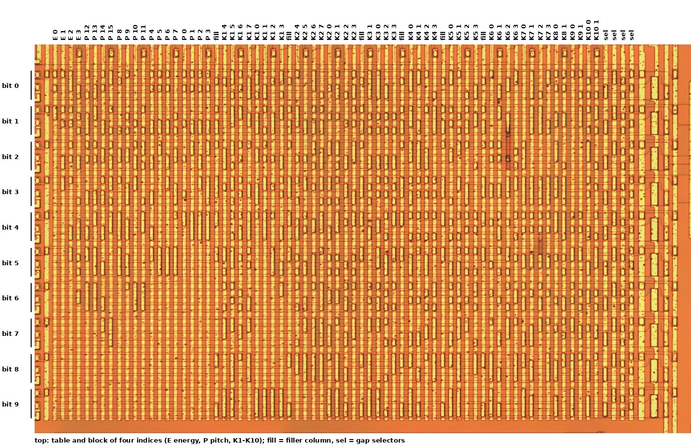

# The parameter and chirp ROMs

Before trusting a reading of the unknown cells, read some known ones. The 5220's LPC and chirp tables in published emulator sources are said to have been checked against this decap ([preparation](preparation.md#source-and-licence)), and the parameter tables have been read from the chip itself through `PROM OUT` ([datasheet §8.10](../datasheet/prom-out.md)). So reading the parameter ROM (block C) tests the method rather than the tables. The chirp is different: nothing but the die can confirm it (target T5, see [targets](index.md#targets)).

- **The parameter ROM:** every readable bit of all 248 entries equals the tables read through `PROM OUT`.
- **The chirp ROM:** found as block **I**. All 52 words equal Table 8-7, so the 26 entries that the vector fit left unconfirmed are confirmed. The column decoder, and with it the clamp above address 51, is not read.

Positions are in full-resolution pixels ([preparation](preparation.md#tools-and-coordinates)). `python investigation/tools/die.py rom` repeats both readings from the image. It writes [`rom_parameters.csv`](data/rom_parameters.csv) and [`rom_chirp.csv`](data/rom_chirp.csv), and compares them with the tables.

## How a ROM bit looks

Both ROMs are built the same way:

- **Gate lines** are vertical metal lines at a pitch of 36.3 px (12.4 µm).
- **Diffusion strips** run horizontally under them at a pitch of 31.9 px (10.9 µm). They show faintly through the field oxide as pairs of edges 10 px apart.
- **A stored transistor** is a thin-oxide window where a gate line crosses the gap between two strips. The metal steps down into the window, and its outline shows as a dark rim inside the line. Windows over adjacent gaps on the same line merge into one long window.

**The reading.** For each gate line and each gap, the tool measures the fraction of dark pixels (red < 175) in a 33 px band centred on the line, between the two strips. It then splits each line's gaps into two classes by 2-means.

Two simpler measures were tried and rejected, because the lower half of C is slightly out of focus and they misread it there:

- the darkness of the rim on the line's edges: 86 errors;
- a fixed threshold.

The dark-pixel measure can also be fooled by a dark particle sitting on a plain line. All such sites are listed under [the result](#result).

## The parameter ROM

### Organisation

*Figure: the parameter ROM (block C), with the table and block held by each column. Die image: John McMaster, siliconpr0n, CC BY 4.0.*

**Rows.** 51 diffusion strips form 10 groups of five, separated by gaps that never hold a transistor. Each group is one **output bit**: group *g* is bit *g*, with group 0 (the top) as the LSB. A group's four gaps hold four words.

**Columns.** There are 73 gate lines from x = 12,494 to 15,122:

- **Column 0**, at the left edge, has a window in the first gap of every group. It is part of the periphery.
- **Columns 1–68** hold the data: 68 columns × 4 gaps = 272 words of 10 bits.
- **Columns 69–72** are the gap selectors. They hold the same pattern in every group:
  - column 70 has gaps 1 and 2, column 69 has gaps 3 and 4;
  - column 72 has gaps 1 and 3, column 71 has gaps 2 and 4.

  So two address bits pick one of the four gaps.
- Lines further right (x 15,167–15,318) carry large windows at a regular pitch. They are probably the output loads.

**Polarity and order.** A window stores a **1**. Within a column, table index 4*b* + *r* is in gap 4 − *r* of each group. So the lowest index is at the bottom of the group.

### Which column holds what

Each column holds one table's block of four consecutive indices. The tables lie in the order of the frame, but within a table the decoder puts the blocks in an order of its own:

| Table | Columns, for blocks 0, 1, 2 … |
|---|---|
| Energy | 1, 2, 3, 4 |
| Pitch | 17, 18, 19, 20, 13, 14, 15, 16, 9, 10, 11, 12, 5, 6, 7, 8 |
| K1 | 26, 27, 28, 29, 22, 23, 24, 25 |
| K2 | 35, 36, 37, 38, 31, 32, 33, 34 |
| K3 | 41, 40, 42, 43 |
| K4, K5 | 45–48; 50–53 |
| K6, K7 | 55–58; 59–62 |
| K8, K9, K10 | 63–64; 65–66; 67–68 |

That accounts for 62 columns, or 248 words: exactly the 248 entries of Tables 8-4 to 8-6 ([datasheet §8.1](../datasheet/coded-parameters.md)). The whole array, 68 columns × 4 words × 10 bits, is 2,720 bits: the size US 4,335,277 gives its parameter ROM (202, Fig. 8e). The other six columns (21, 30, 39, 44, 49 and 54) are **fillers**. Each sits where a table's columns end, and four of them hold the same four words (514, 522, 313 and 318). No index reaches them.

**The pitch table is stored unshifted.** Its words are the register values of Table 8-5 (0, 15, 16 … 159) in bits 0–7, with bits 8 and 9 clear. On `PROM OUT` the same entries appear as the value × 4, in bits 2–9 ([datasheet §8.10](../datasheet/prom-out.md)). Energy and K appear in the same bits on both. So the pitch field is moved up by two bits, or two bit-times, between the ROM and the pin. Where that happens is not known. It does not change any table value.

### Result

All 2,480 bits of the 248 entries were compared with the values read from chip 1 through `PROM OUT` (`investigation/captures/promout/chip1/rom.csv`).

| | Sites |
|---|---|
| Read automatically, equal to `PROM OUT` | 2,470 |
| Under a dark particle, which the reading takes for a window: read by eye at full resolution, no window, equal to `PROM OUT` | 5: (column 18, gap 6), (42, 26), (59, 36), (60, 26) and (61, 24) |
| **Unreadable**: the metal is damaged | 5: column 57, gaps 11–14 (under the scratch at x ≈ 14,560, y ≈ 11,800–11,950), and column 61, gap 26 |
| **Different from `PROM OUT`** | **0** |

The five unreadable sites hold bits of K6 indices 8–11 and of K7 index 11. `PROM OUT` gives all of them.

**The method is trusted.** Every bit that can be seen equals the chip's own output. The two manual corrections are recorded in `investigation/tools/die.py` (`PROM_BY_EYE`, `PROM_UNREADABLE`), so the reading can be repeated. The full reading is in [`rom_parameters.csv`](data/rom_parameters.csv).

## The chirp ROM

### Where it is

E is not the chirp ROM. It is an array of identical cells with no data pattern, so it is not a ROM at all ([floorplan](floorplan.md#blocks)).

The chirp ROM is a small array between B and C, at **x 10,700–11,480, y 8,980–10,220**. [`cells.json`](data/cells.json) records it as `block_I`. It is built like C and has the same pitches. A row of address lines sits above it and a decoder row below.

*Figure: the chirp ROM (block I), with the address block of each column and the bit of each band. Die image: John McMaster, siliconpr0n, CC BY 4.0.*

### Chirp ROM organisation

**Rows.** 36 strips form four bands of nine, separated by empty gaps. Each band has a wide strip in its middle, with four gaps above it and four below. Each half-band is one **output bit**: 4 bands × 2 = **8 bits**.

**Columns.** There are 13 data columns. With four gaps each, that gives **13 × 4 = 52 words**, which is the patent's 52 locations. Every column of the array was read: there is no fourteenth data column, so locations 52–63 do not exist.

- **Selectors.** Four columns on the right select the gap. They are mirrored about each band's middle strip:
  - one pair selects gap *u* ∈ {0, 1} or {2, 3};
  - the other selects *u* ∈ {0, 2} or {1, 3}.

  Gap *u* above the middle strip is paired with gap 7 − *u* below it.
- **Periphery.** Two columns on the left carry large windows, as C's loads do.

**The reading separates cleanly.** On the 416 data sites, the highest score without a window is 0.101 and the lowest with one is 0.182, against a threshold of 0.144. There are no particles and no damage on the array. So no site needed a judgement by eye.

### Decoding

**Polarity.** 32 of the 52 words have a window at every bit. Table 8-7 has exactly 32 zero words: address 0 and addresses 21–51. So **a window stores 0** here, the opposite of C.

**Bit order.** Of the 8! = 40,320 ways to assign the eight half-bands to bit weights, only one makes the 20 non-zero words equal the 20 non-zero entries of Table 8-7. That is the plain physical order: from the top, band 0's upper half is bit 7 (the sign) down to band 3's lower half, which is bit 0. Every non-zero word has bit 7 clear, so every chirp value is positive.

**Address order.** Within a column, address 4*b* + *u* is in gap *u* of the upper half (and gap 7 − *u* of the lower half). The six columns that hold anything other than zero carry blocks 0–5 in the physical order 1, 0, 3, 2, 5, 4: the pairs are swapped. The seven all-zero columns hold blocks 6–12, in an order the data cannot show.

### Chirp ROM result

| Address | 0 | 1 | 2 | 3 | 4 | 5 | 6 | 7 | 8 | 9 | 10 |
|---|---|---|---|---|---|---|---|---|---|---|---|
| Die | 0 | 3 | 15 | 40 | 76 | 108 | 113 | 80 | 37 | 38 | 76 |
| **Address** | 11 | 12 | 13 | 14 | 15 | 16 | 17 | 18 | 19 | 20 | 21–51 |
| Die | 68 | 26 | 50 | 59 | 19 | 55 | 26 | 37 | 31 | 29 | 0 |

**All 52 words equal Table 8-7** ([datasheet §8.1](../datasheet/coded-parameters.md)), including the 26 entries that the vector fit could not confirm on its own. The reading is in [`rom_chirp.csv`](data/rom_chirp.csv).

**Why this confirms those entries, rather than only matching them.** Two steps above were fixed by matching against the table: the bit order and the column-to-block order. The confirmation does not depend on that matching:

- **The bit order** is the only assignment of 40,320 that works. It is also the plain physical order. A die that differed from the table would not have matched under any order.
- **The address order** follows from the anchors. The vector fit confirms 26 entries at their own addresses (datasheet §8.1), with at least one in each non-zero column:
  - those anchors fix which block each column holds;
  - block 0, with confirmed entries at addresses 0, 1 and 3, fixes the order within every column. That order is one rule for the whole array, set by the selectors.

  Together they place every other entry: for example, 15 at address 2, and 108 before 113 at addresses 5 and 6.

So the die and the confirmed entries together determine all 52 values. They agree with the published tables, and are read independently of them and of the model.

### The decoder and the clamp: not read

A count above 51 should read as location 51. The array has no locations 52–63, so a count of 52 or more selects no column. What then reaches the output depends on:

- the column decoder (the address lines above the array and the decoder row below);
- how the outputs are precharged.

The decoder's transistors sit over diffusion lines that the metal mostly hides. So the selected column could not be traced for each count.

Behaviour is not in question: the chip outputs zero for those counts ([datasheet §8.6](../datasheet/excitation-interpolation.md)). Whether that zero comes from a clamp in the counter, from the decoder, or from the precharge stays open. It is a question about the circuit, not about any value.

## Open questions

- **The chirp ROM's decoder and the clamp above 51.** Whether a count of 52 or more gives zero through a clamp in the counter, the decoder or the precharge ([above](#the-decoder-and-the-clamp-not-read)). Needs the diffusion under the decoder.
- **Where the pitch field is shifted.** The ROM stores pitch unshifted, and `PROM OUT` shows it two bits up ([which column holds what](#which-column-holds-what)).
- **The parameter ROM's decoder.** The order of the columns above comes from matching the data; it has not been traced from the address lines in F.
