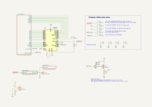
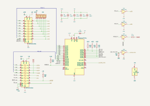
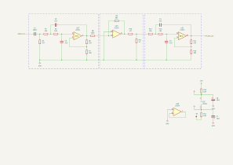
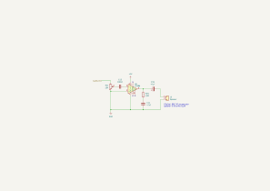

# Hardware and firmware

The measurements in this project are made on one board: a TMS5220 driven by a Raspberry Pi Pico 2, with probe points for a PicoScope 3405D. The board is the KiCad project `investigation/kicad/tms5220_usb/`. The Pico 2 runs the capture firmware in `investigation/firmware/`, and the host drives it over USB serial with the tools in `investigation/tools/` (see [Capture tools](../tools/index.md)).

This section covers:

- [The board](#the-board) and its schematic sheets.
- [The audio output stage](audio-output-stage.md): the analogue path from the TMS5220's `SPEAKER` pin to the line output.
- [The firmware](#the-firmware). Building and flashing it: [`BUILD.md`](https://github.com/simoninns/speak5220/blob/main/BUILD.md).
- [The firmware's USB command protocol](firmware-protocol.md), its VSM emulation and its trace.

## The board

The schematic has a top sheet and three sub-sheets:

| Sheet | File | Contents |
|---|---|---|
| Top | `tms5220_usb.kicad_sch` | The TMS5220 (U1), the power input (J1: +5 V, ground, −5 V), the `OSC` level shifter (Q1, R1, R25, R26), the `SPEAKER` load (R2, 1K), the audio output connector (J2) and the PicoScope probe points (TP1–TP10) |
| `pico_interface` | `pico_interface.kicad_sch` | The Raspberry Pi Pico 2 (A1) and the level translation between its 3.3 V GPIO and the TMS5220's 5 V interface |
| `audio_output` | `audio_output.kicad_sch` | The [audio output stage](audio-output-stage.md): an LM324 (U2) filter and level chain |
| Power Amp | `poweramp.kicad_sch` | An LM386 (U6) speaker amplifier with a 10K volume control (RV1) and a speaker connector (J3). A note on the sheet gives the original BBC Microcomputer speaker as 8 Ω, 0.2 W |

The project symbol library (`tms5220_usb.kicad_sym`) holds the TMS5220, TMS6100 and SN74LVC4245A symbols. The Raspberry Pi Pico symbol and footprint come from the [Ki-Lime Pi](https://github.com/recursivenomad/ki-lime-pi-to-go) library, a git submodule in `investigation/kicad/libraries/ki-lime-pi-pico/`.

### Clock

The TMS5220 has no oscillator of its own on this board. The firmware runs the Pico 2 at 144 MHz and generates the TMS5220's 640 kHz clock (an 8 kHz sample rate) with PWM on GPIO22. The clock is buffered to 5 V by U5D, then level-shifted by a PNP transistor (Q1) so that `OSC` swings between −5 V and +5 V, as on Atari's Star Wars sound board. When U5D is high, Q1 is off and R26 pulls `OSC` to −5 V; when U5D is low, Q1 is on and `OSC` is at +5 V. A 0–5 V clock does not work.

### Host interface

The Pico 2's GPIO assignments are in `investigation/firmware/src/pins.h`:

| GPIO | Signal | Path |
|---|---|---|
| 0–7 | TMS5220 data bus, D7 (LSB) on GPIO0 to D0 (MSB) on GPIO7 | U4 (SN74LVC4245A), direction set by GPIO20, enabled by GPIO21; 10K pull-ups (RN1) on the 5 V side |
| 8–11 | `ADD1`, `ADD2`, `ADD4`, `ADD8` (VSM address inputs) | U3 (SN74LVC4245A, fixed 5 V to 3.3 V) |
| 12, 13 | `M0`, `M1` | U3 |
| 14 | `ADD8` data output to the TMS5220 | U5 (74AHCT125) and R23 1K, enabled by GPIO15 |
| 16, 17 | `WS`, `RS` | U5 |
| 18, 19 | `READY`, `INT` | U3 |
| 22 | `OSC` | U5D and Q1 |
| 25 | On-board LED, lit while the TMS5220 is talking | |
| 26 | `SCOPE_TRIG` (TP5) | Direct |

TI numbers the TMS5220 data bus with D0 as the most significant bit, so the bus is wired in reverse and a byte value can be written to GPIO0–7 without reordering. The `ADD8` output enable, `WS`, `RS` and the data bus enable are pulled up (inactive) on the Pico side by R19–R22, and `READY` is pulled up to +5 V by R18. The Pico is powered from the board's +5 V through a Schottky diode (D1) to VSYS. The TMS5220's `TEST` pin (20) is not connected.

### Probe points

| Test point | Signal | Scope channel |
|---|---|---|
| TP1 | `ROMCLK` (pin 3) | Alternative for channel D |
| TP2 | `SPEAKER` (pin 8) across R2 1K: the raw DAC output before the audio stage, 0 to about 1.16 V (idle about 0.6 V), DC coupled | A (×1) |
| TP3 | `T11` (pin 7), sample sync | B (×10) |
| TP4 | `I/O` (pin 9), serial data out | C (×10) |
| TP5 | `SCOPE_TRIG` (Pico GPIO26), the capture marker and trigger source | D (×10) |
| TP6–TP9 | Ground, for the probe ground clips | |
| TP10 | `PROM OUT` (pin 10) | Logic D0 |

[Capture tools](../tools/index.md#probes) gives the probe settings and the board configurations that the captures record.

## Schematics

The sheets below are exported from the KiCad project ([`BUILD.md`](https://github.com/simoninns/speak5220/blob/main/BUILD.md) gives the command to regenerate them).



*Figure: the top sheet: the TMS5220, the power input, the `OSC` level shifter, the `SPEAKER` load and the probe points.*



*Figure: the Pico 2 and the level translators between it and the TMS5220's host and VSM interfaces.*



*Figure: the audio output stage, described in [Audio output stage](audio-output-stage.md).*



*Figure: the LM386 speaker amplifier and its volume control.*

## The firmware

The capture firmware in `investigation/firmware/` makes the Pico 2 emulate up to four speech PHROMs (TMS6100) on core 1, with their images held in SRAM. The Acorn PHROM A is built in, in bank `F`, and the host can upload other images. Core 1 also records a timestamped trace of every VSM access and every host interface cycle. The TMS5220 is driven entirely by commands from the host over USB serial: upload, Speak, Speak External, raw command writes, status reads and trace download. [Firmware protocol](firmware-protocol.md) documents the protocol, and `investigation/tools/pico.py` implements the host side:

```bash
python investigation/tools/pico.py demo        # say "Acorn BBC Computer" once
python investigation/tools/pico.py selftest    # upload, speak and trace, checking every result
```

The PHROM data comes from [TMS6100-Emulator](https://github.com/simoninns/TMS6100-Emulator). The on-board LED lights while the TMS5220 is talking.

With the PicoScope connected, one command captures a word into a complete capture directory, with the readable files and checks ([Capturing PROM words](../tools/capture.md)). Every take uses the standard procedure: the chip is reset, then the Speak is timed to the chip's frame clock, so that repeats start from the same state.

```bash
python investigation/tools/run.py acorn_phrom_a ACORN --takes 2 --path both
```

Building and flashing the firmware, and setting up the development environment, are described in [`BUILD.md`](https://github.com/simoninns/speak5220/blob/main/BUILD.md). Reflash only while the TMS5220 is idle: stopping its clock mid-speech can wedge it ([Stopping the clock](firmware-protocol.md#warning-stopping-the-clock-can-wedge-the-tms5220)).
