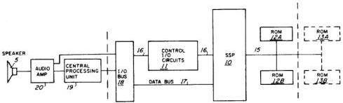

# CONTROL INTERFACE SYSTEM FOR USE WITH A MEMORY DEVICE EXECUTING VARIABLE LENGTH INSTRUCTIONS

This is a transcription of United States Patent 4,335,277, *Control Interface System for Use with a Memory Device Executing Variable Length Instructions*, granted to Ajay K. Puri and assigned to Texas Instruments Incorporated (date of patent Jun. 15, 1982). It describes a speech synthesizer and the interface between it and a controlling CPU. The text and tables follow the printed patent, including its layout: tables sit where they fall on the printed pages, so they sometimes interrupt the running text. The sentence that opens ALTERNATIVE EMBODIMENTS, for example, ends after the Read-Only-Memories section of the logic diagram description.

The transcription is split into these pages:

- Front matter and abstract (this page)
- [Drawings](drawings.md): the drawing sheets
- [Description](description.md): background, brief description of the drawings, general description, modes of operation and the block diagrams
- [Synthesizer logic diagrams](logic-diagrams.md): the detailed logic, with Tables I and II
- [Alternative embodiments and Tables III–V](alternative-embodiments.md)
- [Claims](claims.md)

United States Patent [19] — Puri — [11] Patent Number: 4,335,277 — [45] Date of Patent: Jun. 15, 1982

[54] CONTROL INTERFACE SYSTEM FOR USE WITH A MEMORY DEVICE EXECUTING VARIABLE LENGTH INSTRUCTIONS

[75] Inventor: Ajay K. Puri, Lubbock, Tex.

[73] Assignee: Texas Instruments Incorporated, Dallas, Tex.

[21] Appl. No.: 250,982

[22] Filed: Apr. 3, 1981

## Related U.S. Application Data

[63] Continuation of Ser. No. 36,928, May 7, 1979, abandoned.

[51] Int. Cl.³ G10L 1/00

[52] U.S. Cl. 179/1 SM; 364/900

[58] Field of Search 179/1 SM, 1 SG, 1 SB; 364/200 MS File, 900 MS File

## References Cited

### U.S. Patent Documents

3,575,555 4/1971 Schanne 179/1 SM

3,662,348 5/1972 Weiss 179/1 SM

### Other Publications

D. Cannon, et al. "Designing with Microprocessors", Texas Instruments Co., 1975, pp. 112, 113.
Mozer, "Talking Board", Computer Design, Jul. 1976, pp. 46, 48.

Primary Examiner—Joseph F. Ruggiero
Assistant Examiner—E. S. Kemeny
Attorney, Agent, or Firm—William E. Hiller; Melvin Sharp; James T. Comfort

## Abstract

A control interface system for use with a memory device executing variable length instructions and implementable utilizing integratable field effect semiconductor devices is disclosed. One example of such a system is a speed synthesis device controlled by the central processing unit of a computer. A control latch is utilized to release the control device, such as a central processing unit, after an instruction has been initiated. A plurality of latches, each set by the conclusion of the execution of a previous instruction, are utilized to reset the control latch. An attempted second access of the memory device during the execution of a previous command will result in suspending the operation of the control device until such time as the previous instruction is concluded and the new instruction is initiated.

6 Claims, 43 Drawing Figures

