# Appendices

## APPENDIX A – SYSTEM CLOCK

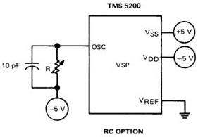

*Figure A-1 – TMS 5200 Oscillator Options.*

TYPICAL VALUES:

|  SAMPLE FREQUENCY | R  |
| --- | --- |
|  10 kHz | R = 80-100 kΩ  |
|  8 kHz | R = 120-200 kΩ  |

### A.1 OSCILLATOR TRIMMING PROCEDURE

To avoid capacitive loading of the high impedance OSC input, the following procedure is recommended for setting the TMS 5220 clock frequency. Reference to Table A-1, Comparison of System Times (page 16), shows that an RC oscillator frequency of 640 kHz corresponds to a ROM clock rate of 160 kHz. This signal is buffered and not affected by measurement instrument capacities.

To set the RC oscillator frequency, connect a frequency counter to the ROM clock output of the TMS 5220 and trim the reading to 160 kHz. Use of 10 pF shunt capacitor is recommended to prevent circuit layout and environmental stray noise from affecting device operation.

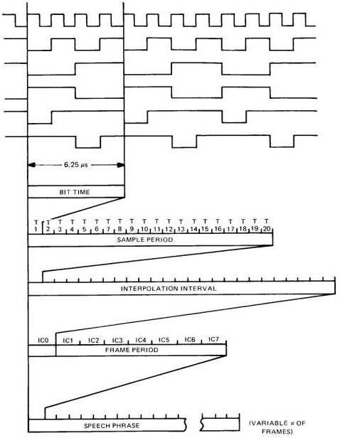

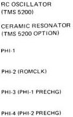

*Figure A-2 – System Timing Summary.*

TABLE A-1 – A COMPARISON OF SYSTEM TIMES

|  SAMPLE RATE: | 10 kHz | 8 kHz  |
| --- | --- | --- |
|  FRAME RATE | 50 Hz | 40 Hz  |
|  FRAME PERIOD | 20 ms | 25 ms  |
|  INTERPOLATION RATE | 400 Hz | 320 Hz  |
|  INTERPOLATION INTERVAL | 2.5 ms | 3.125 ms  |
|  SAMPLE RATE | 10 kHz | 8 kHz  |
|  SAMPLE PERIOD | 100 μs | 125 μs  |
|  ROM CLOCK RATE | 200 kHz | 160 kHz  |
|  ROM CLOCK PERIOD | 5 μs | 6.25 μs  |
|  RC OSC RATE | 800 kHz | 640 kHz  |
|  RC OSC PERIOD | 1250 ns | 1562.5 ns  |

NOTE: All timing references in this data manual are based on an 8-kHz sample rate.

## APPENDIX B – TMS 5220 INTERNAL COMMAND EXECUTION

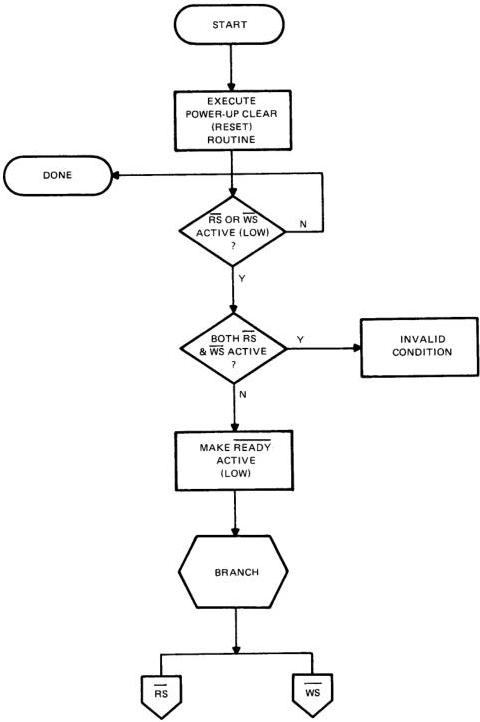

*Figure B-1 – Power On.*

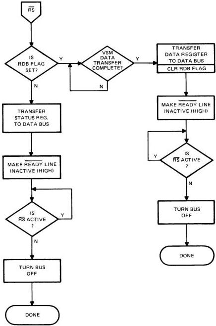

*Figure B-2 – Read Select Active.*

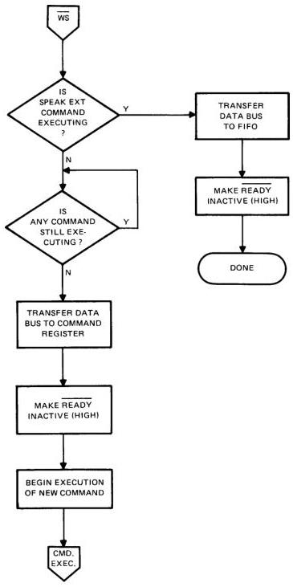

*Figure B-3 – Write Select Active.*

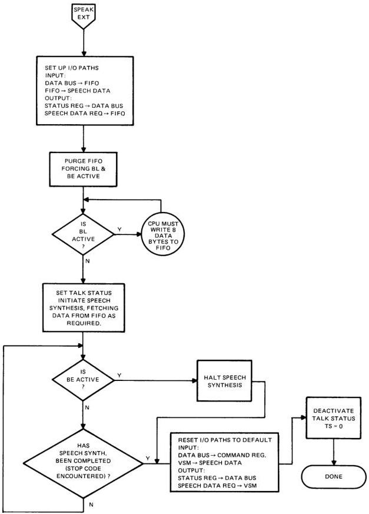

*Figure B-4 – Speak External Command.*

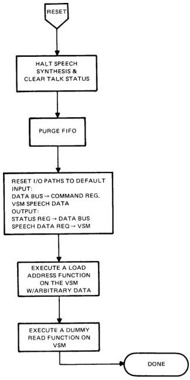

*Figure B-5 – Reset Command.*

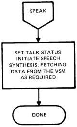

*Figure B-6 – Speak.*

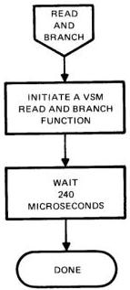

*Figure B-7 – Read and Branch.*

## APPENDIX C – SYSTEM TIMING DIAGRAMS

### WRITE CYCLE FOR READ AND BRANCH, LOAD ADDRESS, SPEAK, SPEAK EXTERNAL AND RESET COMMANDS

timing requirements

|  PARAMETER |   | MIN | NOM | MAX | UNIT  |
| --- | --- | --- | --- | --- | --- |
|  tWSL-DV | Delay time from WS low to data valid |  |  | 7 | μs  |
|  tRL-DX | Delay time from READY low to data invalid | 0 |  |  | μs  |
|  tRH-WSH | Delay time from READY high to WS high | 6 |  |  | μs  |
|  twait | Read-and-branch command wait time from READY high until next allowable* command |  |  | 595 | μs  |
|  twait | Load-address command wait time from READY high until next allowable* command |  |  | 42 | μs  |
|  twait | Speak command wait time from READY high until next allowable* command | Preceded by load-address command |  | 287 | μs  |
|   |   |  Not preceded by load-address command | 56 |   |   |
|  twait | Reset command wait time from READY high until next allowable* command |  |  | 300 | μs  |
|  twait | Speak external command wait time from READY high until next allowable* command |  |  | 42 | μs  |

switching characteristics

|  PARAMETER |   | MIN | NOM | MAX | UNIT  |
| --- | --- | --- | --- | --- | --- |
|  tWSL-RH | Delay time from WS low to READY high |  |  | 100 | ns  |
|  tw(R) | READY high pulse width | 18 |  | 26 | μs  |

All timing is based on a clock frequency of 8 kHz.

* If a new command is issued prior to the completion of the present command (before the end of twait), then the READY signal will go high and stay high until the present command is finished executing in the VSP.

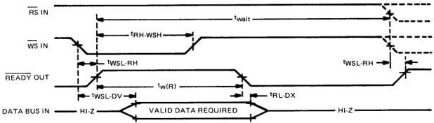

*Figure C-1 – Write Cycle for Read-and-Branch, Load-Address, Speak, Speak External, and Reset Commands.*

### WRITE CYCLE FOR EXTERNAL SPEECH DATA

timing requirements

|  PARAMETER |   | MIN | NOM | MAX | UNIT  |
| --- | --- | --- | --- | --- | --- |
|  tWSL-DV | Delay time from WS low to data valid |  |  | 7 | μs  |
|  tRL-DX | Delay time from READY low to data invalid | 0 |  |  | μs  |
|  tRH-WSH | Delay time from READY high to WS high | 6 |  |  | μs  |
|  twait | Wait time from WS high until next allowable* access | 10 |  |  | μs  |

switching characteristics

|  PARAMETER |   | MIN | TYP | MAX | UNIT  |
| --- | --- | --- | --- | --- | --- |
|  tWSL-RH | Delay time from WS low to READY high |  |  | 100 | ns  |
|  tw(R) | READY high pulse width |  |  | 23 | μs  |

All timing is based on a clock frequency of 8 kHz.

* If a new command is issued to the VSP prior to the completion of the present command then the READY command will go high (as usual) and remain high until the completion of the present command as defined by twait above.

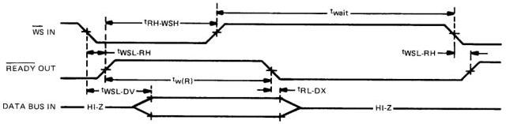

*Figure C-2 – Write Cycle for External Speech Data.*

### READ CYCLE FOR STATUS TRANSFERS

timing requirements

|  PARAMETER |   | MIN | NOM | MAX | UNIT  |
| --- | --- | --- | --- | --- | --- |
|  tRH-RSH | Delay time from READY high to RS high | 6 |  |  | μs  |
|  twait | Wait time from RS high to next allowable* command | 12 |  |  | μs  |

switching characteristics

|  PARAMETER |   | MIN | TYP | MAX | UNIT  |
| --- | --- | --- | --- | --- | --- |
|  tRSL-RH | Delay time from RS low to READY high |  |  | 100 | ns  |
|  tRH-DV | Delay time from READY high to data valid (stable) | 6 |  | 11 | μs  |
|  tRSL-DX | Delay time from RS low to data bus driven (output unstable) |  | tRH-DV − 2 |  | μs  |
|  tRSH-DZ | Delay time from RS high to data output disabled |  |  | 10.5 | μs  |

* If a new command is issued to the VSP prior to the completion of the present command, then after the READY signal goes high, in its normal response time, it will remain high until the present command has been fully executed by the VSP.

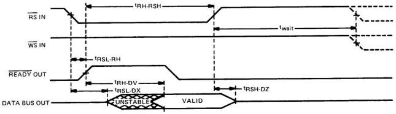

*Figure C-3 – Read Cycle for Status Transfer.*

### READ BYTE SEQUENCE

timing requirements

|  PARAMETER |   | MIN | NOM | MAX | UNIT  |
| --- | --- | --- | --- | --- | --- |
|  tWSL-DV | Delay time from WS low to data valid |  |  | 7 | μs  |
|  tRH-WSH | Delay time from READY high to WS high | 6 |  |  | μs  |
|  tWSH-DX | Delay time from WS high to data invalid | 0 |  |  | μs  |
|  tRH-RSH | Delay time from READY high to RS high | 8 |  |  | μs  |
|  tWSH-RSL | Delay time from WS high to RS low | 12 |  |  | μs  |

switching characteristics

|  PARAMETER |   |   | MIN | TYP | MAX | UNIT  |
| --- | --- | --- | --- | --- | --- | --- |
|  tWSL-RH | Delay time from WS low to READY high |   |  |  | 100 | ns  |
|  tRSL-RH | Delay time from RS low to READY high |   |  |  | 100 | ns  |
|  tw(R) | READY high pulse width (write) |   |  |  | 26 | μs  |
|  tRL-RL | Delay time from READY low (write) to READY low (read) | No previous load address |  |  | 320 | μs  |
|   |   |  Previous load address |  |  | 440  |   |
|  tRSH-DZ | Delay time from RS high to data output disabled |   | 4 |  | 9 | μs  |

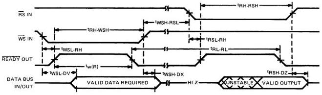

*Figure C-4 – Read Byte Sequence.*
