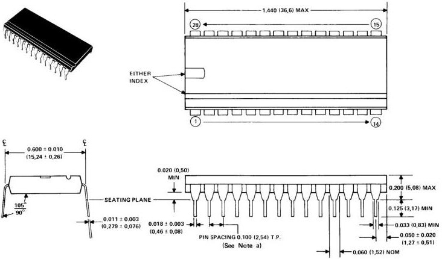
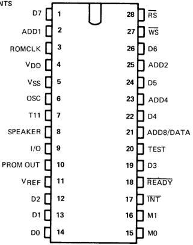

# Electrical and Mechanical Data

## 9. ELECTRICAL CHARACTERISTICS

### 9.1 ABSOLUTE MAXIMUM RATINGS OVER OPERATING FREE-AIR TEMPERATURE RANGE (UNLESS OTHERWISE NOTED)\*

Any pin with respect to VSS -20 V to +0.3 V

Power Dissipation 600 mW

Operating temperature range 0°C to 70°C

Storage temperature range -30°C to 125°C

*Stresses beyond those listed under "Absolute Maximum Ratings" may cause permanent damage to the device. This is a stress rating only and functional operation of the device at these or any other conditions beyond those indicated in the "Recommended Operating Conditions" section of this specification is not implied. Exposure to absolute-maximum-rated conditions for extended periods may affect device reliability.

### 9.2 RECOMMENDED OPERATING CONDITIONS

|  PARAMETER | MIN | NOM | MAX | UNIT  |
| --- | --- | --- | --- | --- |
|  Supply voltage, VSS | 4.5 | 5 | 5.5 | V  |
|  Supply voltage, VREF |  | 0 |  | V  |
|  Supply voltage, VDD | -4.5 | -5 | -5.5 | V  |
|  High-level input voltage, VIH | VSS-0.6 |  | VSS | V  |
|  Low-level input voltage, VIL (see Note 1) |  | 0 | VSS-4 | V  |
|  Operating free-air temperature, TA | 0 |  | 70 | °C  |
|  Operational frequency (External RC) | 576 | 640 | 704 | kHz  |

NOTE 1: The algebraic convention, where the more-positive (less-negative) limit is designated as maximum, is used in this data sheet for logic voltages levels only.

### 9.3 ELECTRICAL CHARACTERISTICS OVER FULL RANGE OF RECOMMENDED OPERATING CONDITIONS

|  PARAMETER |   |   | MIN | TYP | MAX | UNIT  |
| --- | --- | --- | --- | --- | --- | --- |
|  VOH | D0-D7, WS, RS, INT | IOH = 0.4 mA | 2.4 |  | VSS | V  |
|   |  ROMCLK, ADD 1-8, M0, M1 | IOH = 100 μA | VSS-0.5 |  | VSS | V  |
|  VOL | D0-D7, WS, RS, INT | IOL = 1.6 mA | VREF-0.5 | 0 | VREF+0.5 | V  |
|   |  ROMCLK, ADD 1-8, M0, M1 | IOL = 100 μA |  |  | VSS-4.5 | V  |
|  IREF | Supply current from VREF |   |  | 3 | 5 | mA  |
|  IDD | Supply current from VDD |   |  | 10 | 35 | mA  |
|  Ci | Input capacitance, (except data bus) |   |  | 15 |  | pF  |
|  Co | Output capacitance, (except data bus) |   |  | 15 |  | pF  |
|  Cdb | Data bus load capacitance |   | 25 |  | 300 | pF  |

### 9.4 STATIC DISCHARGE PROTECTION

All inputs and outputs are guarded against electrostatic damage by state-of-the-art protection devices incorporated on the chip.

## 11. MECHANICAL DATA

### 11.1 28-PIN 600-MIL PLASTIC PACKAGE (100-MIL PIN SPACING)

NOTES: a. Each pin centerline is located within 0.010 inch (0.26 millimeters) of its true longitudinal position.

b. All linear dimensions are shown in inches (and parenthetically in millimeters for reference only). Inch dimensions govern.

### 11.2 PIN ASSIGNMENTS AND FUNCTIONS

|  PIN | NAME | IN/OUT | FUNCTION  |
| --- | --- | --- | --- |
|  1 | DBUS 7 | I/O | Memory data bus (LSB)  |
|  2 | ADD1 | O | Address bus to VSM (LSB)  |
|  3 | ROMCLK | O | Clock to VSM  |
|  4 | VDD | I | Drain supply voltage (-5 V NOM)  |
|  5 | VSS | I | Substrate supply voltage (+5 V NOM)  |
|  6 | OSC | I | Oscillator input  |
|  7 | T11 | O | Sync  |
|  8 | SPEAKER | O | Audio output  |
|  9 | I/O | O | Serial data out  |
|  10 | PROM OUT | O | Testing use only  |
|  11 | VREF | I | Ground reference voltage (0 V NOM)  |
|  12 | DBUS 2 | I/O | Memory data bus  |
|  13 | DBUS 1 | I/O | Memory data bus  |
|  14 | DBUS 0 | I/O | Memory data bus (MSB)  |
|  15 | M0 | O | Command bit 0 to VSM  |
|  16 | M1 | O | Command bit 1 to VSM  |
|  17 | INT | O | Interrupt (active low)  |
|  18 | READY | O | Transfer cycle W/CPU complete  |
|  19 | DBUS 3 | I/O | Memory data bus  |
|  20 | TEST | I | Testing use only  |
|  21 | ADD8/DATA | I/O | Address to VSM and serial data in (MSB)  |
|  22 | DBUS 4 | I/O | Memory data bus  |
|  23 | ADD 4 | O | Address bus to VSM  |
|  24 | DBUS 5 | I/O | Memory data bus  |
|  25 | ADD 2 | O | Address bus to VSM  |
|  26 | DBUS 6 | I/O | Memory data bus  |
|  27 | WS | I | Write select (active low)  |
|  28 | RS | I | Read select (active low)  |

### 11.3 TERMINAL ASSIGNMENTS

