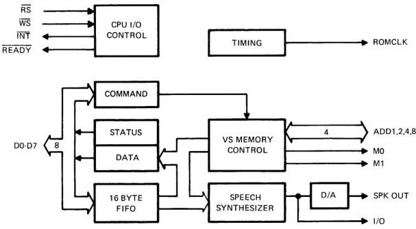
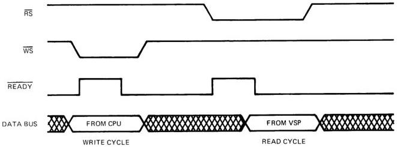
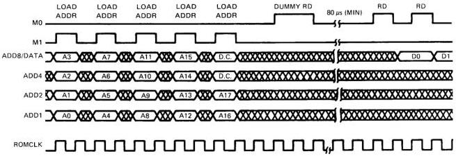

# Introduction, Interface and Commands

## 1. INTRODUCTION

### 1.1 SCOPE

This manual describes in detail the functional characteristics of a linear predictive coding (LPC) speech synthesis device, the TMS 5220. In addition to this document, the user may wish to refer to the TMS 6100 128K bit ROM electrical specification.

### 1.2 KEY FEATURES

- High-quality voice communication from a microcomputer system
- Low-data-rate LPC encoding
- Low-cost P-channel MOS technology
- +5 V and -5 V supplies only
- Interrupt-based service requests
- TTL compatible

### 1.3 DEVICE OPERATION

The TMS 5220 Voice Synthesis Processor (VSP) enables verbal communication with a microcomputer based system. The VSP is fabricated using P-channel MOS technology and is TTL compatible.

Speech data that has been compressed using pitch-excited linear predictive coding (LPC), is supplied to the VSP either by the CPU or by direct serial access of a Voice Synthesis Memory (VSM). The VSP decodes this data to construct a time-varying digital filter model of the vocal tract. This model is excited with a digital representation of either glottal air impulses (voiced sounds) or the rush of air (unvoiced sounds). The output of this model is passed through an eight-bit digital-to-analog converter to produce a synthetic speech waveform.

The VSP has been designed to minimize the data rate required to produce synthetic speech and to simplify the interface with the host CPU. The CPU may service the device either in a polled fashion, by monitoring device status, or by responding to interrupt service requests generated by the VSP. A simplified block diagram of the VSP is shown in Figure 1.

## 2. SYSTEM CLOCK

This manual describes all VSP timing based on an 8-kHz sample rate (limiting the output frequency to 4 kHz) and a 40-Hz frame rate (the rate at which new speech data is fetched and processed). This requires the internal RC oscillator in the VSP to run at 640 kHz. The user has the mask-programmable option of balancing the internal oscillator with a resistor (completing the RC network).

The 640-kHz clock is divided by four to produce two major phases, PHI-1 and PHI-2, with corresponding precharge clocks, PHI-3 and PHI-4 (see Appendix A). All control and timing operations within the VSP occur on one of the two 6.25-microsecond major phases. Twenty of these 6.25-microsecond bit times comprise each sample period (8-kHz sample rate). Twenty-five of these 125-microsecond sample periods make up one 3.25-millisecond interpolation interval, eight of which (IC0-IC7) make up the 25-millisecond frame period. During IC0, new speech data is transferred to the Synthesizer, at a 40-Hz frame rate.

## 3. CPU INTERFACE

The CPU interface consists of an eight-bit bidirectional data bus (D0-D7), separate selects for read operations and write operations (RS & WS), a ready line for synchronization (READY) and an interrupt line (INT) to indicate a status change on the VSP that requires CPU attention.

*Figure 1 – Voice Synthesis Processor Block Diagram.*

### 3.1 RS AND WS

VSP activity on the memory data bus is controlled by the select lines as shown below.

TABLE 1 - RS AND WS FUNCTION

|  RS | WS | BUFFER CONDITION  |
| --- | --- | --- |
|  H | H | High impedance state  |
|  H | L | Input to VSP. Some other device must be driving the bus (typically the CPU)  |
|  L | H | Output from VSP. No other device should be driving the bus at this time.  |
|  L | L | Illegal condition. Results not predictable.  |

It is important to note that no device can successfully complete a Read cycle (from the VSP) while WS is active (low) nor can a successful Write cycle (to the VSP) be carried out while RS is active (low). Device behavior cannot be predicted if both WS and RS go active simultaneously. System logic should be designed to prevent this condition from occurring.

### 3.2 READY

The VSP is a "Slow Memory"¹ device requiring wait states from the CPU to successfully complete a memory cycle. The effect of inserting wait states into memory access cycles is to extend the minimum allowable access time by one clock period for each wait state. The VSP controls the number of wait states executed by the CPU with the READY signal. The logic timing for typical read and write cycles to the VSP is shown in Figure 2.

*Figure 2 – Read and Write Cycles to the VSP.*

The READY line on the VSP goes high 100 ns after RS or WS goes active (low) to let the CPU know that the data transfer cycle cannot yet be completed. When the VSP has established stable data on the data bus (in the case of RS) or has completed latching data in from the data bus (in the case of WS), the READY line will go low indicating that the CPU may complete the data transfer cycle.

### 3.3 INTERRUPTS

The interrupt line (INT) indicates changes in the status of the VSP that may require CPU attention. INT goes active (low) when any of the following occur:

- Talk Status (TS) makes a one-to-zero transition indicating the end of speech processing.
- Buffer Low (BL) makes a zero-to-one transition indicating that more phrase data needs to be supplied to the FIFO for Speak External Command.
- Buffer Empty (BE) makes a zero-to-one transition indicating that the CPU failed to supply data fast enough for a Speak External Command.²

INT goes inactive (high) when the Status Register is read, or if the Reset instruction is executed.

## 4. VOICE SYNTHESIS MEMORY (VSM) – (TMS 6100)

In addition to receiving speech data from the CPU, the VSP may directly access up to 16 TMS 6100's (128K-bit serial ROM) with no external hardware required. This is accomplished with a four-bit parallel bus (ADD8,4,2,1), (ADD8 is multiplexed as the Data Out line out of the TMS 6100 as well as the most-significant bit of the 4-bit address bus into the TMS 6100), two control lines (M0, M1), and a synchronizing clock (ROMCLK).

¹Slow Memory devices are those devices that cannot properly respond to system memory cycles within the minimum access time as determined by the CPU clock rate.

²An interrupt will be generated at the Initiation of a Speak External Instruction if BE was previously low.

The TMS 6100 is a mask programmable 128K-bit-Read-Only Memory internally organized as 16K words of eight bits; externally it appears as 128K X 1. Once the 20-bit address (14 bits to select a byte within the device, four chip select bits, two bits ignored) is loaded through ADD1, ADD2, ADD4, and ADD8 in five Load Address sequences, data is read out bit-wise by toggling a control pin (M0). The ROM contains an on-chip address counter that is incremented every eight bits (eight toggles of M0). The four internal chip select bits are a mask programmable option, and allow parallel connection of up to 16 ROMs (about 30 minutes of speech) without the need of external select circuitry.

|  M0 | M1 | FUNCTION  |
| --- | --- | --- |
|  L | L | Idle — The passive NOP state of TMS 6100  |
|  L | H | Load Address — The four bits of data on ADD8,4,2,1 are loaded to the internal address register at the location indicated by the TMS 6100 Load Pointer. After each Load Address function, the Load Pointer is advanced to the left by four bit positions to allow the next most-significant nibble of the address to be properly loaded. The first read function3, following a Load Address function, resets the Load Pointer to the LS bit and initiates a ROM access to fetch the address data byte. This is the only function of this "Dummy Read". No data is transferred out of VSM until the second read function following a Load Address.  |
|  H | L | Read — When the addressed data byte has been fetched and stored in the VSM Data Register, it is ready to be serially transferred out starting with the MSB. Each successive read function causes the next least-significant bit to be driven on the Data Out line of the VSM that is currently selected. The next data byte is being fetched at the same time the serial transfer is taking place so that when the last bit of the current byte is transferred, the VSM Data Register can be reloaded without delay. When the Read function immediately follows a Load Address function, it is treated as a "Dummy Read". No data is transferred, but the Load Pointer is reset and ROM access is initiated.  |
|  H | H | Read and Branch — Starting at the current address, two bytes are fetched from the ROM to form a 16-bit word. The 14 low-order bits of this word replace the 14 low-order bits of the Address Register. The Load Pointer is then reset and a ROM access initiated to fetch the byte at this new address.*  |

Figure 3 shows a typical sequence of loading the Address Register and reading two data bits back. For more critical timing constraints, consult the TMS 6100 Electrical Specification.

*Figure 3 – TMS 6100 Function Timing. Note: A0 is the LSB in 6100 address.*

3A minimum of two Load Address instructions are required to change the VSM address.

*Read and Branch will not work with multiple VSM systems. Bus contention will occur.

## 5. I/O STRUCTURE

The VSP has two input holding registers, a Command Register and a 128-bit FIFO Buffer, and two output holding registers, the Data Register and the Status Register. On a Write cycle from the CPU, when WS becomes active (low), the control logic of the VSP routes data from the Memory Data Bus to either the FIFO Buffer (if a Speak External command is executing) or the Command Register (all other cases). Once this data has been latched in, the VSP signals completion of the data transfer to the CPU by lowering the READY Line to its active (low) condition. Similarly, on a Read cycle, when RS goes active (low), the VSP puts either the contents of the Data Register on the bus (if the preceding command was a Read Byte command) or the contents of the Status Register (all other cases).

### 5.1 COMMAND REGISTER

The Command Register receives command data from the Memory Data Bus and holds it for the Controller to interpret and execute. The VSP behaves as an attached processor to the host CPU and performs its synthesis tasks when appropriate commands are sent by the host CPU. For details on available commands and format, see Section 6.

### 5.2 FIFO BUFFER

The 128-bit FIFO Buffer is organized as a 16-byte parallel-in, serial-out buffer. This buffer is used to hold speech data passed from the CPU to be processed by a Speak External command in the VSP. As required by the synthesis section, data is shifted out serially starting with the LSB from the "First-In" byte. When this byte has been exhausted, the stack ripples down one byte and begins shifting out bits from the new "First-In" byte. A Stack Pointer keeps track of the location of the "Last-In" byte and data from the CPU is always loaded just above this location. When the stack becomes less than half full (i.e., eight byte locations are void of data), the buffer-low status condition (BL) becomes true. This signals the CPU that more data should be provided to the VSP. Under worst-case conditions, the buffer will be completely empty in one more frame period (25 milliseconds), and invalid data will be processed as external speech data. As a Fail-Safe measure, if the buffer does reach such a condition, the buffer empty status (BE) becomes true and the Talk Status Latch is reset causing speech to terminate immediately. To resume speech with data provided by the CPU, another Speak External command must be issued.

### 5.3 DATA REGISTER

The eight-bit Data Register is organized as a serial-in parallel-out Holding Register. This register is used by the VSP to formulate a byte of data from serial data fetched from the VSM during the execution of a Read Byte command. Data is loaded to the Data Register so that the last bit loaded is in the least-significant-bit location (D7). When the Data Register has been loaded and RS goes active (low), this byte is transferred to the Memory Data Bus (D0 = MSB). The READY Line goes low when the data is stable.

### 5.4 STATUS REGISTER

The three bits of the Status Register provide up-to-date information to the CPU on the state of the VSP. The Status Register may be read at any time except immediately after passing a Read Byte command to the VSP. When RS goes active (low) the VSP routes the status data to the Memory Data Bus (D0 = TS; D1 = BL; D2 = BE) and lowers the Ready Line when the data is stable.

TS - Talk Status is active (high) when the VSP is processing speech data. Talk Status goes active at the initiation of a Speak command or after nine bytes of data are loaded into the FIFO following a Speak External command. It goes inactive (low) when the stop code (Energy = 1111) is processed, or immediately by a buffer empty condition or a reset command. Audio output is interpolating to zero during this frame and is terminated on the next frame boundary.
BL - Buffer Low is active (high) when the FIFO Buffer is more than half empty. Buffer Low is set when the "Last-In" byte is shifted down past the half-full boundary (becomes the eighth data byte) of the stack. Buffer Low is cleared when data is loaded to the stack so that the "Last-In" byte lies above the half-full boundary and becomes the ninth data byte of the stack.
BE - Buffer Empty is active (high) when the FIFO Buffer has run out of data while executing a Speak External command. Buffer Empty is set when the last bit of the "Last-In" byte is shifted out to the Synthesis Section. This causes Talk Status to be cleared. Speech is terminated at some abnormal point and the Speak External command execution is terminated. Data from the Memory Data Bus is once again routed to the Command Register.

## 6. DESCRIPTION OF COMMANDS

The VSP operates under the control of the CPU to a minimal degree. The CPU passes commands to the VSP which initiates an activity but the CPU is not involved in carrying out that activity. Commands available for use by the CPU and the formats of these commands are shown below:

TABLE 2 - VSP COMMANDS AND COMMAND FORMAT

|  DATA BUS COMMAND CODE (D0-D7)* | OPERATION  |
| --- | --- |
|  X000XXXX | Nop  |
|  X001XXXX | Read Byte  |
|  X010XXXX | Nop  |
|  X110XXXX | Speak External  |
|  X011XXXX | Read and Branch  |
|  X100AAAA* | Load Address  |
|  X101XXXX | Speak  |
|  X111XXXX | Reset  |

*A = Address
X = Don't care

When WS becomes active (low), assuming a Speak External command is not presently executing, the data on the memory data bus is latched into the command register. Once the transfer has been completed, the VSP activates (low level) the READY line to release the CPU and begins interpreting and executing the command. Command execution for each instruction is described below.

If the user tries to pass a command to the VSP while another command is executing, the new command will not be accepted until the previous command is completed. The VSP keeps the CPU executing wait states until it is ready to accept a new command. Appendix C lists execution times for each command. The VSP uses the READY flag to tell the CPU to execute wait states until the present command has been fully executed.

### 6.1 READ BYTE

The Read Byte command allows the CPU to access data stored in the TMS 6100 VSM. Read Byte causes the next eight bits to be read from the VSM (ignoring byte boundaries). These bits are packed into the data register so that the last bit read from VSM is in the least-significant-bit position (D7). When RS goes active (low), and before initiation of a new instruction, this data byte is placed on D0-D7.

This eight-bit transfer from the VSM requires 80 microseconds. If RS should become active before the data register is completely loaded and ready to be transferred, the VSP keeps the CPU executing wait states (by not lowering the READY line) until the data transfer from VSM is complete and the Data Byte is stable on the Memory Data Bus. At this time the READY line is activated and the CPU may accept the Data Byte to complete the memory cycle.

### 6.2 READ AND BRANCH

The Read and Branch command causes the VSP to initiate a Read and Branch function on the VSM (see VSM description). The VSP is not able to access the VSM for 240 microseconds after executing this command.

### 6.3 LOAD ADDRESS

The Load Address command allows the CPU to alter the Address Register of the TMS 6100 to point to new speech data. Load Address causes the VSP to load the four address bits from the VSP Address Register to one nibble of the VSM Address Register by initiating a VSM Load Address function (see VSM description). If the next command following is a Read Byte, Speak, or Reset command, a dummy Read function is passed to the VSM before that next command is executed. Bit D7 is loaded into ADD1 which is the LSB of the VSM address. Bit D4 is loaded into ADD8.

### 6.4 SPEAK

The Speak command allows speech to be generated from phrase data stored in the VSM. The Speak command generates an internal signal that immediately causes Talk Status to be set and initiates speech synthesis calculations using the next available data from the VSM. Audio output begins on the following frame boundary. The VSP continues to fetch data from the VSM and generates speech output until a stop code (Energy = 1111) is received and recognized. At such time the audio output begins to interpolate down to the zero energy level. On the next frame boundary, speech has ended and the Talk Status is cleared. This completes execution of the Speak command. Execution of the Speak command may also be halted by the execution of Reset command. This causes audio output to halt immediately (without waiting for a frame boundary) and Talk Status to be cleared.

### 6.5 SPEAK EXTERNAL

The Speak External command allows the CPU to supply speech data to the VSP from some memory other than the VSM. Upon receipt of a Speak External command, the VSP purges the FIFO buffer (BL and BE becomes active [high]) and directs data written into the VSP to this buffer. The VSP idles waiting for the CPU to fill the buffer before speech begins. When the buffer low status becomes false (by the CPU loading a minimum of nine bytes to the FIFO), Talk Status is set and speech synthesis calculations begin using data from the FIFO. Data continues to be taken from the FIFO until a stop code is encountered or the buffer empty abnormal termination occurs. While the Speak External command is executing, all data written to the VSP is routed to the FIFO buffer. A Reset command is not recognized as a command.

### 6.6 RESET

The Reset command allows the CPU to halt the Speak command and to put the VSP into a known state. Reset clears Talk Status, halting speech activity immediately. The 128-bit FIFO Buffer is purged (BL and BE become active [high]) and the I/O paths are set to their default condition (Memory Data Bus → Command Register; Status Register → Memory Data Bus). A Load Address function is given to the VSM (using dummy address data) followed by a "Dummy Read" function.

The Reset command cannot halt the Speak External command. Flow diagrams for each instruction are given in Appendix B. System timing diagrams may be found in Appendix C.

## 7. POWER-UP CLEAR

The VSP contains internal circuitry to ensure a clear condition 95 percent of the time upon power-up, provided the (VSS - VDD) rise time to +10 volts is less than 2 milliseconds. If more than one power supply is used, the voltages need to be supplied to the VSP simultaneously. The Power-Up Clear sequence is finished 15 milliseconds after (VSS - VDD) reaches +10 volts. The events caused by the Power-Up Clear are similar to the Reset command and are noted below:

- Talk Status is cleared and any speech activity is halted.
- The T State Counter is reset.
- The FIFO is purged (BL & BE go active [high]) possibly causing the INT line to become active (low).
- I/O multiplexers are set to allow data to be written to the Command Register, and Data Read from the Status Register.
- The TMS 6100 is put into a known state by issuing a Load Address (using arbitrary address data) followed by a "Dummy Read".

If the user requires higher reliability in securing initialization, he should execute his own initialization sequence. A 100-percent assurance can be given that the VSP is in a clear state by writing nine bytes of all "ones" to the VSP followed by a Reset command, provided that (VSS - VDD) rise time to +10 volts is less than 2 milliseconds.
