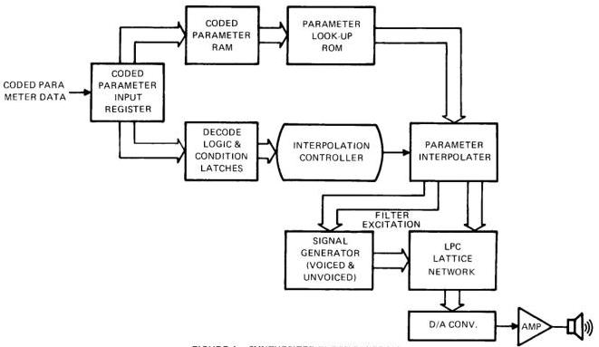
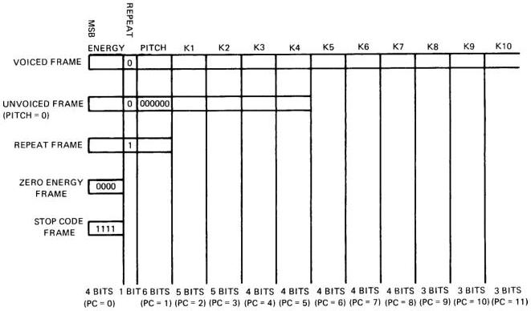

# 8. SPEECH SYNTHESIS

As previously mentioned, speech data fed to the VSP is encoded using pitched-excited LPC. The process of recovering this data is described briefly here and in more detail in the following sections. (This information is intended solely for the reader's information. Proper application of the VSP does not depend on a thorough understanding of this process). A simplified block diagram of the speech synthesis element of the VSP is shown in Figure 4.

*Figure 4 – Synthesizer Block Diagram.*

Coded speech parameter data is fed serially from either the VSM or the FIFO buffer to the Parameter Input Register. Here the Controller unpacks the data and performs various tests (i.e., is the repeat bit set, is pitch zero, is energy zero). Once unpacked the coded parameter data is stored in RAM to be used as the index value to select the appropriate value from the Parameter Look-Up ROM. The outputs of the Parameter Look-Up ROM are the target values for the interpolation logic to reach in this frame period. During each of the eight interpolation periods the interpolation logic sends new pitch and energy parameters to the signal generator which produces the filter excitation sequence, and new K-parameter values to the LPC lattice network. So, at the end of each sample period there is a new value of digitized synthetic speech available to the D/A converter.

## 8.1 CODED SPEECH PARAMETERS

The 12 synthesis parameters (pitch, energy and reflection coefficients K1-K10), are stored in the VSM in coded form. Each parameter occupies between 3-6 bits. These coded values select a 10-bit actual parameter from the parameter Look-Up ROM. Depending on the influence of each parameter on speech quality, between 8 and 64 possible values are stored in the Look-Up ROM for decoding and use in synthesis calculations. Table 3 summarizes parameter coding for the TMS 5220.

TABLE 3 - PARAMETER CODING

|  PARAMETER | LEVELS | CODE BITS  |
| --- | --- | --- |
|  ENERGY | 15* | 4  |
|  PITCH | 64 | 6  |
|  K1 | 32 | 5  |
|  K2 | 32 | 5  |
|  K3 | 16 | 4  |
|  K4 | 16 | 4  |
|  K5 | 16 | 4  |
|  K6 | 16 | 4  |
|  K7 | 16 | 4  |
|  K8 | 8 | 3  |
|  K9 | 8 | 3  |
|  K10 | 8 | 3  |
|  12 | 247 | 49 + REPEAT = 50 BITS  |

*Energy = 1111 is the stop code.

A full set of coded parameters for each frame would require a data rate of 40 Hz X 50 bits = 2000 bits per second. Three special cases, in which a full frame is not necessary, allow the data rate to be considerably reduced:

(1) Since the vocal tract changes shape relatively slowly, it is often possible to repeat previous reflection coefficient data. To facilitate the repeat feature, a control bit has been added to each frame (an additional bit following energy). If the repeat bit is 1, only energy and pitch data are accessed from the VSM and the previous K1-K10 values are retained.
(2) Unvoiced speech requires fewer filter reflection coefficients. When Pitch = 000000, only K1-K4 are fetched from the VSM and stored in the Parameter RAM. K5-K10 are zeroed.
(3) When Energy = 0000 no other data is required. Energy = 0000 during interword or intersyllable pauses. The combination of these three cases has reduced average data rate for male speech to approximately 1200 bits per second.

Figure 5 shows the four possibilities of frame data string lengths.

*Figure 5 – Frame Data String Lengths.*

One complete set of parameters (12), used as target values during interpolation, is stored in coded form in the synthesizer. The storage medium is a 50-bit RAM of variable word length, e.g., six bits for pitch, three bits for K10. Data is supplied to the RAM via the parallel outputs of a serial shift register which accepts data from some VSM. The Parameter RAM outputs are used as inputs for the Parameter ROM.

## 8.2 D/A CONVERSION

The VSP contains an eight-bit digital-to-analog converter with 2% linearity LSB resolution. Every 125 microseconds the most-significant 10 bits of the 14-bit lattice filter output are sampled. From this sample, the seven low-order bits and the sign bit (MSB) are sent to the D/A converter. The remaining two bits are combined logically with the sign bit and used to clip the driver to either a full ON or full OFF condition. Table 4 shows the analog output from the D/A converter for various inputs from the lattice filter.

TABLE 4 - DIGITAL-TO-ANALOG CONVERTER OUTPUT

|  NO. | Y LATCH OUTPUT |   |   |   | D/A INPUT | ANALOG OUTPUT (μA)  |
| --- | --- | --- | --- | --- | --- | --- |
|   |  YL13 | YL12 | YL11 | YL10-YL4  |   |   |
|  >+127 | 0 | 1 | 1 | X | 11111111 | 0  |
|   |  0 | 1 | 0 | X | 11111111 | 0  |
|   |  0 | 0 | 1 | X | 11111111 | 0  |
|  127 | 0 | 0 | 0 | 1111111 | 11111111 | 0  |
|  126 | 0 | 0 | 0 | 1111110 | 11111110 | 5.86  |
|   |  |  | — |  |  |   |
|   |  |  | — |  |  |   |
|  +1 | 0 | 0 | 0 | 0000001 | 10000001 | 738  |
|  0 | 0 | 0 | 0 | 0000000 | 10000000 | 744  |
|  *-1 | 1 | 1 | 1 | 1111111 | 01111111 | 750  |
|  -2 | 1 | 1 | 1 | 1111110 | 01111110 | 755.8  |
|   |  |  | — |  |  |   |
|   |  |  | — |  |  |   |
|   |  |  | — |  |  |   |
|  -128 | 1 | 1 | 1 | 0000000 | 00000000 | 1500  |
|  <-128 | 1 | 1 | 0 | X | 00000000 | 1500  |
|   | 1 | 0 | 1 | X | 00000000 | 1500  |
|   | 1 | 0 | 0 | X | 00000000 | 1500  |

* No output, resting level.

## 8.3 AUDIO OUTPUT

The output of the D/A converter (see Table 4) is a current source designed to deliver 0 to 1.5 milliamperes with resolution to 5.9 microamperes. This output has been optimized to drive the EXT AUD input of the SN76489AN sound generator chip. With a 1.8-kilohm resistor in series, the VSP delivers 2.7 volts (I = 1.5 milliamperes) when the Y latch output is less than -128. When the Y latch output is greater than +127, the audio output is clipped to 0 volts. When no speech generation is taking place, the Y latch output is -1 making the audio output drive 750 microamperes. (Speaker output must be ac-coupled to audio amplifier).
